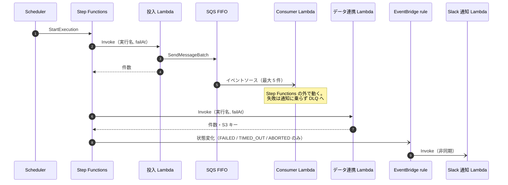

# 機能仕様書

各処理（ステートマシン・Lambda 4 種）の振る舞いと処理の流れを定義する。機能要件の一覧は [`02-requirements-specification.md`](./02-requirements-specification.md) を参照。

本デモは画面を持たないため、テンプレートの「画面仕様 / 画面遷移 / UI/UX 方針」を「処理仕様 / 処理の流れ / 操作方針」に読み替える。

## 目次

- [処理仕様](#処理仕様)
- [処理の流れ](#処理の流れ)
- [操作方針](#操作方針)

## 処理仕様

入出力の形式は [07 API 仕様書](07-api-specification.md)、タイムアウト・リトライの値は [04 非機能仕様書](04-non-functional-specification.md) を参照。

### ステートマシン（`batch`）

| ステート | 種類 | 内容 |
|---|---|---|
| `Enqueue` | Lambda タスク | 投入 Lambda を呼ぶ。実行名（`$$.Execution.Name`）と実行入力の `failAt` を渡す |
| `DataSync` | Lambda タスク | データ連携 Lambda を呼ぶ。実行名と `failAt` を渡す |

- 2 つのタスクを順に実行し、両方成功したら `SUCCEEDED` で終える。分岐・並列は持たない
- 各タスクの `Retry` は一時的なエラー（04「リトライ」）だけを対象にする。注入した失敗・検証エラーはリトライしない
- `Catch` は付けない。タスクの失敗はそのまま実行の失敗になり、状態変化イベントとして EventBridge へ出る

### 投入 Lambda（`enqueue`）

1. 入力を検証する。`failAt` が未定義の値なら検証エラーで失敗する
2. `failAt` が `enqueue` なら、キューへ積む前に注入エラーで失敗する
3. MySQL スタブから配信対象を取得する
4. 配信対象ごとにメールメッセージを作り、SQS FIFO へ送る（`SendMessageBatch`、10 件ずつ）
   - `failAt` が `consumer` なら、各メッセージの `simulateFailure` を `true` にする
5. 送った件数を返す

`SendMessageBatch` の一部が失敗した場合も、残りのバッチは送り切ってから、失敗した配信対象 ID をまとめて `EnqueuePartialFailureError` で投げる。再実行で全件を送り直しても、重複排除 ID が決定的なため 5 分以内なら重複しない（05「メールメッセージ」）。

失敗したときは、エラー名・メッセージ・スタックトレースを含むエラーログを 1 行出してから投げ直す。タスク入力の検証を通った後の失敗には `executionName` を付ける。

### Consumer Lambda（`consumer`）

SQS イベントソースから最大 5 件ずつ受け取り、1 件ずつ処理する。

1. メッセージ本文を検証する。不正な本文はその 1 件を失敗として扱う
2. `simulateFailure` が `true` なら、その 1 件を注入エラーで失敗させる
3. メール送信スタブへ渡す
4. 失敗したメッセージの ID だけを `batchItemFailures` で返す（部分バッチ応答）

- **失敗したメッセージと同じグループの後続メッセージは、送らずに失敗として返す。** 送ってしまうと、再配信された前のメッセージが後から届き、グループ内の順序が逆転するため（FIFO の部分バッチ応答で AWS が求める扱い）。別のグループのメッセージは影響を受けず、そのまま送る。グループは配信対象ごとなので、影響は同じ宛先の中に閉じる
- 失敗した 1 件ごとに、`messageId`・グループ ID・エラー名・スタックトレースを含むエラーログを出す
- イベント自体の形式が不正（`Records` が無い等）なら `ValidationError` を投げ、バッチ全体を再配信させる
- 成功したメッセージは SQS から削除され、失敗したものだけが可視性タイムアウト後に再配信される
- 3 回受信しても失敗したメッセージは DLQ へ移る（`maxReceiveCount: 3`）
- Slack への通知はしない（02「F-5」）

### データ連携 Lambda（`data-sync`）

1. 入力を検証する
2. MySQL スタブから配信対象を取得する
3. S3 へ連携ファイル（JSON）を書く
4. `failAt` が `dataSync` なら、ここで注入エラーで失敗する
5. BigQuery スタブへ書く
6. Cuenote FC スタブへ書く
7. 書いた件数と S3 のキーを返す

書き出しの順序は元資料で未確定のため、本デモでは上記の順に固定する。途中で失敗すると前段の書き込みが残る（元資料のリスク 4）。補償処理（巻き戻し）は持たない。

### Slack 通知 Lambda（`notify-slack`）

1. EventBridge のイベントを検証する。対象外の形式なら何もせず終える（エラーにしない）
2. 実行 ARN・ステートマシン ARN・状態・開始/終了時刻・エラー名・原因を取り出す
3. Slack スタブへ通知内容を渡す

EventBridge rule の非同期呼び出しが失敗した場合は、Lambda の既定の再試行（2 回）に任せる。

## 処理の流れ

## 操作方針

利用者は開発者 1 人で、操作はすべて CLI で行う。コマンドの正本は実装時に `scripts/` と README に置く。

### 全体方針

- **実行**: `aws stepfunctions start-execution`（`local` は LocalStack のエンドポイント）で、実行入力に `failAt` を指定して起動する
- **確認**: 実行の状態は `describe-execution`、各 Lambda の出力は CloudWatch Logs、連携ファイルは S3、DLQ はメッセージ数で確かめる
- **ログ**: すべての Lambda は 1 行 1 JSON の構造化ログを出す。スタブの出力にも `stub` フィールドを付け、どの外部サービスへの送信を模したかを絞り込めるようにする
