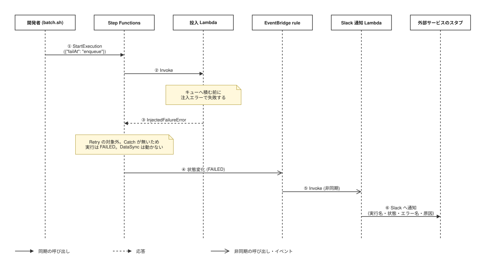
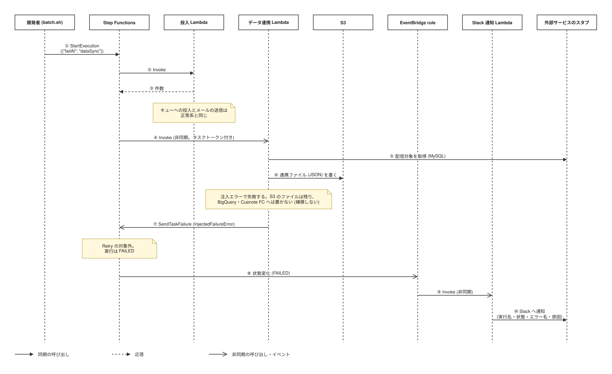
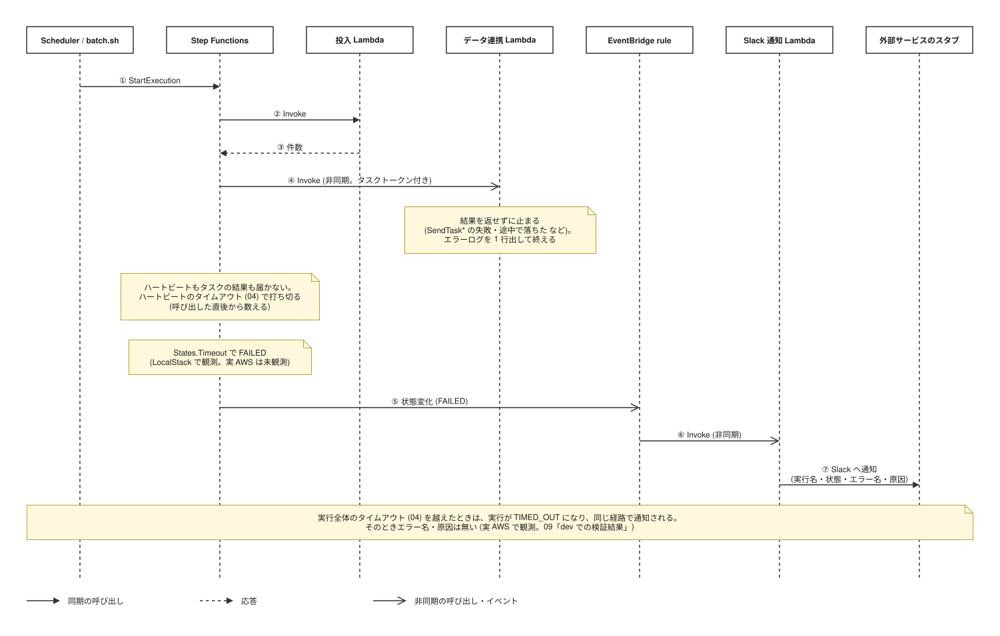
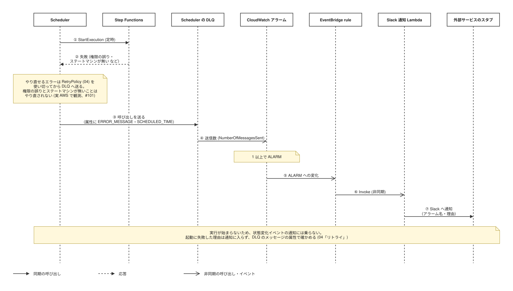
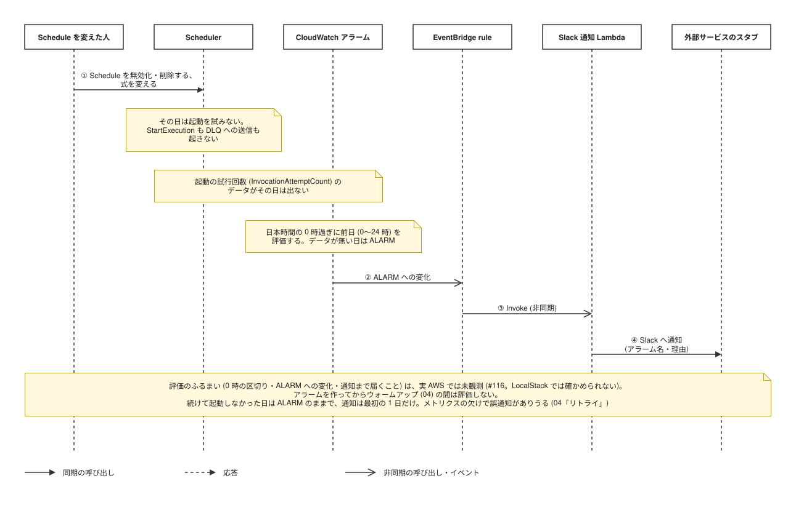

# 機能仕様書

各処理（ステートマシン・Lambda 4 種）の振る舞いと処理の流れを定義する。機能要件の一覧は [`02-requirements-specification.md`](./02-requirements-specification.md) を参照。

本デモは画面を持たないため、テンプレートの「画面仕様 / 画面遷移 / UI/UX 方針」を「処理仕様 / 処理の流れ / 操作方針」に読み替える。

## 目次

- [処理仕様](#処理仕様)
- [処理の流れ](#処理の流れ)
- [操作方針](#操作方針)

## 処理仕様

入出力の形式は [07 API 仕様書](07-api-specification.md)、タイムアウト・リトライの値は [04 非機能仕様書](04-non-functional-specification.md) を参照。

### ステートマシン（`batch`）

| ステート | 種類 | 内容 |
|---|---|---|
| `Enqueue` | Lambda タスク | 投入 Lambda を呼ぶ。実行入力に実行名を足して渡す（07「タスク入力」） |
| `DataSync` | Lambda タスク（`.waitForTaskToken`） | データ連携 Lambda を非同期で呼び、関数がタスクトークンで結果を返すまで待つ。`Enqueue` と同じタスク入力にタスクトークンを足して渡す（07「タスク入力」） |

- 2 つのタスクを順に実行し、両方成功したら `SUCCEEDED` で終える。分岐・並列は持たない
- 各タスクの `Retry` は一時的なエラー（04「リトライ」）だけを対象にする。注入した失敗・検証エラーはリトライしない
- `Catch` は付けない。タスクの失敗はそのまま実行の失敗になり、状態変化イベントとして EventBridge へ出る
- `DataSync` はタイムアウトとハートビートのタイムアウトを持つ（04「パフォーマンス要件」）。関数が結果を返さずに止まっても待ち続けず、`States.Timeout` で失敗にする。ハートビートが切れたときも同じ `States.Timeout` になる（LocalStack で観測。実 AWS は未観測。09「LocalStack での検証結果」）

### 投入 Lambda（`enqueue`）

1. 入力を検証する。`failAt` が未定義の値なら検証エラーで失敗する
2. `failAt` が `enqueue` なら、キューへ積む前に注入エラーで失敗する
3. MySQL スタブから配信対象を取得する
4. 配信対象ごとにメールメッセージを作り、SQS FIFO へ送る（`SendMessageBatch`、10 件ずつ）
   - 本文の `runKey` は、タスク入力の `rerunOf` があればその値、無ければ実行名にする（05「論理キー（runKey）」・#137）。重複排除 ID は `runKey` ではなく実行名から作る
   - `failAt` が `consumer` なら各メッセージの `simulateFailure` を `beforeSend` に、`consumerAfterSend` なら `afterSend` にする。それ以外は `none`
5. 送った件数を返す

`SendMessageBatch` の一部が失敗した場合も、残りのバッチは送り切ってから、失敗した配信対象 ID をまとめて `EnqueuePartialFailureError` で投げる。再実行で全件を送り直しても、重複排除 ID が決定的なため 5 分以内なら重複しない（05「メールメッセージ」）。

失敗したときは、エラー名・メッセージ・スタックトレースを含むエラーログを 1 行出してから投げ直す。タスク入力の検証を通った後の失敗には `executionName` と `runKey` を付ける。投入・データ連携 Lambda の、タスク入力の検証を通った後のログと、Consumer のメール送信スタブの出力・「送信済みのため送りません」のログ（キーに含む）は `runKey` を持つ。`scripts/batch.sh <stage> logs <最初の実行名>` で、元の実行と再実行のログをまとめて引けるようにするため（下記「失敗の後の再実行」）。Consumer の失敗のエラーログは、本文を読む前にも出るため `runKey` を持たない（`messageId` で追う）。

### Consumer Lambda（`consumer`）

SQS イベントソースから最大 5 件ずつ受け取り、1 件ずつ処理する。

1. メッセージ本文を検証する。不正な本文はその 1 件を失敗として扱う
2. `simulateFailure` が `beforeSend` なら、その 1 件を注入エラーで失敗させる（送信記録は書かない）
3. 送信記録（05「送信記録」）へ、キー `<runKey>:<配信対象 ID>` が無いことを条件に「送信中」を書く。書けなかったら、記録を読み直して分ける
   - 「送信済み」なら、送らずに成功として扱う（再配信による二重送信の防止。#136。再実行で、元の実行が送れていたメールを送らないのも同じ判定。#137）
   - 「送信中」なら、前の受信で送ったかどうか判定できない。送り直すと二重送信になりうるため、送らずに `SendStateUnknownError` で失敗させる。メッセージは最大受信回数で DLQ へ移り、DLQ のアラームで人に知らせる（04「リトライ」の「メールの送信の失敗の通知」）
4. メール送信スタブへ渡す。失敗したら「送信中」の記録を消してから失敗させ、次の受信で送り直せるようにする
5. 記録を「送信済み」にする
6. `simulateFailure` が `afterSend` なら、ここで注入エラーで失敗させる（送った直後に落ちたことの再現）
7. 失敗したメッセージの ID だけを `batchItemFailures` で返す（部分バッチ応答）

- **失敗したメッセージと同じグループの後続メッセージは、送らずに失敗として返す。** 送ってしまうと、再配信された前のメッセージが後から届き、グループ内の順序が逆転するため。AWS の指示（FIFO の部分バッチ応答では、最初の失敗で処理をやめ、残りをすべて失敗として返す）をグループ単位に緩めた扱いで、Powertools for AWS Lambda の `skipGroupOnError` と同じ形（[公式](https://docs.aws.amazon.com/lambda/latest/dg/services-sqs-errorhandling.html)）。別のグループのメッセージは影響を受けず、そのまま送る。グループは配信対象ごとなので、影響は同じ宛先の中に閉じる
- 失敗した 1 件ごとに、`messageId`・グループ ID・エラー名・スタックトレースを含むエラーログを出す
- イベント自体の形式が不正（`Records` が無い等）なら `ValidationError` を投げ、バッチ全体を再配信させる
- 成功したメッセージは SQS から削除され、失敗したものだけが可視性タイムアウト後に再配信される
- 3 回受信しても失敗したメッセージは DLQ へ移る（`maxReceiveCount: 3`）
- Slack 通知 Lambda は呼ばない。DLQ へ移ったことは、DLQ のアラームで通知される（02「F-5」・#135）
- **送信記録で防げるのは、同じ論理キーの同じ宛先のメールの重複だけ。** `rerun` で起動した再実行は元の実行と同じ論理キーを使うため、重複を防ぐ（下記「失敗の後の再実行」）。`run` で起動し直した実行は別の論理キーになり、重複を防がない（05「論理キー（runKey）」）
- **「送った」と「記録した」の間で落ちると、送り直さずに DLQ へ倒す。** 送った後に「送信済み」にできなかったとき・「送信中」の記録を消せなかったときは「送信中」が残り、次の受信は判定不能として失敗する。二重送信より、送ったかもしれないメールを人に確かめてもらう側を選んだ（`error-handling.md`「判定不能を正常値に丸めない」。04 の `Lambda.ClientExecutionTimeoutException` をやり直さない理由と同じ）

### データ連携 Lambda（`data-sync`）

ステートマシンから非同期で呼ばれるため、戻り値・例外はステートマシンに届かない。結果は入力のタスクトークンで返す（09「LMI（Lambda Managed Instances）」）。

1. 入力からタスクトークンを取り出す。読めなければ結果を返せないため、エラーログを出して終える
2. 入力の残りを検証する
3. MySQL スタブから配信対象を取得する
4. S3 へ連携ファイル（JSON）を書く
5. `failAt` が `dataSync` なら、ここで注入エラーで失敗する
6. BigQuery スタブへ書く
7. Cuenote FC スタブへ書く
8. `holdSeconds` があれば、その秒数だけ待つ。60 秒ごとにハートビート（`SendTaskHeartbeat`）を送る
9. 書いた件数と S3 のキーを `SendTaskSuccess` で返す

書き出しの順序は元資料で未確定のため、本デモでは上記の順に固定する。途中で失敗すると前段の書き込みが残る（元資料のリスク 4）。補償処理（巻き戻し）は持たない。残った書き込みは、再実行で書き直す（下記「失敗の後の再実行」）。

S3 のキーの日付と `exportedAt` は、同じ時刻（UTC）から作る。キーの最後と、連携ファイル・BigQuery / Cuenote FC スタブの出力の `runKey` は、投入 Lambda と同じく、タスク入力の `rerunOf` があればその値、無ければ実行名にする（05「論理キー（runKey）」）。

2〜9 で失敗したときは、投入 Lambda と同じくエラーログを 1 行出してから、`SendTaskFailure` で失敗を返す（エラー名と `cause` の形は 07「エラーハンドリング」）。**例外は投げない。** 非同期の呼び出しで投げると、受け取るのは Lambda の再試行だけで、同じタスクトークンで処理が二重に走るため（非同期の呼び出しの再試行も 0 にしている）。ハートビート・`SendTaskSuccess` の失敗も同じく `SendTaskFailure` で返し、`SendTaskFailure` 自体が失敗したらエラーログを出して終える。そのときはステートマシン側のタイムアウトで `FAILED` になる。

環境変数の誤りだけは、ロガーを組み立てられないため例外を投げる。デプロイの誤りで、結果はハートビートのタイムアウトで `FAILED` になる。

### Slack 通知 Lambda（`notify-slack`）

受け付けるイベントは 2 種類で、`source` で見分ける（07「状態変化イベント」「アラームの状態変化イベント」）。

| イベント | 意味 | 通知に使う項目 |
|---|---|---|
| Step Functions の状態変化（`aws.states`） | 実行が `FAILED` / `TIMED_OUT` / `ABORTED` で終わった（F-5） | 実行名・実行 ARN・状態・エラー名・原因 |
| CloudWatch アラームの状態変化（`aws.cloudwatch`） | 次のどれかのアラームが `ALARM` になった。どれも実行の状態変化イベントでは知らせられない失敗。Scheduler の DLQ のアラーム（起動に失敗した。F-5・#101）、実行が始まらない日のアラーム（その日に起動を試みなかった。F-5・#109）、メール送信キューの DLQ のアラーム（実行は `SUCCEEDED` だが、メールの送信に失敗し続けたメッセージが DLQ にある。F-5・#135） | アラーム名・`ALARM` になった理由 |

1. EventBridge のイベントを検証する。対象外（形式違い・通知対象外の状態。アラームの `OK` への変化も含む）なら、理由を警告ログに出して正常に終える。エラーにすると非同期呼び出しの再試行で同じイベントを受け直すだけで、結果は変わらないため
2. 通知に使う項目を取り出す（07「スタブへの出力」）。状態変化イベントのエラー名と原因は、`null` でも項目が無くても `null` に揃える
3. Slack スタブへ通知内容を渡す。実行の失敗とアラームは、別の行（`message` が違う）で出す

通知自体が失敗した場合は、実行名（アラームならアラーム名）付きのエラーログを出してから投げ直し、Lambda の既定の再試行（2 回）に任せる。

アラームの通知には、起動に失敗した理由（エラーコード）は入らない。理由は DLQ のメッセージの属性にあり、DLQ を受信して確かめる（04「リトライ」）。実行が始まらない日のアラームでは、`get-schedule` で Schedule の状態（`DISABLED`・削除・式の変更）を、`list-executions` でその日の定時の起動の実行が本当に無いかを確かめる（メトリクスの欠けによる誤通知がありうる。04「リトライ」）。メール送信キューの DLQ のアラームでは、DLQ のメッセージの本文で、失敗した実行名と配信対象を確かめる（下記「操作方針」）。

## 処理の流れ

図は [`images/sequences/`](images/sequences/) の `.drawio.svg` が正本（編集の仕方は [09「システム構成図」](09-architecture-specification.md#システム構成図)）。丸数字はメッセージの順。タイムアウト・リトライの秒数や回数は図に書かず、[04 非機能仕様書](04-non-functional-specification.md) を正本とする。

### 正常系

#### 15 分を超える処理（`dev` のみ・LMI）

`holdSeconds` を付けた実行。データ連携 Lambda は LMI で動き、Lambda の 15 分の上限を超えて待つ（09「[LMI（Lambda Managed Instances）](09-architecture-specification.md#lmilambda-managed-instances)」）。図の観測値は `dev` で確かめたもの（09「[`dev` での検証結果](09-architecture-specification.md#dev-での検証結果)」の「LMI」。#66）。`local` は LMI を使わないため、15 分を超えては待てない。

#### 一時的なエラーを `Retry` で吸収する

Lambda の呼び出しが一時的なエラーで失敗しても、`Retry` でやり直して成功すれば、実行は正常系と同じく `SUCCEEDED` になる（04「[リトライ](04-non-functional-specification.md#リトライ)」）。図は投入タスクで描いたが、`DataSync` タスクにも同じ `Retry` が付く。対象のエラーは CDK の定義で固定し、UT（08 #55）で確かめている。一時的なエラーは注入できないため、実行時の動きは観測していない。

### 準正常系

想定内の不正な入力・一部の失敗を、決めたとおりに扱う流れ。`failAt` で注入する失敗は、下の「[実行の失敗](#実行の失敗)」で扱う。

#### 実行入力の検証エラー

実行入力がタスク入力のスキーマに合わないと、投入 Lambda が `ValidationError` で失敗する。`Retry` の対象外のため、やり直さずに `FAILED` になり、Slack へ通知される（04「[リトライ](04-non-functional-specification.md#リトライ)」）。スキーマは未知のキーも拒否するため、`failat` のような綴り違いも通さない（07「[タスク入力](07-api-specification.md#タスク入力投入データ連携-lambda-共通)」）。実行と通知のエラー名は LocalStack の IT（08 #26）で確かめた。実 AWS では未観測。

#### 投入の一部の失敗を `Retry` で送り直す

`SendMessageBatch` の一部が失敗すると、投入 Lambda は残りを送り切ってから `EnqueuePartialFailureError` を投げる。投入タスクだけがこのエラーを `Retry` し、やり直しでは全件を送り直す。送れていた分は重複排除 ID が同じため、5 分以内なら重複しない（上の「[投入 Lambda](#投入-lambdaenqueue)」・05「[メールメッセージ](05-data-specification.md#メールメッセージmailmessage)」）。SQS の一部の失敗は注入できないため、実行時の動きは観測していない。

#### 本文が不正なメッセージ（Consumer）

Consumer Lambda は、本文が不正なメッセージの 1 件だけを失敗にし、他は送る（部分バッチ応答）。不正な本文は何度受け取っても失敗するため、最大受信回数に達すると DLQ へ移る（上の「[Consumer Lambda](#consumer-lambdaconsumer)」）。投入 Lambda は本文を型どおりに組み立てるため、`failAt` では起こせない。1 件ずつの扱いは UT（08 #11・#24）で確かめた。不正な本文を実際のキューに置いた動きは観測していない。

#### 送った直後に落ちたメッセージの再配信（`failAt: consumerAfterSend`）

Consumer がメールを送った後、メッセージがキューから消える前に落ちると、同じメッセージが再配信される。Consumer は送信記録で「送信済み」を見つけ、送らずに成功として扱う。メールは 1 通だけになる（上の「[Consumer Lambda](#consumer-lambdaconsumer)」・05「[送信記録](05-data-specification.md#送信記録sendrecord)」・#136）。`failAt: consumerAfterSend` は、送って送信済みを記録した後に失敗させて、この流れを再現する。LocalStack の IT（08 #80）で確かめた。実 AWS では未観測。

### 実行の失敗

実行が `FAILED` / `TIMED_OUT` / `ABORTED` で終わると、状態変化イベントが EventBridge rule を経て Slack 通知 Lambda に届く（02「F-5」）。メールの送信の失敗だけは Step Functions の外で起き、実行は `SUCCEEDED` のため状態変化イベントでは通知されない。DLQ へ移った後に、DLQ のアラームで遅れて通知される（#135）。

#### 投入の失敗（`failAt: enqueue`）

#### データ連携の失敗（`failAt: dataSync`）

#### データ連携の結果が返らない（ハートビート切れ）

#### メールの送信の失敗（`failAt: consumer`）

### 起動されない失敗

実行が始まらないため、状態変化イベントは出ない。CloudWatch アラームの `ALARM` への変化を EventBridge rule が拾い、同じ Slack 通知 Lambda を呼ぶ（04「リトライ」）。

#### Scheduler の起動の失敗（#101）

#### 起動を試みなかった日（#109）

### 失敗の後の再実行

失敗の通知を受けたら、原因を直してから `scripts/batch.sh <stage> rerun <元の実行名> [failAt]` で再実行する（02「F-8」・#137）。再実行は新しい実行名で起動し、実行入力の `rerunOf` に元の実行名を入れる。投入・データ連携 Lambda は `rerunOf` を論理キーにして、元の実行の送信記録と連携ファイルを引き継ぐ（05「[論理キー（runKey）](05-data-specification.md#論理キーrunkey)」）。

#### 再実行で起きること

再実行は、元の実行がどこで失敗したかによらず、投入とデータ連携を最初からやり直す。元の実行で送れていたメールは、送信記録が「送信済み」のため送らない。

| 元の失敗 | 再実行で起きること | 残るもの・人がすること |
|---|---|---|
| 投入の失敗（`failAt: enqueue`・検証エラー） | 1 件も積まれていないため、全件を送る | なし |
| 投入の一部の失敗（`Retry` を使い切った） | 送れていた分は送らず、残りを送る | なし |
| データ連携の失敗（`failAt: dataSync`） | メールは全件送信済みのため送らない。S3 は同じキーに上書きし（同じ日のとき）、BigQuery・Cuenote FC へ書く | なし |
| データ連携の結果が返らない（ハートビート切れ・`TIMED_OUT`） | 上と同じ。どこまで書けていたか分からないため、すべてを書き直す | BigQuery・Cuenote FC への書き込みが二重になりうる。スタブは防がず、`runKey` の同じ出力が 2 回出ることで見分ける（07「スタブへの出力」） |
| メールの送信の失敗（`failAt: consumer`。実行は `SUCCEEDED`） | 送れなかった分だけを送る。データ連携は書き直す（上と同じく二重になりうる） | 元の実行のメッセージは DLQ に残る。再実行が終わり、送れたことを確かめてから DLQ を空にする（下記「操作方針」） |
| 送ったかどうか判定できない（「送信中」の記録が残った） | 判定できないまま、また `SendStateUnknownError` で DLQ へ移る | 送ったかを確かめ、記録を直してから再実行する（下記「送信中のまま残った記録」） |
| 手動停止（`ABORTED`） | 止める前に積んだメールは送られているため送らず、残りを送る。データ連携は書き直す | 元の実行のデータ連携 Lambda は、停止の後も動き続ける。終わるのを待ってから再実行する（下記「手動停止」） |
| 起動されなかった（Scheduler の起動の失敗・起動を試みなかった日） | 元の実行が無いため、`rerun` は使えない | `run` で起動する |

- **`SUCCEEDED` の実行も再実行できる。** メールの送信の失敗は、実行が `SUCCEEDED` のまま起きるため（上の「メールの送信の失敗」）
- **元の実行の `failAt` / `holdSeconds` は引き継がない**（07「実行入力」）。引き継ぐと、注入した失敗がそのまま再現され、回復にならない
- **`run` で起動し直さない。** 別の論理キーになり、送れていたメールまで全件を送り直す（上の「Consumer Lambda」）
- **元の実行のメッセージがまだキューに残っていても、同じ宛先の送信は重ならない。** グループは配信対象ごとで、同じグループのメッセージは前のものが終わるまで次が渡されない（05「メールメッセージ」）。再実行のメッセージは、元の実行のメッセージの処理が終わってから（送信済みにするか、DLQ へ移ってから）届く

#### `rerun` が断る条件

スクリプトは、起動する前に元の実行を `describe-execution` で読み、次のときは起動せずに 1 で終える。判定できなかったとき（認証切れ・接続先の誤り）も、起動しない。

| 条件 | 断る理由 |
|---|---|
| 元の実行が見つからない（実行名の形式でない名前を含む） | 論理キーの引き継ぎ先が無い。名前の誤りで、新しい論理キーとして全件を送ってしまうのを防ぐ（06「入力バリデーション」） |
| 元の実行が `RUNNING`（再実行の再実行では、最初の実行も） | 同じ論理キーの実行が重なる。重なったときの扱いは #138 で決める |
| 最初の実行の開始から 7 日を過ぎている | 送信記録の期限（04「保持期間」）を過ぎると記録が消えている可能性があり、送れていたメールを送り直しうる |
| 元の実行の入力の `rerunOf` が、実行名の制約に合わない | 引き継ぐ値が壊れている（06「入力バリデーション」） |

再実行の再実行では、元の実行の入力に `rerunOf` があればその値（最初の実行の名前）を引き継ぎ、7 日は最初の実行の開始から数える。

#### 再実行の流れ

`failAt: dataSync` で失敗した実行を、同じ日に再実行した場合。

#### 送信中のまま残った記録

「送った」と「記録した」の間で落ちた記録（上の「Consumer Lambda」）は、再実行では解消しない。`failAt` では起こせず、テストでも確かめていない手順のため、スクリプトにはしない。

1. 送ったかを確かめる。`scripts/batch.sh <stage> logs <最初の実行名>` で、その配信対象の `sendgrid` スタブのログがあるかを見る（実サービスでは送信側の履歴を見る）
2. 記録を直す。テーブルは `serverless-practice-app-<stage>-send-records`、キーは `<最初の実行名>:<配信対象 ID>`。どちらも「送信中」のときだけ書き換わるよう、条件を付ける
   - 送っていた: `aws dynamodb update-item --update-expression "SET #s = :sent" --condition-expression "#s = :sending"`（`:sent` は `SENT`、`:sending` は `SENDING`、`#s` は `status`）
   - 送っていなかった: `aws dynamodb delete-item --condition-expression "#s = :sending"`
3. `rerun` で再実行する。送っていた分は送らず、送っていなかった分を送る

### 手動停止・二重起動・実行の重なり

一般的なバッチで起きる 3 つの状況の流れ（#138）。どれも止める仕組みは持たず、何が二重になるかを決めて人の手順で避ける。扱いと理由の正本は 04「[手動停止と実行の重なり](04-non-functional-specification.md#手動停止と実行の重なり)」。

#### 手動停止

`stop-execution` で止めると、実行は `ABORTED` になり、状態変化イベントで通知される（02「F-5」）。**止まるのは実行だけで、始めた処理は止まらない。** 止める前に積んだメッセージは Consumer が送り、非同期で呼んだデータ連携 Lambda は動き続けて、結果を返すときに失敗する。LocalStack で観測した流れで、実 AWS（LMI）では未観測（#167）。

止めた実行を再実行するときは、元の実行のデータ連携 Lambda が終わったことを確かめてから `rerun` する。終わったことは、`scripts/batch.sh <stage> logs <元の実行名>` の `data-sync` に「データ連携に失敗しました」（`InvalidToken`）の行が出たことで分かる（LocalStack で観測した行。実 AWS のエラー名は未観測で #167）。待たずに再実行すると、2 つのデータ連携が重なる（下の「実行の重なり」）。`rerun` で断るようにする変更は #166。

#### 二重起動

同じ定時の起動から実行が 2 つ始まりうる流れ。Scheduler が呼び出しをやり直すときに実行名が変わるかは観測しておらず、図は推論（04「リトライ」・#92）。防がないと決めている。

#### 実行の重なり

定時の実行どうしは重ならない（ステートマシンのタイムアウトが起動の間隔より短い）。重なるのは、手動で起動した実行が他の実行と時間が重なるとき。論理キーが違えば別の実行として扱い、互いに防がない。注意が要るのは、止めた直後に `rerun` して、同じ論理キーのデータ連携が 2 つ動く場合。

## 操作方針

利用者は開発者 1 人で、操作はすべて CLI で行う。コマンドの正本は `scripts/`（作成・削除は `stack.sh`、実行と確認は `batch.sh`）に置き、README からはそれを呼ぶだけにする。

### 全体方針

- **実行**: `aws stepfunctions start-execution`（`local` は LocalStack のエンドポイント）で、実行入力に `failAt` / `holdSeconds` を指定して起動する（`scripts/batch.sh <stage> run [failAt] [--hold-seconds <秒>]`）
- **再実行**: 失敗した実行を、論理キーを引き継いで起動し直す（`scripts/batch.sh <stage> rerun <元の実行名> [failAt] [--hold-seconds <秒>]`。上記「[失敗の後の再実行](#失敗の後の再実行)」）。`run` と同じく、終わるまで待って結果を出す
- **確認**: 実行の状態は `describe-execution`、各 Lambda の出力は CloudWatch Logs、連携ファイルは S3、DLQ はメッセージ数で確かめる
- **ログ**: すべての Lambda は 1 行 1 JSON の構造化ログを出す。スタブの出力にも `stub` フィールドを付け、どの外部サービスへの送信を模したかを絞り込めるようにする
- **メール送信キューの DLQ の後始末**: DLQ のアラームは、DLQ を空にするまで `ALARM` のままで、その間の次の失敗は通知されない（04「リトライ」の「メールの送信の失敗の通知」）。通知を受けたら DLQ のメッセージ数（`scripts/batch.sh <stage> dlq`）と本文で失敗した実行名・配信対象を確かめ、対応したら DLQ を空にする。対応が再実行なら、再実行で送れたことを確かめてから空にする（DLQ のメッセージは送れなかったことの記録のため）（`aws sqs purge-queue`。`scripts/` にはまだ無い）。空にしなければ、保持期間（4 日）で消えるまで `ALARM` が続く。空にした後に `OK` に戻ることは、まだ観測していない（04「リトライ」）
