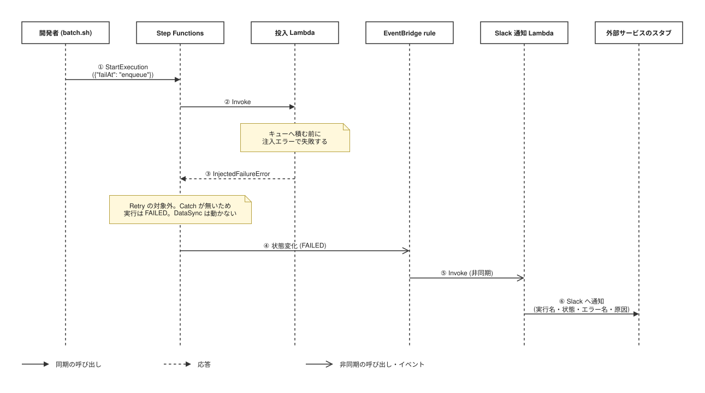
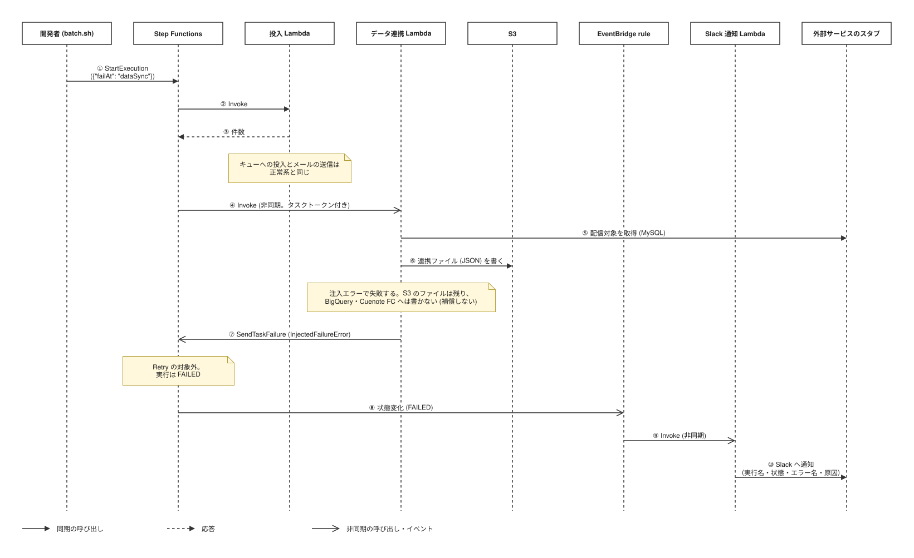
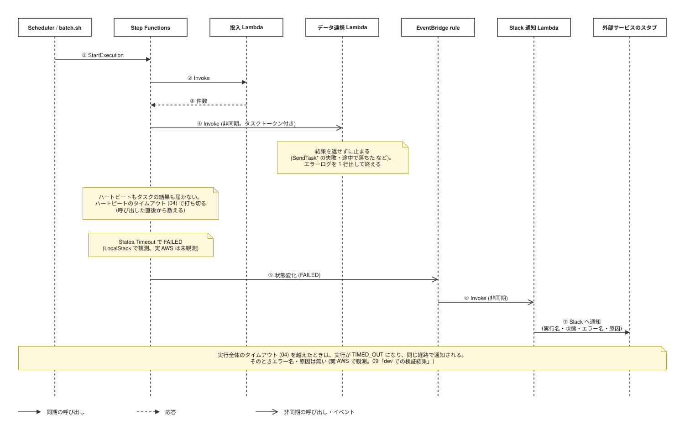
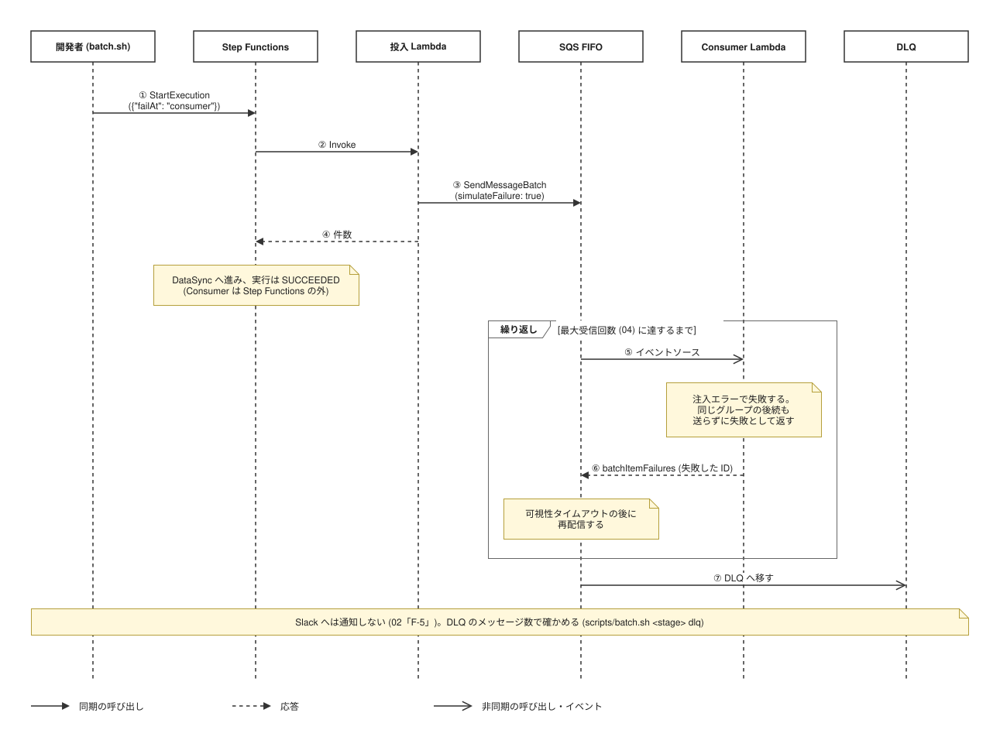
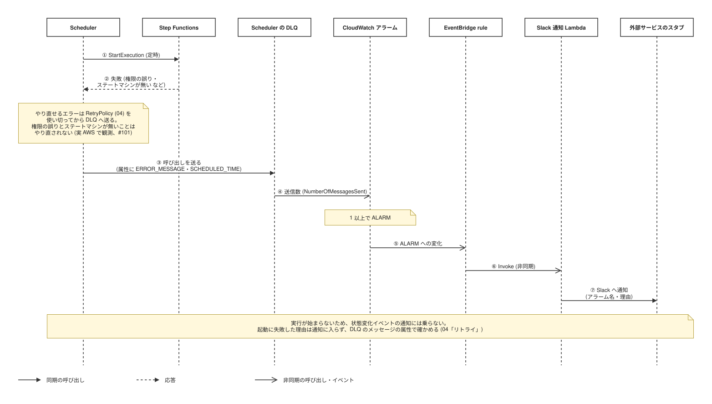
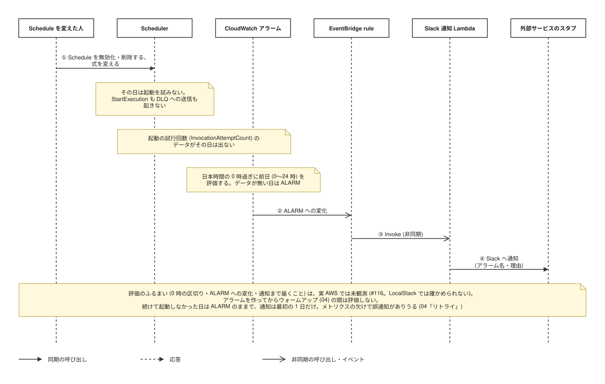

# 機能仕様書

各処理（ステートマシン・Lambda 4 種）の振る舞いと処理の流れを定義する。機能要件の一覧は [`02-requirements-specification.md`](./02-requirements-specification.md) を参照。

本デモは画面を持たないため、テンプレートの「画面仕様 / 画面遷移 / UI/UX 方針」を「処理仕様 / 処理の流れ / 操作方針」に読み替える。

## 目次

- [処理仕様](#処理仕様)
- [処理の流れ](#処理の流れ)
- [操作方針](#操作方針)

## 処理仕様

入出力の形式は [07 API 仕様書](07-api-specification.md)、タイムアウト・リトライの値は [04 非機能仕様書](04-non-functional-specification.md) を参照。

### ステートマシン（`batch`）

| ステート | 種類 | 内容 |
|---|---|---|
| `Enqueue` | Lambda タスク | 投入 Lambda を呼ぶ。実行入力に実行名を足して渡す（07「タスク入力」） |
| `DataSync` | Lambda タスク（`.waitForTaskToken`） | データ連携 Lambda を非同期で呼び、関数がタスクトークンで結果を返すまで待つ。`Enqueue` と同じタスク入力にタスクトークンを足して渡す（07「タスク入力」） |

- 2 つのタスクを順に実行し、両方成功したら `SUCCEEDED` で終える。分岐・並列は持たない
- 各タスクの `Retry` は一時的なエラー（04「リトライ」）だけを対象にする。注入した失敗・検証エラーはリトライしない
- `Catch` は付けない。タスクの失敗はそのまま実行の失敗になり、状態変化イベントとして EventBridge へ出る
- `DataSync` はタイムアウトとハートビートのタイムアウトを持つ（04「パフォーマンス要件」）。関数が結果を返さずに止まっても待ち続けず、`States.Timeout` で失敗にする。ハートビートが切れたときも同じ `States.Timeout` になる（LocalStack で観測。実 AWS は未観測。09「LocalStack での検証結果」）

### 投入 Lambda（`enqueue`）

1. 入力を検証する。`failAt` が未定義の値なら検証エラーで失敗する
2. `failAt` が `enqueue` なら、キューへ積む前に注入エラーで失敗する
3. MySQL スタブから配信対象を取得する
4. 配信対象ごとにメールメッセージを作り、SQS FIFO へ送る（`SendMessageBatch`、10 件ずつ）
   - `failAt` が `consumer` なら、各メッセージの `simulateFailure` を `true` にする
5. 送った件数を返す

`SendMessageBatch` の一部が失敗した場合も、残りのバッチは送り切ってから、失敗した配信対象 ID をまとめて `EnqueuePartialFailureError` で投げる。再実行で全件を送り直しても、重複排除 ID が決定的なため 5 分以内なら重複しない（05「メールメッセージ」）。

失敗したときは、エラー名・メッセージ・スタックトレースを含むエラーログを 1 行出してから投げ直す。タスク入力の検証を通った後の失敗には `executionName` を付ける。

### Consumer Lambda（`consumer`）

SQS イベントソースから最大 5 件ずつ受け取り、1 件ずつ処理する。

1. メッセージ本文を検証する。不正な本文はその 1 件を失敗として扱う
2. `simulateFailure` が `true` なら、その 1 件を注入エラーで失敗させる
3. メール送信スタブへ渡す
4. 失敗したメッセージの ID だけを `batchItemFailures` で返す（部分バッチ応答）

- **失敗したメッセージと同じグループの後続メッセージは、送らずに失敗として返す。** 送ってしまうと、再配信された前のメッセージが後から届き、グループ内の順序が逆転するため。AWS の指示（FIFO の部分バッチ応答では、最初の失敗で処理をやめ、残りをすべて失敗として返す）をグループ単位に緩めた扱いで、Powertools for AWS Lambda の `skipGroupOnError` と同じ形（[公式](https://docs.aws.amazon.com/lambda/latest/dg/services-sqs-errorhandling.html)）。別のグループのメッセージは影響を受けず、そのまま送る。グループは配信対象ごとなので、影響は同じ宛先の中に閉じる
- 失敗した 1 件ごとに、`messageId`・グループ ID・エラー名・スタックトレースを含むエラーログを出す
- イベント自体の形式が不正（`Records` が無い等）なら `ValidationError` を投げ、バッチ全体を再配信させる
- 成功したメッセージは SQS から削除され、失敗したものだけが可視性タイムアウト後に再配信される
- 3 回受信しても失敗したメッセージは DLQ へ移る（`maxReceiveCount: 3`）
- Slack への通知はしない（02「F-5」）

### データ連携 Lambda（`data-sync`）

ステートマシンから非同期で呼ばれるため、戻り値・例外はステートマシンに届かない。結果は入力のタスクトークンで返す（09「LMI（Lambda Managed Instances）」）。

1. 入力からタスクトークンを取り出す。読めなければ結果を返せないため、エラーログを出して終える
2. 入力の残りを検証する
3. MySQL スタブから配信対象を取得する
4. S3 へ連携ファイル（JSON）を書く
5. `failAt` が `dataSync` なら、ここで注入エラーで失敗する
6. BigQuery スタブへ書く
7. Cuenote FC スタブへ書く
8. `holdSeconds` があれば、その秒数だけ待つ。60 秒ごとにハートビート（`SendTaskHeartbeat`）を送る
9. 書いた件数と S3 のキーを `SendTaskSuccess` で返す

書き出しの順序は元資料で未確定のため、本デモでは上記の順に固定する。途中で失敗すると前段の書き込みが残る（元資料のリスク 4）。補償処理（巻き戻し）は持たない。

S3 のキーの日付と `exportedAt` は、同じ時刻（UTC）から作る。

2〜9 で失敗したときは、投入 Lambda と同じくエラーログを 1 行出してから、`SendTaskFailure` で失敗を返す（エラー名と `cause` の形は 07「エラーハンドリング」）。**例外は投げない。** 非同期の呼び出しで投げると、受け取るのは Lambda の再試行だけで、同じタスクトークンで処理が二重に走るため（非同期の呼び出しの再試行も 0 にしている）。ハートビート・`SendTaskSuccess` の失敗も同じく `SendTaskFailure` で返し、`SendTaskFailure` 自体が失敗したらエラーログを出して終える。そのときはステートマシン側のタイムアウトで `FAILED` になる。

環境変数の誤りだけは、ロガーを組み立てられないため例外を投げる。デプロイの誤りで、結果はハートビートのタイムアウトで `FAILED` になる。

### Slack 通知 Lambda（`notify-slack`）

受け付けるイベントは 2 種類で、`source` で見分ける（07「状態変化イベント」「アラームの状態変化イベント」）。

| イベント | 意味 | 通知に使う項目 |
|---|---|---|
| Step Functions の状態変化（`aws.states`） | 実行が `FAILED` / `TIMED_OUT` / `ABORTED` で終わった（F-5） | 実行名・実行 ARN・状態・エラー名・原因 |
| CloudWatch アラームの状態変化（`aws.cloudwatch`） | 次のどちらかのアラームが `ALARM` になった。どちらも実行が始まっていない。Scheduler の DLQ のアラーム（起動に失敗した。F-5・#101）、実行が始まらない日のアラーム（その日に起動を試みなかった。F-5・#109） | アラーム名・`ALARM` になった理由 |

1. EventBridge のイベントを検証する。対象外（形式違い・通知対象外の状態。アラームの `OK` への変化も含む）なら、理由を警告ログに出して正常に終える。エラーにすると非同期呼び出しの再試行で同じイベントを受け直すだけで、結果は変わらないため
2. 通知に使う項目を取り出す（07「スタブへの出力」）。状態変化イベントのエラー名と原因は、`null` でも項目が無くても `null` に揃える
3. Slack スタブへ通知内容を渡す。実行の失敗とアラームは、別の行（`message` が違う）で出す

通知自体が失敗した場合は、実行名（アラームならアラーム名）付きのエラーログを出してから投げ直し、Lambda の既定の再試行（2 回）に任せる。

アラームの通知には、起動に失敗した理由（エラーコード）は入らない。理由は DLQ のメッセージの属性にあり、DLQ を受信して確かめる（04「リトライ」）。実行が始まらない日のアラームでは、`get-schedule` で Schedule の状態（`DISABLED`・削除・式の変更）を、`list-executions` でその日の定時の起動の実行が本当に無いかを確かめる（メトリクスの欠けによる誤通知がありうる。04「リトライ」）。

## 処理の流れ

図は [`images/sequences/`](images/sequences/) の `.drawio.svg` が正本（編集の仕方は [09「システム構成図」](09-architecture-specification.md#システム構成図)）。丸数字はメッセージの順。タイムアウト・リトライの秒数や回数は図に書かず、[04 非機能仕様書](04-non-functional-specification.md) を正本とする。

### 正常系

### 実行の失敗

実行が `FAILED` / `TIMED_OUT` / `ABORTED` で終わると、状態変化イベントが EventBridge rule を経て Slack 通知 Lambda に届く（02「F-5」）。メールの送信の失敗だけは Step Functions の外で起き、通知されない。

#### 投入の失敗（`failAt: enqueue`）

#### データ連携の失敗（`failAt: dataSync`）

#### データ連携の結果が返らない（ハートビート切れ）

#### メールの送信の失敗（`failAt: consumer`）

### 起動されない失敗

実行が始まらないため、状態変化イベントは出ない。CloudWatch アラームの `ALARM` への変化を EventBridge rule が拾い、同じ Slack 通知 Lambda を呼ぶ（04「リトライ」）。

#### Scheduler の起動の失敗（#101）

#### 起動を試みなかった日（#109）

## 操作方針

利用者は開発者 1 人で、操作はすべて CLI で行う。コマンドの正本は `scripts/`（作成・削除は `stack.sh`、実行と確認は `batch.sh`）に置き、README からはそれを呼ぶだけにする。

### 全体方針

- **実行**: `aws stepfunctions start-execution`（`local` は LocalStack のエンドポイント）で、実行入力に `failAt` / `holdSeconds` を指定して起動する（`scripts/batch.sh <stage> run [failAt] [--hold-seconds <秒>]`）
- **確認**: 実行の状態は `describe-execution`、各 Lambda の出力は CloudWatch Logs、連携ファイルは S3、DLQ はメッセージ数で確かめる
- **ログ**: すべての Lambda は 1 行 1 JSON の構造化ログを出す。スタブの出力にも `stub` フィールドを付け、どの外部サービスへの送信を模したかを絞り込めるようにする
