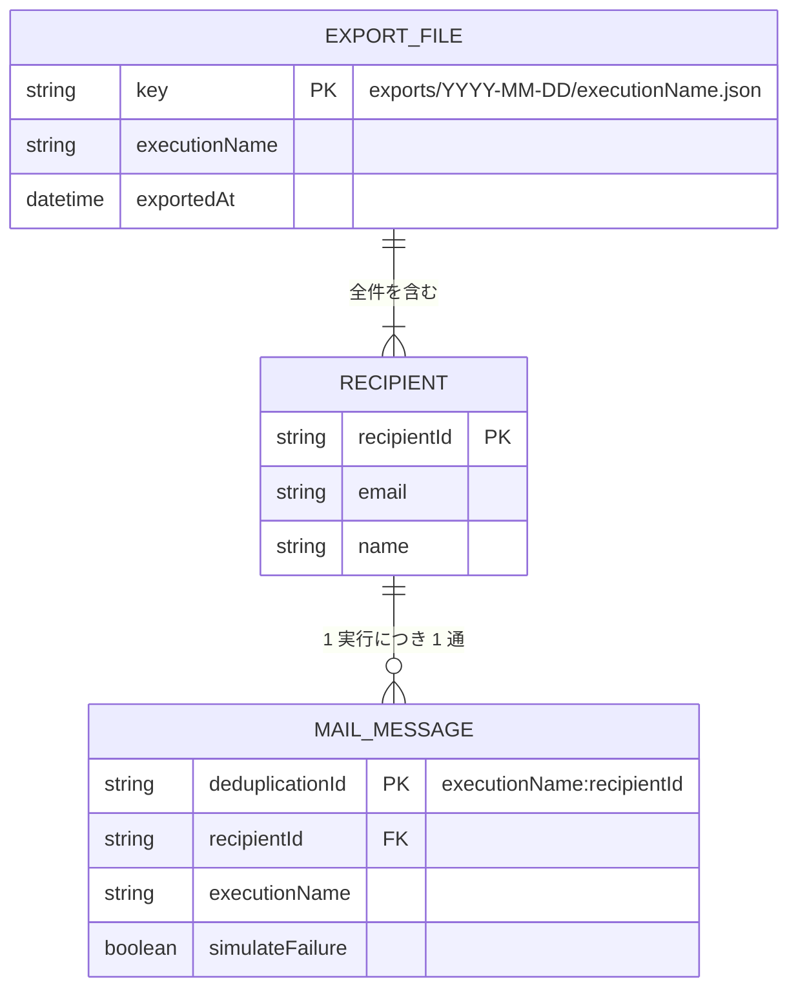
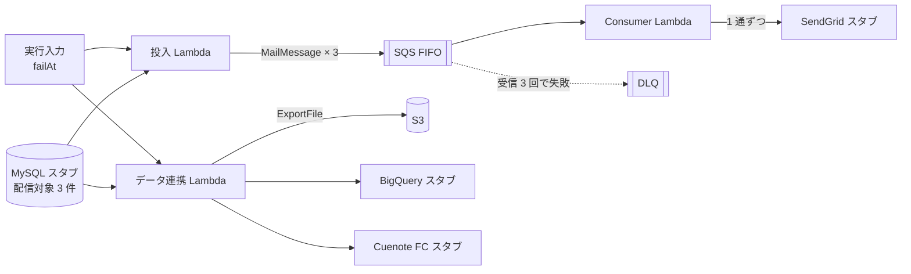

# データ仕様書

データモデルとスキーマを定義する。Lambda 間・サービス間の受け渡しの契約は [`07-api-specification.md`](./07-api-specification.md) を参照。

本デモは DB を持たない。MySQL はスタブが固定データを返し、永続化するのは S3 の連携ファイルだけ。

## 目次

- [エンティティ一覧](#エンティティ一覧)
- [ER 図](#er-図)
- [エンティティ詳細](#エンティティ詳細)
- [スキーマ定義](#スキーマ定義)
- [データフロー](#データフロー)

## エンティティ一覧

| エンティティ | 説明 |
|------|------|
| 配信対象（Recipient） | メールの宛先。MySQL スタブが返す固定データ |
| メールメッセージ（MailMessage） | SQS FIFO に積む 1 通分のメール。配信対象 1 件につき 1 つ |
| 連携ファイル（ExportFile） | データ連携 Lambda が S3 に書く JSON。1 実行につき 1 つ |
| SSM パラメータ | Terraform が CDK へ渡すリソースの ARN・名前・URL |

## ER 図

## エンティティ詳細

### 配信対象（Recipient）

MySQL スタブが返す固定の 3 件。投入 Lambda とデータ連携 Lambda の両方が読む。

#### フィールド

| フィールド | 型 | 説明 |
|-----------|----|------|
| `recipientId` | string | 配信対象の ID。`r-001` 形式 |
| `email` | string | 宛先メールアドレス |
| `name` | string | 表示名 |

#### インデックス・制約

- `recipientId` はスタブのデータ内で一意
- `email` は `@example.com` のドメインに限る（実在の宛先を持たない。06「データ保護」）

### メールメッセージ（MailMessage）

SQS FIFO のメッセージ本文（JSON）と、送信時の属性。

#### フィールド

| フィールド | 型 | 説明 |
|-----------|----|------|
| `executionName` | string | 投入したステートマシンの実行名 |
| `recipientId` | string | 配信対象の ID |
| `email` | string | 宛先メールアドレス |
| `subject` | string | 件名。デモでは固定文言 |
| `simulateFailure` | boolean | `true` なら Consumer が注入エラーで失敗する。`failAt: "consumer"` のときだけ `true` |

#### インデックス・制約

| SQS の属性 | 値 | 理由 |
|---|---|---|
| `MessageGroupId` | `recipientId` | 順序が要るのは同じ宛先の中だけ。宛先ごとにグループを分け、別宛先は並行に処理できるようにする |
| `MessageDeduplicationId` | `<executionName>:<recipientId>` | 同じ実行の再投入（Step Functions の Retry）を 5 分以内なら重複排除する。UUID を毎回作ると効かない（元資料のリスク 2） |

- 5 分を超えた再投入や、Consumer 側の二重処理は防げない。Consumer の冪等化は将来構成とする（09「将来構成」）
- グループは実行をまたいで共有される。失敗し続けるメッセージ（`failAt: "consumer"`）がグループの先頭にあると、DLQ へ移るまで（約 3 分）同じ宛先の別の実行のメッセージも止まる。Consumer は同じグループの後続を失敗として返す（03「Consumer Lambda」）ため、仕組み上は後続の受信回数も増え、DLQ へ移りうる。IT はこのため `consumer` のケースを最後に順番に実行する（08「テストケース」）

### 連携ファイル（ExportFile）

データ連携 Lambda が S3 に書く JSON。

#### フィールド

| フィールド | 型 | 説明 |
|-----------|----|------|
| `executionName` | string | 書き出した実行の実行名 |
| `exportedAt` | string | 書き出した時刻（ISO 8601、UTC） |
| `recipients` | Recipient[] | 配信対象の全件 |

#### インデックス・制約

- オブジェクトキーは `exports/<YYYY-MM-DD>/<executionName>.json`（日付は UTC）。同じ実行を再実行すると同じキーに上書きされる
- `Content-Type` は `application/json`
- 7 日でライフサイクル削除する（04「保持期間」）

### SSM パラメータ

Terraform が書き、CDK が合成時に読む。名前は `/serverless-practice-app/<stage>/<name>`。

#### フィールド

| `<name>` | 値 | 読む側 |
|---|---|---|
| `queue/url` | メール送信キューの URL | 投入 Lambda の環境変数 `QUEUE_URL` |
| `queue/arn` | メール送信キューの ARN | Consumer のイベントソース |
| `dlq/arn` | DLQ の ARN | 参照のみ（確認用） |
| `scheduler-dlq/arn` | Scheduler の DLQ の ARN | Schedule 定義の `DeadLetterConfig` |
| `scheduler-dlq/name` | Scheduler の DLQ のキュー名 | DLQ のアラーム（メトリクスのディメンション `QueueName`） |
| `bucket/name` | 連携ファイルの出力先バケット名 | データ連携 Lambda の環境変数 `BUCKET_NAME` |
| `schedule-group/name` | Schedule group 名 | Schedule 定義 |
| `role/enqueue/arn` | 投入 Lambda の実行ロール ARN | 投入 Lambda |
| `role/consumer/arn` | Consumer Lambda の実行ロール ARN | Consumer Lambda |
| `role/data-sync/arn` | データ連携 Lambda の実行ロール ARN | データ連携 Lambda |
| `role/notify-slack/arn` | Slack 通知 Lambda の実行ロール ARN | Slack 通知 Lambda |
| `role/state-machine/arn` | ステートマシンの実行ロール ARN | ステートマシン |
| `role/scheduler/arn` | Scheduler の実行ロール ARN | Schedule 定義 |
| `consumer/timeout-seconds` | Consumer Lambda のタイムアウト（秒）。正本は Terraform の `consumer_timeout_seconds` で、SQS の可視性タイムアウトはこの 6 倍（04「連動するパラメータ」） | Consumer Lambda のタイムアウト |
| `capacity-provider/arn` | LMI のキャパシティプロバイダの ARN。`dev` だけに作る（`local` には無い） | データ連携 Lambda の LMI への紐付け（`dev` だけ。09「LMI（Lambda Managed Instances）」） |

#### インデックス・制約

- 型はすべて `String`。秘匿値を置かないため `SecureString` は使わない
- CDK は値を**デプロイ時に**読む（`valueForStringParameter`。CloudFormation の SSM パラメータ型の参照になる）。合成時に読む方式（`valueFromLookup`）は値が `cdk.context.json` にキャッシュされ、ステージ間で混ざりうるため使わない。数値（`consumer/timeout-seconds`）も、LocalStack へのデプロイで Lambda のタイムアウトとして解決されることを確認した（#20）

## スキーマ定義

実行時に検証する入力（実行入力・Lambda の入力・SQS メッセージ本文・EventBridge イベント）は Zod スキーマで定義し、型は `z.infer` で導出する（`typescript.md`）。置き場所は `functions/src/schemas/`。形の正本はスキーマで、本書の表はその説明とする。

スタブの固定データ（配信対象 3 件）は `functions/src/stubs/` に置く。

## データフロー

