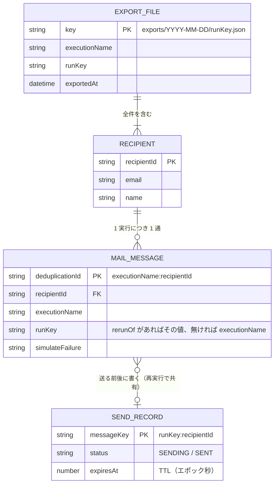
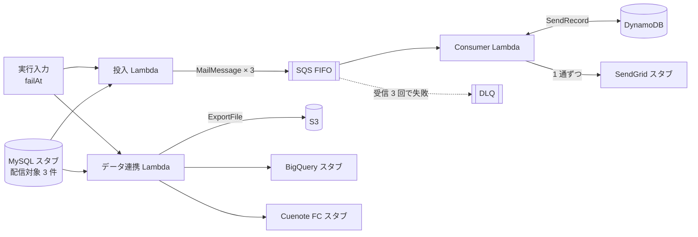

# データ仕様書

データモデルとスキーマを定義する。Lambda 間・サービス間の受け渡しの契約は [`07-api-specification.md`](./07-api-specification.md) を参照。

MySQL はスタブが固定データを返す。永続化するのは、S3 の連携ファイルと、二重送信を防ぐための DynamoDB の送信記録（#136）だけ。

## 目次

- [エンティティ一覧](#エンティティ一覧)
- [ER 図](#er-図)
- [エンティティ詳細](#エンティティ詳細)
- [スキーマ定義](#スキーマ定義)
- [データフロー](#データフロー)

## エンティティ一覧

| エンティティ | 説明 |
|------|------|
| 配信対象（Recipient） | メールの宛先。MySQL スタブが返す固定データ |
| メールメッセージ（MailMessage） | SQS FIFO に積む 1 通分のメール。配信対象 1 件につき 1 つ |
| 連携ファイル（ExportFile） | データ連携 Lambda が S3 に書く JSON。1 実行につき 1 つ |
| 送信記録（SendRecord） | Consumer がメールを送る前後に書く記録。メールメッセージ 1 つにつき 1 つ。再配信で同じメールを送り直さないために使う |
| SSM パラメータ | Terraform が CDK へ渡すリソースの ARN・名前・URL |

## ER 図

## エンティティ詳細

### 配信対象（Recipient）

MySQL スタブが返す固定の 3 件。投入 Lambda とデータ連携 Lambda の両方が読む。

#### フィールド

| フィールド | 型 | 説明 |
|-----------|----|------|
| `recipientId` | string | 配信対象の ID。`r-001` 形式 |
| `email` | string | 宛先メールアドレス |
| `name` | string | 表示名 |

#### インデックス・制約

- `recipientId` はスタブのデータ内で一意
- `email` は `@example.com` のドメインに限る（実在の宛先を持たない。06「データ保護」）

### メールメッセージ（MailMessage）

SQS FIFO のメッセージ本文（JSON）と、送信時の属性。

#### フィールド

| フィールド | 型 | 説明 |
|-----------|----|------|
| `executionName` | string | 投入したステートマシンの実行名 |
| `runKey` | string | 論理キー（下記「論理キー（runKey）」）。再実行では元の実行名、それ以外では `executionName` と同じ値 |
| `recipientId` | string | 配信対象の ID |
| `email` | string | 宛先メールアドレス |
| `subject` | string | 件名。デモでは固定文言 |
| `simulateFailure` | string | Consumer に失敗を注入する箇所。`none`（注入しない）/ `beforeSend`（送る前に失敗する。`failAt: "consumer"`）/ `afterSend`（送って送信済みを記録した後に失敗する。`failAt: "consumerAfterSend"`）。#136 までは真偽値だった |

#### インデックス・制約

| SQS の属性 | 値 | 理由 |
|---|---|---|
| `MessageGroupId` | `recipientId` | 順序が要るのは同じ宛先の中だけ。宛先ごとにグループを分け、別宛先は並行に処理できるようにする |
| `MessageDeduplicationId` | `<executionName>:<recipientId>` | 同じ実行の再投入（Step Functions の Retry）を 5 分以内なら重複排除する。UUID を毎回作ると効かない（元資料のリスク 2）。`runKey` ではなく実行名から作る（下記） |

- 5 分を超えた再投入と、Consumer 側の二重処理（送った直後に落ちて再配信される）は、重複排除では防げない。どちらも、同じキーの送信記録（下記「送信記録」）で Consumer が送り直さない（#136）
- **重複排除 ID は、再実行で引き継がない**（#137）。引き継ぐと、元の実行から 5 分以内に再実行したとき、再実行のメッセージが重複として捨てられる。`failAt: "consumer"` のメッセージは約 3 分で DLQ へ移り、通知を受けてすぐ再実行すると 5 分に収まりうる。重複として捨てられたメッセージも、送信は成功として返る（公式「Amazon SQS FIFO queue message deduplication ID」の記述。このデモでは観測していない）ため、送れなかったメールが送られないまま誰も気づけない。実行をまたいだ重複は、重複排除ではなく送信記録（`runKey` から作る）で防ぐ
- グループは実行をまたいで共有される。失敗し続けるメッセージ（`failAt: "consumer"`）がグループの先頭にあると、DLQ へ移るまで（約 3 分）同じ宛先の別の実行のメッセージも止まる。Consumer は同じグループの後続を失敗として返す（03「Consumer Lambda」）ため、仕組み上は後続の受信回数も増え、DLQ へ移りうる。IT はこのため `consumer` のケースを最後に順番に実行する（08「テストケース」）

### 連携ファイル（ExportFile）

データ連携 Lambda が S3 に書く JSON。

#### フィールド

| フィールド | 型 | 説明 |
|-----------|----|------|
| `executionName` | string | 書き出した実行の実行名 |
| `runKey` | string | 論理キー（下記「論理キー（runKey）」）。再実行で書いたファイルかどうかを、`executionName` と見比べて分けられる |
| `exportedAt` | string | 書き出した時刻（ISO 8601、UTC） |
| `recipients` | Recipient[] | 配信対象の全件 |

#### インデックス・制約

- オブジェクトキーは `exports/<YYYY-MM-DD>/<runKey>.json`（日付は書き出した時刻の UTC）。同じ日の再実行は、失敗した実行が残したファイルを同じキーで上書きする。日をまたいだ再実行は別の日付のキーに書き、元のファイルはライフサイクル削除（7 日）まで残る（#137）
- `Content-Type` は `application/json`
- 7 日でライフサイクル削除する（04「保持期間」）

### 送信記録（SendRecord）

DynamoDB のテーブル `serverless-practice-app-<stage>-send-records`（Terraform が作る）の 1 項目。Consumer がメールを送る前に「送信中」、送った後に「送信済み」を書き、再配信で同じメールを送り直さない（03「Consumer Lambda」・#136）。保存先に DynamoDB を選んだ理由は 09「送信記録の保存先」。

#### フィールド

| フィールド | 型 | 説明 |
|-----------|----|------|
| `messageKey` | string（パーティションキー） | `<runKey>:<recipientId>`。再実行は元の実行と同じキーを使い、元の実行で送れていたメールを送り直さない（#137）。`rerunOf` の無い実行ではメールメッセージの `MessageDeduplicationId` と同じ値になるが、再実行では違う値になる（上記「メールメッセージ」） |
| `status` | string | `SENDING`（送信中。送る前に書く）/ `SENT`（送信済み。送った後に書く） |
| `expiresAt` | number | 期限（エポック秒）。書いた時刻の 7 日後。DynamoDB の TTL の属性 |

#### インデックス・制約

- 「送信中」は、キーが無いことを条件に書く（条件付きの書き込み）。同じキーを 2 つ書けないことが、送るかどうかの判定の土台になる
- 書き込みを断られた直後は、強い整合性の読み取りで状態を読み直す
- 「送信中」を消すのは、送れなかったときだけ。消す条件は状態が `SENDING` であること（「送信済み」は消さない）
- 期限を過ぎた記録は、DynamoDB の TTL が非同期に消す。期限ちょうどに消えることを前提にしない。期限の 7 日は、メッセージが再び届きうる期間（キュー 1 日・DLQ 4 日。04「保持期間」）より長く取った
- 本文・宛先メールアドレスは持たない（キーの配信対象 ID だけ。06「データ保護」）
- テーブルは課金モードをオンデマンド（`PAY_PER_REQUEST`）にし、置いておくだけの料金をかけない（09「費用」）

### 論理キー（runKey）

「どの実行の続きか」を表す値で、失敗の後の再実行（03「[失敗の後の再実行](03-functional-specification.md#失敗の後の再実行)」・#137）が、元の実行の送信記録と連携ファイルを引き継ぐために使う。保存する項目ではなく、投入 Lambda とデータ連携 Lambda がタスク入力から作る。

| タスク入力 | `runKey` |
|---|---|
| `rerunOf` がある（再実行） | `rerunOf` の値（元の実行名。再実行の再実行でも、最初の実行の名前） |
| `rerunOf` が無い（定時起動・`run` での起動） | `executionName` の値。#137 より前と同じキーになる |

| 使う場所 | 作り方 | 再実行で引き継ぐか |
|---|---|---|
| 送信記録のキー | `<runKey>:<recipientId>` | 引き継ぐ。元の実行で送れていたメールを送らない |
| 連携ファイルのキー | `exports/<YYYY-MM-DD>/<runKey>.json` | 引き継ぐ。同じ日なら上書きする |
| SQS の重複排除 ID | `<executionName>:<recipientId>` | **引き継がない**（上記「メールメッセージ」） |

実行名を使い回して同じキーにする手はとれない。Step Functions の Standard ワークフローは、終わった実行と同じ名前の実行を 90 日間は始められない（公式「StartExecution」の記述。観測していない）。

### SSM パラメータ

Terraform が書き、CDK のスタックがデプロイ時に読む（下記「インデックス・制約」。仕組みは [SSM Parameter Store 解説](guides/ssm.md)）。名前は `/serverless-practice-app/<stage>/<name>`。

#### フィールド

| `<name>` | 値 | 読む側 |
|---|---|---|
| `queue/url` | メール送信キューの URL | 投入 Lambda の環境変数 `QUEUE_URL` |
| `queue/arn` | メール送信キューの ARN | Consumer のイベントソース |
| `dlq/arn` | DLQ の ARN | 参照のみ（確認用） |
| `dlq/name` | DLQ のキュー名 | メール送信キューの DLQ のアラーム（メトリクスのディメンション `QueueName`。#135） |
| `scheduler-dlq/arn` | Scheduler の DLQ の ARN | Schedule 定義の `DeadLetterConfig` |
| `scheduler-dlq/name` | Scheduler の DLQ のキュー名 | Scheduler の DLQ のアラーム（メトリクスのディメンション `QueueName`） |
| `bucket/name` | 連携ファイルの出力先バケット名 | データ連携 Lambda の環境変数 `BUCKET_NAME` |
| `send-records/name` | 送信記録のテーブル名 | Consumer Lambda の環境変数 `SEND_RECORDS_TABLE`（#136） |
| `schedule-group/name` | Schedule group 名 | Schedule 定義 |
| `role/enqueue/arn` | 投入 Lambda の実行ロール ARN | 投入 Lambda |
| `role/consumer/arn` | Consumer Lambda の実行ロール ARN | Consumer Lambda |
| `role/data-sync/arn` | データ連携 Lambda の実行ロール ARN | データ連携 Lambda |
| `role/notify-slack/arn` | Slack 通知 Lambda の実行ロール ARN | Slack 通知 Lambda |
| `role/state-machine/arn` | ステートマシンの実行ロール ARN | ステートマシン |
| `role/scheduler/arn` | Scheduler の実行ロール ARN | Schedule 定義 |
| `consumer/timeout-seconds` | Consumer Lambda のタイムアウト（秒）。正本は Terraform の `consumer_timeout_seconds` で、SQS の可視性タイムアウトはこの 6 倍（04「連動するパラメータ」） | Consumer Lambda のタイムアウト |
| `capacity-provider/arn` | LMI のキャパシティプロバイダの ARN。`dev` だけに作る（`local` には無い） | データ連携 Lambda の LMI への紐付け（`dev` だけ。09「LMI（Lambda Managed Instances）」） |

#### インデックス・制約

- 型はすべて `String`。秘匿値を置かないため `SecureString` は使わない
- CDK は値を**デプロイ時に**読む（`valueForStringParameter`。CloudFormation の SSM パラメータ型の参照になる）。合成時に読む方式（`valueFromLookup`）は値が `cdk.context.json` にキャッシュされ、ステージ間で混ざりうるため使わない。数値（`consumer/timeout-seconds`）も、LocalStack へのデプロイで Lambda のタイムアウトとして解決されることを確認した（#20）

## スキーマ定義

実行時に検証する入力（実行入力・Lambda の入力・SQS メッセージ本文・EventBridge イベント）は Zod スキーマで定義し、型は `z.infer` で導出する（`typescript.md`）。置き場所は `functions/src/schemas/`。形の正本はスキーマで、本書の表はその説明とする。

スタブの固定データ（配信対象 3 件）は `functions/src/stubs/` に置く。

## データフロー

