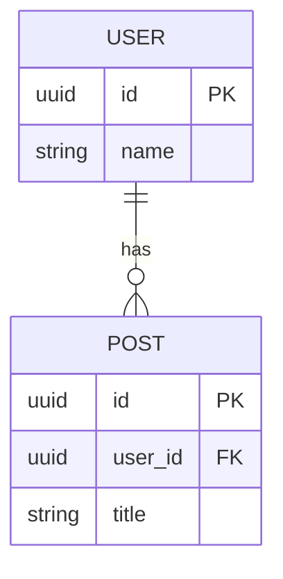
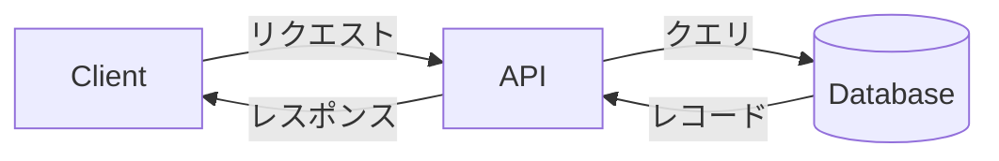

# データ仕様書

データモデルとスキーマを定義する。API のレスポンス形式は [`07-api-specification.md`](./07-api-specification.md) を参照。

## 目次

- [エンティティ一覧](#エンティティ一覧)
- [ER 図](#er-図)
- [エンティティ詳細](#エンティティ詳細)
- [スキーマ定義](#スキーマ定義)
- [データフロー](#データフロー)

## エンティティ一覧

<!-- 記入: 主要なエンティティ（テーブル/コレクション）と役割の一覧 -->

| エンティティ | 説明 |
|------|------|
|  |  |

## ER 図

<!-- 記入: エンティティとリレーションを Mermaid の erDiagram で記述する。
     カーディナリティ: ||--o{ = 1対多 / ||--|| = 1対1 / }o--o{ = 多対多 -->

## エンティティ詳細

### {エンティティ名}

#### フィールド

<!-- 記入: フィールドごとの型・必須・説明 -->

| フィールド | 型 | 説明 |
|-----------|----|------|
|  |  |  |

#### インデックス・制約

<!-- 記入: インデックス・一意制約・アプリ側バリデーションなど -->

## スキーマ定義

<!-- 記入: DDL / ORM スキーマ（Prisma 等）。生成元・更新手順があれば明記 -->

## データフロー

<!-- 記入: データの流れを Mermaid の flowchart で記述する。派生データの生成元も明示 -->

