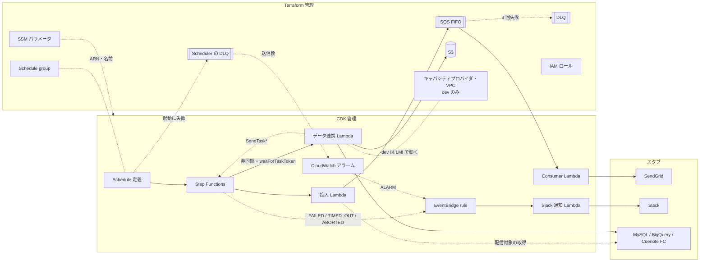

# アーキテクチャ仕様書

システム構成・技術スタック・インフラ・セットアップ手順を定義する。再現対象の構成は [元資料](references/aws-batch-architecture.md)、目的とスコープは [01 要求仕様書](01-business-requirements.md) を参照。

## 目次

- [技術スタック](#技術スタック)
- [構成方針](#構成方針)
- [システム構成図](#システム構成図)
- [環境変数](#環境変数)
- [ローカル開発セットアップ](#ローカル開発セットアップ)
- [デプロイ](#デプロイ)
- [CI とマージの条件](#ci-とマージの条件)
- [LMI（Lambda Managed Instances）](#lmilambda-managed-instances)
- [将来構成](#将来構成)

## 技術スタック

| レイヤー | 技術 |
|----------|------|
| Lambda | TypeScript / Node.js 22.x ランタイム / AWS SDK for JavaScript v3 |
| ビルド | esbuild（CDK の `NodejsFunction` 経由） |
| テスト | Vitest |
| IaC（土台） | Terraform 1.14 系 / AWS Provider |
| IaC（アプリ） | AWS CDK v2（TypeScript）。アプリは `tsx` で実行し、ステージは `-c stage=<ステージ名>`（`local` または `dev`）で渡す。機能フラグは推奨値を `cdk.json` に記録 |
| Terraform → CDK の受け渡し | SSM Parameter Store |
| ローカル実行 | LocalStack（Docker）+ `tflocal` / `cdklocal` |
| 実 AWS | 個人の検証用アカウント（ステージ名 `dev`） |
| CI | GitHub Actions（actionlint / markdownlint / Markdown の相対リンクの実在 / shellcheck / 秘匿ファイル検出 / 型検査・テスト / Terraform の整形・構文 / LocalStack での IT） |
| パッケージ管理 | npm（リポジトリ直下に 1 つ） |

## 構成方針

### ディレクトリ構成

```text
.
├── functions/            # Lambda 本体（handler とスタブ）
│   ├── src/
│   │   ├── handlers/     # enqueue / consumer / data-sync / notify-slack
│   │   ├── stubs/        # 外部サービスのスタブ
│   │   ├── schemas/      # 入力の Zod スキーマ（型は z.infer で導出）
│   │   ├── errors/       # エラークラス（name が Step Functions との契約）
│   │   ├── types/        # 複数ファイルで使う型と、スタブが実装する口（interface）
│   │   └── lib/          # 入力検証・構造化ロガーなどの共通処理
│   └── test/
├── infra/
│   ├── terraform/        # 土台（IAM・SQS・S3・Schedule group・SSM 出力。dev だけ LMI の VPC・キャパシティプロバイダ）
│   │   └── envs/         # <stage>.tfvars（変数）/ <stage>.s3.tfbackend（state のキー）。秘匿値は置かない
│   └── cdk/              # アプリ（Lambda・Step Functions・Schedule・EventBridge rule）。bin/（入口）・lib/（スタック）・test/
├── scripts/              # 検査・デプロイ補助スクリプト
└── test/                 # リポジトリ全体に対するテスト（Lint 設定の回帰テスト等）と IT（test/it/）
```

元資料では Terraform と CDK が別リポジトリだが、デモでは 1 リポジトリ内の 2 ディレクトリで代替する。「変更が 2 か所にまたがる」構造はそのまま残る。

### IaC の責務分担

| リソース | 管理 | 備考 |
|---|---|---|
| IAM ロール（Lambda 4 種・Step Functions・Scheduler） | Terraform | CDK からは `mutable: false` で参照し、ポリシーを足させない |
| SQS FIFO + DLQ | Terraform | `maxReceiveCount: 3`。可視性タイムアウトは Consumer のタイムアウトの 6 倍 |
| Scheduler の DLQ（SQS 標準キュー） | Terraform | 起動に失敗した呼び出しを受ける（04「リトライ」・#101）。Scheduler は FIFO を DLQ に使えない |
| S3 バケット（データ連携の出力先） | Terraform | 元資料の表に無いが、状態を持つ土台として Terraform に置く |
| Schedule group | Terraform | |
| LMI の VPC・キャパシティプロバイダ | Terraform | `dev` だけ作る。関数の紐付けは CDK（「LMI」の「IaC の責務」） |
| SSM パラメータ | Terraform | 上記の ARN・名前・URL を `/serverless-practice-app/<stage>/...` に書き出す |
| Lambda 4 種 | CDK | |
| Step Functions | CDK | |
| Schedule 定義 | CDK | Terraform の Schedule group を名前で参照。`DeadLetterConfig` は Terraform の Scheduler の DLQ を SSM で参照 |
| CloudWatch アラーム（Scheduler の DLQ・実行が始まらない日） | CDK | rule のイベントパターンにアラーム名を書くため、rule と同じスタックに置く。数えるキューは SSM のキュー名、数える Schedule group は SSM の group 名で参照。実行が始まらない日のアラームは、壁時計の窓とウォームアップを使うため L1（`CfnAlarm`）で作る |
| EventBridge rule（失敗通知 3 つ） | CDK | 実行の失敗と、2 つのアラーム（アラームごとに 1 つ）。通知先 Lambda と同じスタックに置く |

**名前の先決め**: IAM ポリシーは Terraform が先に作るため、CDK が後から作るリソースの ARN を知らない。関数名・ステートマシン名を `serverless-practice-app-<stage>-<name>` の命名規約で固定し、Terraform 側はこの接頭辞のワイルドカードで権限を付ける。

**連動するパラメータ**: SQS の可視性タイムアウト（Terraform）と Consumer Lambda のタイムアウト（CDK）は連動する。Consumer のタイムアウトの正本は Terraform に置き、SSM 経由で CDK に渡す（04「連動するパラメータ」）。

### 外部サービスのスタブ

外部への接続は `functions/src/stubs/` のスタブに置き換える。実在の宛先へは何も送らない。

| 接続先 | スタブの振る舞い |
|---|---|
| SendGrid | 送信内容を構造化ログに出す |
| Slack | 通知内容を構造化ログに出す |
| MySQL | 固定の配信対象データを返す |
| BigQuery / Cuenote FC | 書き込み内容を構造化ログに出す |
| S3 | スタブにせず、Terraform が作ったバケットへ実際に書く |

handler はスタブを直接 import せず、インターフェース経由で受け取る。

| インターフェース（`functions/src/types/`） | 役割 | 実装するスタブ |
|---|---|---|
| `RecipientRepository` | 配信対象を取得する | `MySqlStub` |
| `MailSender` | メールを 1 通送る | `SendGridStub` |
| `FailureNotifier` | 実行の失敗を知らせる | `SlackStub` |
| `ExportWriter` | 配信対象の全件を書き出す | `BigQueryStub` / `CuenoteFcStub` |

BigQuery と Cuenote FC は、データ連携 Lambda から見た振る舞い（全件を書く）が同じため、1 つのインターフェースにまとめる。失敗の流れ（① 失敗通知・DLQ 行き）を試せるよう、Step Functions の実行入力で失敗を注入できるようにする（例: `{"failAt": "dataSync"}`）。

### Step Functions の流れ

`Enqueue（投入）→ DataSync（データ連携）` を順に実行する。Lambda タスクには一時的なエラー（`Lambda.ServiceException` 等）のみ `Retry` を付ける。`DataSync` は非同期で呼び、データ連携 Lambda がタスクトークンで結果を返すまで待つ（「LMI」）。Consumer は SQS イベントソースで起動し、Step Functions の外で動く（元資料の「コレオグラフィ」部分）。

ステートマシンの種類は **Standard**。`DataSync` が使う `.waitForTaskToken` と、失敗の通知に使う EventBridge への状態変化イベントは、どちらも Standard でしか使えないため（[公式](https://docs.aws.amazon.com/step-functions/latest/dg/choosing-workflow-type.html)）。CDK で種類を明示し（`stateMachineType: STANDARD`）、UT で固定している（#90）。以前は既定に頼っており、合成したテンプレートに `StateMachineType` が出なかったため、Express に変わっても検査で落ちなかった。

明示より前にデプロイしたスタックへは、上書きでデプロイできない。CloudFormation は `StateMachineType` の変更を置換（作り直し）として扱い、名前を指定したリソースは置換できないため（[公式](https://docs.aws.amazon.com/AWSCloudFormation/latest/TemplateReference/aws-resource-stepfunctions-statemachine.html)）。LocalStack では `StateMachineAlreadyExists` で失敗し、ロールバックの後もリソースが残って作り直しまで失敗したため、LocalStack ごと作り直した（2026-10-18）。実 AWS では試していない。残っているスタックがあれば、`scripts/stack.sh <stage> down` で消してから `up` で作る。

## システム構成図



## 環境変数

Lambda の環境変数に秘匿値は無い（外部サービスはすべてスタブのため）。Lambda の環境変数は CDK が SSM の値から設定する。

| 変数 | 用途 | 参照箇所 |
|------|------|----------|
| `STAGE` | ステージ名（`local` / `dev`） | 全 Lambda |
| `QUEUE_URL` | メール送信キューの URL | 投入 Lambda |
| `BUCKET_NAME` | データ連携の出力先バケット | データ連携 Lambda |

LocalStack 上の Lambda から AWS API を呼ぶときのエンドポイントは、LocalStack が注入する設定に任せる。コード側でエンドポイントを分岐しない。

手元（開発機）で使う環境変数は次のとおりで、`.env`（Git 管理外）に置く。雛形は `.env.example`。

| 変数 | 用途 | 参照箇所 |
|------|------|----------|
| `LOCALSTACK_AUTH_TOKEN` | LocalStack の起動に要る認証トークン（下記「LocalStack の認証」）。CI ではリポジトリのシークレット（Actions 用と Dependabot 用の 2 か所）から渡す | `docker-compose.yml` |
| `LAMBDA_IGNORE_ARCHITECTURE` | 任意。`1` なら Lambda の `ARM_64` 指定を無視してホストのアーキテクチャで動かす。x86 のホスト（CI のランナー・Intel の Mac）用で、既定は `0`。Lambda は JS だけでネイティブモジュールを含まないため、動作は変わらない | `docker-compose.yml` |
| `BUDGET_ALERT_EMAIL` | `dev` の予算アラートの通知先メールアドレス（下記「予算アラート」）。個人情報のため `.env` にだけ置く。同じ名前の環境変数があればそちらを優先する | `scripts/budget-alert.sh` |

## ローカル開発セットアップ

### 前提ツール

| ツール | 用途 | 導入 |
|---|---|---|
| Docker | LocalStack の実行 | 導入済み前提 |
| LocalStack アカウント | 認証トークンの取得 | 無料の Hobby プランを作成（下記「LocalStack の認証」） |
| Python 3 | 起動スクリプトのヘルスチェック判定 | macOS 標準 |
| Node.js 22 以上 | Lambda のビルド・CDK | 導入済み前提 |
| Terraform 1.14 系 | 土台の構築 | 導入済み前提 |
| AWS CLI v2 | 実行の起動・確認 | `brew install awscli` |
| `tflocal` | Terraform を LocalStack へ向ける | `brew install pipx` → `PIPX_HOME=~/.local/pipx pipx install terraform-local`（`PIPX_HOME` を付けないと、macOS では空白を含むパスに入り起動できない） |
| `cdklocal` / `cdk` | CDK を LocalStack へ向ける | npm の devDependencies で導入 |

### 手順（ステージ `local`）

1. `.env.example` を `.env` にコピーし、`LOCALSTACK_AUTH_TOKEN` を入れる
2. LocalStack を起動する（`./scripts/localstack.sh up`。使うサービスがすべて使える状態になるまで待つ）
3. 依存を入れる（`npm ci`）
4. 土台とアプリを作る（`./scripts/stack.sh local up`。Terraform → CDK の順に作る）
5. 実行を起動して結果を見る（`./scripts/batch.sh local run [failAt]` → 表示された実行名で `./scripts/batch.sh local logs <実行名>`）。受け入れ条件をまとめて確かめるなら `npm run test:it`
6. 消す（`./scripts/stack.sh local down`。CDK → Terraform の順に消す）

コマンドの正本は `scripts/` に置き、README からはスクリプトを呼ぶだけにする。Terraform・CDK を個別に操作するときは `scripts/terraform.sh` / `scripts/cdk.sh` を使う。CDK のテンプレートを変えたら、`deploy` の前に `scripts/cdk.sh <stage> diff` で差分を見る。名前を固定したリソースは置換できないため、置換を伴う差分は終了コード 3 で分かるようにしている。`local` では変更セットとテンプレートの両方の方法で比べる（LocalStack の変更セットが入れ子の項目の差分を返さないことがあるため。#100）。

### LocalStack の認証

2026-03-23 以降の LocalStack は、起動に LocalStack アカウントの認証トークンが要る（コミュニティ版のイメージは廃止された）。本デモは無料の **Hobby プラン**（非商用）を使う。使う 10 サービス（Lambda / SQS / S3 / Step Functions / EventBridge / EventBridge Scheduler / SSM / IAM / CloudWatch Logs / CloudWatch（メトリクス・アラーム。#101 で追加））はすべて含まれる（CloudWatch は 2026-10-20 に health が `available` であることを確かめた）。

- トークンの要らない最後の版（`4.14.0`、2026-02 で更新停止）に固定する案もあったが、保守されない版では本物の AWS との挙動のずれが広がるため採らなかった
- トークンは秘匿値として扱う（06「データ保護」）
- イメージのタグは `docker-compose.yml` を正本とする

CI の `it` に渡すトークンは、GitHub の 2 か所に同じ値を登録する。Dependabot が起動したワークフローには、Actions のシークレットは渡らず、Dependabot のシークレットだけが渡る（GitHub 公式「Automating Dependabot with GitHub Actions」）。

| 登録先 | 渡る実行 | 登録の確かめ方（値は表示されない） |
|---|---|---|
| Actions のシークレット | 自分で出した PR・main への push | `gh secret list --app actions` |
| Dependabot のシークレット | Dependabot が出した PR | `gh secret list --app dependabot` |

- Dependabot のシークレットが無い間は、Dependabot の PR の `it` が LocalStack の起動前に落ちた。#103 の実行（2026-10-19）で、`it` のステップの環境変数 `LOCALSTACK_AUTH_TOKEN` が空だった。登録の後、Dependabot が起動した #112 の実行（2026-10-22、1 回目）ではトークンが渡り（ログ上は `***`）、`it` が通った（#113）
- トークンを替えたら、手元の `.env` と 2 か所のシークレットをすべて更新する。どれかが古いままだと、その経路の PR だけが `it` で落ちる

## デプロイ

### 順序

Terraform → CDK の順にデプロイし、削除はその逆（CDK → Terraform）で行う。逆にすると、CDK のスタックが参照中のロールやキューが先に消える。

### ステージ

| ステージ | デプロイ先 | 方法 |
|---|---|---|
| `local` | LocalStack | 手元から `tflocal` / `cdklocal` |
| `dev` | 実 AWS（検証用アカウント） | 手元から `terraform` / `cdk`（AWS プロファイルで認証） |

CI からのデプロイは行わない（デモのため手動で十分）。

`dev` の認証は、MFA 付きの IAM ユーザーで `aws login --profile <名前>` を実行し、`AWS_PROFILE=<名前>` を設定してスクリプトを呼ぶ。長期のアクセスキーは発行しない。

- CDK・AWS CLI は `aws login` のプロファイルをそのまま読む
- Terraform 1.14.3 は読めない（`No valid credential sources found` で止まる。2026-10-11 に確認）。そのため `scripts/terraform.sh` が `dev` のときだけ、`aws configure export-credentials` で一時的な認証情報に変換し、環境変数でそのプロセスにだけ渡す。認証情報が既に環境変数にあれば、変換せずにそのまま使う

### Terraform の state

backend は `s3` の 1 種類に統一し、置き場所をステージで分ける。運用ルールの正本は [`.claude/rules/iac.md`](../.claude/rules/iac.md)。

| ステージ | state の置き場所 | 理由 |
|---|---|---|
| `dev` | 実 AWS のこのリポジトリ専用のバケット `serverless-practice-app-tfstate`、キー `serverless-practice-app/dev/terraform.tfstate` | 手元の state を失うと実 AWS のリソースを見失うため |
| `local` | LocalStack 内の S3（`tflocal` が backend の向き先を LocalStack へ差し替える） | LocalStack の再起動でリソースごと消えるため、state も同じ寿命の使い捨てでよい |

- state バケットは Terraform で管理しない（自分の state を置くバケットを自分で作れないため）。冪等なスクリプト `scripts/tfstate-bucket.sh dev` で作成し、次の設定にそろえる。バケット名・リージョンは `versions.tf` の backend から読む（書き写さない）
  - バージョニング有効 / 公開アクセスのブロック 4 項目すべて有効 / オブジェクトの所有者は `BucketOwnerEnforced`（ACL を使わない）/ 暗号化は SSE-S3
  - バケットポリシーで HTTPS 以外のアクセスを拒否する
  - ライフサイクル: 古い版は 90 日で消すが、新しい順に 10 版は日数に関わらず残す。途中で止まったマルチパートアップロードは 7 日で消す
  - 項目ごとに今の設定と比べ、ずれている項目だけを直す（2 回目の実行では何も変えない）。`--check` は直さずに比べ、ずれがあれば終了コード 1 で終える
  - 他のアカウントが持つ名前・別リージョンのバケットはエラーで止める（バケット名は全体で一意のため、他人のバケットに state を書かせない）。設定を読めないときも「未設定」とみなさずに止める
  - 作った直後のバケットは、しばらく存在の確認（`head-bucket`）に 404 を返すことがある（2026-10-11 に実 AWS で確認。LocalStack では起きない）。そのため作成が `BucketAlreadyOwnedByYou` を返したら、作成済みとして続ける
- バケットはこのリポジトリ専用にする（2026-10-11 に決定。.claude/rules/iac.md の「共有バケットを prefix で分ける」から外れる）。検証用アカウントは他のプロジェクトと共用だが、共有の state バケットはまだ無く、prefix は権限の境界にもならない（iac.md）。専用にすれば名前だけで持ち主のリポジトリが分かり、デモを畳むときもバケットごと扱える。キーの先頭（prefix）はリポジトリ名のまま残す
- ロックは S3 のネイティブロック（`use_lockfile = true`）を使い、DynamoDB テーブルは作らない
- `envs/*.tfvars` は秘匿値を置かない前提でコミットする。秘匿値が必要になったら `*.secret.tfvars`（Git 管理外）に分ける
- backend の共通部分（バケット・リージョン・`use_lockfile`）は `infra/terraform/versions.tf`、ステージで変わる `key` は `envs/<stage>.s3.tfbackend` に置き、`init` で渡す（`scripts/terraform.sh`）
- `tflocal` は backend の接続先を LocalStack に差し替え、state のバケットを LocalStack 内に自動で作る（2026-10-08 に確認。`serverless-practice-app/local/terraform.tfstate` に保存された）。差し替えのために作業ディレクトリへ書き出す `localstack_providers_override.tf` は Git 管理外にしている

### 費用

常時課金のリソースは作らない。存在する間は課金されるもの（LMI の EC2）は、検証の間だけ作る（01「制約・前提」・「LMI（Lambda Managed Instances）」）。

- **NAT Gateway は作らない**: 外部接続はすべてスタブなので、Lambda から外部へ出る経路が要らない。NAT Gateway は時間課金のため、置くとデモを止めている間も費用がかかる。VPC は LMI のキャパシティプロバイダにサブネットが要るため `dev` だけに作り、パブリックサブネットと IGW の経路にする（VPC・サブネット・IGW は無料）
- **LMI の EC2 は存在する間だけ課金される**: `dev` の検証の間だけ作り、確かめたら消す（「LMI」の「費用と消し忘れへの備え」）
- 残りは従量課金（Lambda・SQS・Step Functions・S3・SSM）で、デモの実行量なら無料枠に収まる見込み
- **CloudWatch アラーム（Scheduler の DLQ。#101・実行が始まらない日。#109）は存在する間、月額で課金される**: 標準の解像度のアラームは、アラームのメトリクス 1 つあたり月 $0.10 で、無料枠は 10 個（料金ページの写しと第三者の解説による。公式の料金ページの該当箇所は読めていない）。このデモは 2 つで、`dev` は検証の間だけ存在する
- 試し終えたら CDK → Terraform の順に削除する
- 削除後も残る 2 つ（state バケットと CDK のブートストラップ）は、中身の保管料だけがかかる。どちらも量が小さく、残す理由がある（下記「`dev` での検証結果」の削除後に残るもの）
- LMI のキャパシティプロバイダのロググループは、#66 までは IaC の管理外で残っていた。#71 で Terraform の管理下に置き、`down` で消えるようにした（下記「`dev` での検証結果」の「LMI」・「LMI」の「IaC の責務」）

### LocalStack での検証結果

本物と同じように動くかが分からなかった 2 点を、LocalStack 2026.09.1 で確かめた（2026-10-11。#22）。3 点目のハートビート切れのエラー名は、#90 で同じ版で確かめた（2026-10-18）。4 点目の Scheduler の DLQ のアラームは、#101 で同じ版で確かめた（2026-10-20）。5 点目の実行が始まらない日のアラームは、#109 で同じ版で確かめた（2026-10-22）。**LocalStack で動いたことは本物で動くことの証明にはならない**ため、どれも最後に `dev` で確認する（02「受け入れ条件」）。ただし 5 点目の評価は、費用のため `dev` での確認を見送っている（#116）。

| 点 | 結果 | `local` での扱い |
|---|---|---|
| EventBridge Scheduler がターゲットを定時に起動するか | **起動しない。** `at()` / `rate()` / `cron()`（タイムゾーン指定あり）の Schedule を、デプロイ済みと同じターゲット・ロールで作り 3 分以上待ったが、実行は 0 件で、LocalStack のログにも起動を試みた形跡が無かった。公式ドキュメントにも「モックのみで、スケジュールの実行・ターゲットの起動は再現しない」とある。作成・取得などの API は動くため、デプロイは通る | 実行は `scripts/batch.sh local run` で手動で起動する（Scheduler と同じ `StartExecution` を、入力 `{}` で呼ぶ）。定時の起動は `dev` で確かめる |
| Step Functions の状態変化イベントが EventBridge rule に届くか | **届く。** `FAILED` と `ABORTED` は rule を経て Slack 通知 Lambda まで届き、`SUCCEEDED` は rule の条件で除外される（いずれも IT で確認。08 #21・#22・#25〜#27）。`TIMED_OUT` も届く（定義を一時的に書き換えて 2 秒でタイムアウトさせ、IT で確認。08 #32）。LocalStack の `TIMED_OUT` では、実行の `error` / `cause` とイベントの `error` / `cause` がどちらも `null` だった。実 AWS でも、実行・通知のどちらにも値は無かった（下記「`dev` での検証結果」） | IT で確かめる。イベントの日時の項目が本物と違う形（文字列）で届くため、通知 Lambda は日時の項目を検証しない（07「状態変化イベント」・#30） |
| `DataSync` のハートビートが切れたときのエラー名（#90） | **`States.Timeout`。** `States.HeartbeatTimeout` ではない。値が出たのは 4 か所で、すべて同じだった: 実行（`DescribeExecution`）の `error`（`cause` は `null`）、実行履歴（`GetExecutionHistory`）の `TaskTimedOut` イベントの `taskTimedOutEventDetails.error`（`resourceType: lambda`・`resource: invoke.waitForTaskToken`）、同じく `ExecutionFailed` イベントの `executionFailedEventDetails.error`、状態変化イベントの `error`（Slack スタブのログ）。公式の記述は揺れており、Task ステートのページは `States.Timeout`、エラー処理のページは `States.HeartbeatTimeout` をこの用途の名前としている。実 AWS の値は未観測 | IT（08 #54）と同じく、定義の `DataSync` の `HeartbeatSeconds` を一時的に 2 にし、`holdSeconds: 10` で実行した（関数は待ちの始めに 1 回だけハートビートを送るため、結果を返す前に切れる）。開始から約 3 秒で `FAILED` になり、タスクのタイムアウト（960 秒）ではない。対照として、書き換えない定義で同じ入力を実行すると 10 秒で `SUCCEEDED` になった。終わったら元の定義に戻し、書き換える前と一致することを確かめた |
| Scheduler の DLQ のアラームが、DLQ への送信で `ALARM` になり、EventBridge に状態変化を出すか（#101） | **`ALARM` にはなるが、EventBridge には出ない。** DLQ に `send-message` で 1 件送ると、直後に `get-metric-statistics` で `NumberOfMessagesSent` のデータポイントが 1 つ見え、アラームは送信の約 4 分 44 秒後に `OK` → `ALARM`、さらに約 11 分 22 秒後に `ALARM` → `OK` になった（`describe-alarms` を 15〜20 秒ごとに読んだ時刻。アラームの履歴の時刻は送信より前の時刻を指しており、使っていない）。この間、Slack 通知 Lambda のログストリームは 0 件だった。同じ形のイベント（`source: aws.cloudwatch`・`detail-type: CloudWatch Alarm State Change`・`detail.alarmName`・`detail.state.value: ALARM`・`detail.state.reason`）を `put-events` で入れると、rule を経て Slack スタブのログ（`message: アラームを通知しました（スタブ）`）が出た | 端から端まで（DLQ → アラーム → rule → 通知）は `dev` で確かめた（下記「`dev` での検証結果」。08 #66）。`dev` ではアラームの履歴の時刻が送信の後を指し、`ALARM` から `OK` に戻るまでは 5 分だった（LocalStack の約 11 分 22 秒と違う）。`local` ではアラームの評価と、rule → 通知 Lambda の経路を別々に確かめる（08 #65）。Scheduler が DLQ へ送ることは、LocalStack では Scheduler が起動しないため確かめられない |
| 実行が始まらない日のアラーム（`AWS/Scheduler` の `InvocationAttemptCount`、期間 1 日、壁時計の窓、ウォームアップ）が評価されるか（#109） | **設定は受け付けるが、評価に反映されないように見える。** `put-metric-alarm` に `EvaluationWindow`（`WallClockWindow`、`Asia/Tokyo`）と `WarmUpConfiguration`（1 分）を渡すと、`describe-alarms` は同じ値を返した。ただし、作った時点（ウォームアップ中のはず）で `ALARM` になり、`StateReasonData` の `startDate` は照会の時刻そのもので、日本時間の 0 時（`15:00Z`）に揃っていなかった。`put-metric-data` で同じメトリクスに 1 を入れた約 1 分後も `ALARM` のままだった（それより後は見ていない。壁時計の窓なら前日を評価するため正しい動きだが、評価の間隔など別の理由と区別できない）。対照として、期間 1 分・既定の窓の同じアラームは、作った時点で `ALARM`、データを入れた約 1 分後に `OK` になった。**`AWS/States` のメトリクスは出ない。** `SUCCEEDED` の実行から約 3 分半の間、`list-metrics --namespace AWS/States` は 0 件、`ExecutionsStarted` の `get-metric-statistics` もデータポイント 0 件だった（同じ時点で `AWS/Lambda` と `AWS/SQS` は出ていた） **CloudFormation で作ると 2 つの設定が落ちる。** CDK でデプロイしたアラームは、デプロイ済みのテンプレート（`get-template`）には `EvaluationWindow` と `WarmUpConfiguration` があるのに、`describe-alarms` ではどちらも無かった。状態は作った直後から `OK`（理由は `Threshold Crossed`）で、上の観測で `put-metric-data` に入れた値が残っていたためと考えられる（確かめていない）。**rule → 通知 Lambda は届く。** 状態変化イベントを `put-events` で入れると、このアラーム名の `ALARM` は rule を経て Slack スタブのログ（`message: アラームを通知しました（スタブ）`）が出た。同じアラーム名の `OK`、関係の無いアラーム名の `ALARM` は出なかった。ただし、デプロイの約 35 秒後に入れた 1 回目の `ALARM` は届かず、約 2 分後に入れ直した 2 回目と、その後の 3 回目は届いた。1 回目が届かなかった理由は確かめていない。対照として、同じ時期に DLQ のアラームの rule へ入れた `ALARM` は届いた | 評価のふるまいは `dev` で確かめる（04「リトライ」の「実行が始まらない日の通知」）。`local` では rule → 通知 Lambda の経路だけを確かめる（08 #69）。観測に使った一時的なアラームは削除した。`dev` ではウォームアップ中の状態だけを確かめ、評価は費用のため見送った（下記「`dev` での検証結果」。#116） |

### `dev` での検証結果

LocalStack では確かめられない 2 点（上記）を、実 AWS の `dev` で確かめた（2026-10-11 に #23。08 #23。2026-10-13 に #44 で定時の Schedule と `TIMED_OUT` を追加。08 #33・#34）。2026-10-18 に #92 で、これらの起動の記録を CloudTrail のイベント履歴から読み、実行名を付けた側と Scheduler の再試行の設定を追加した（デプロイはしていない）。2026-10-21 に #101 で、Scheduler の起動の失敗が DLQ を経て通知されることを追加した。2026-10-23 に #109 で、実行が始まらない日のアラームのウォームアップ中の状態を追加した（評価は費用のため見送った。#116）。

| 点 | 結果 | 確かめ方 |
|---|---|---|
| EventBridge Scheduler がステートマシンを起動するか（1 回限りの Schedule。#23） | **起動する。** 23:09:00（Asia/Tokyo）の予定に対し 23:09:07 に実行が始まり、Schedule に設定した入力がそのまま実行入力になった | 定時の Schedule（`cron(0 9 * * ? *)`）と同じグループ・同じロール・同じターゲットで、1 回だけ起動する Schedule（`at()`、入力 `{"failAt":"dataSync"}`、実行後に自動で削除）を AWS CLI で一時的に作った |
| 定時の Schedule（`cron`）がステートマシンを起動するか（#44） | **起動する。** 08:05:00（Asia/Tokyo）の予定に対し 08:05:43 に実行が始まり、入力 `{}` で `SUCCEEDED` になった。メール送信スタブ 3 件・データ連携のログがそろい、Slack スタブのログは出ていなかった（終了の約 5 秒後に 1 回見ただけで、一定時間は待っていない。`SUCCEEDED` は rule のイベントパターンで除外される）。実行名は Scheduler が付ける UUID（例: `d56acd67-9cb6-4a25-962d-bb6d38fc8890`）で、06「入力バリデーション」の `executionName` の制約を通った（Scheduler が `name` を渡したことは、この表の「定時の起動の実行名を誰が付けるか」の行で、CloudTrail により確かめた） | デプロイした定時の Schedule の式だけを、AWS CLI（`update-schedule`）で `cron(5 8 * * ? *)` に一時的に変えた。タイムゾーン・ターゲット・ロール・入力・`FlexibleTimeWindow`（`OFF`）は `get-schedule` で読んだ値のまま渡した。**式 `cron(0 9 * * ? *)` そのものの発火は見ていない**（時・分のほかは同じ式）。確認後にスタックごと削除したため、式は戻していない |
| `FAILED` の状態変化イベントで通知が出るか | **出る。** 上の実行が DataSync の注入エラーで Retry されずに `FAILED` になり、Slack スタブのログに実行 ARN・状態 `FAILED`・エラー名が出た。日時の項目の形が LocalStack と違う実 AWS（07「状態変化イベント」）でも、通知は落ちなかった（届いたイベントの日時そのものは観測していない） | `scripts/batch.sh dev logs <実行名>` で 4 つの Lambda のログを確かめた |
| `TIMED_OUT` の状態変化イベントで通知が出るか・`error` / `cause` の値（#44） | **出る。値は無い。** 実行は 2 秒で `TIMED_OUT` になり、Slack スタブのログに実行 ARN・状態 `TIMED_OUT`・`error: null`・`cause: null` が出た。`describe-execution` の結果には `error` / `cause` の項目そのものが無く、`States.Timeout` は実行履歴の最後のイベント（`ExecutionTimedOut`）の `error` にだけ出た | IT（08 #32）と同じ手順を AWS CLI で行った。定義の先頭に 10 秒の Wait ステートを足して `TimeoutSeconds` を 2 にし、`scripts/batch.sh dev run` で実行し、終わったら元の定義に戻した。戻した定義が書き換える前と一致することも確かめた。通知 Lambda は値が `null` でも項目が無くても `null` を出す（03「Slack 通知 Lambda」）ため、イベントの `error` / `cause` が `null` なのか項目ごと無いのかは区別していない |
| 定時の起動の実行名を誰が付けるか（#92） | **Scheduler が `StartExecution` の `name` で渡している。** Step Functions が付けたのではない。上の #23・#44 の起動の `StartExecution` イベントは、どちらも呼び出し元が Scheduler の実行ロール（`assumed-role/serverless-practice-app-dev-scheduler`）、`userAgent` が `AmazonEventBridgeScheduler` で始まり、`requestParameters.name` に実行名の UUID（`d56acd67-…`・`426acb98-…`）があった。対照として、同じアカウントの別のステートマシンを `name` なしで呼んだイベントは、`requestParameters` に `name` が無く、実行名は Step Functions が付けた UUID だった。やり直しで同じ名前を使うかは観測していない（2 回とも 1 回目で成功し、やり直しは起きていない）。扱いは 04「リトライ」 | 2026-10-18 に、CloudTrail のイベント履歴（`lookup-events`、`EventName=StartExecution`、2026-10-08〜18）を読んだ。`StartExecution` は管理イベントで、イベント履歴に 90 日残る（公式）。デプロイはしていない |
| Scheduler の `RetryPolicy` の実際の値（#92） | **最大 185 回・24 時間（86,400 秒）。** CDK（L1 の `CfnSchedule`）は `RetryPolicy` を省略しており、CloudFormation の `CreateSchedule` の `requestParameters.target` にも `retryPolicy` は無かった。#44 で `get-schedule` で読んだ `Target` をそのまま渡した `UpdateSchedule`（2026-10-12T23:00:51Z）の `requestParameters.target.retryPolicy` が `maximumRetryAttempts: 185`・`maximumEventAgeInSeconds: 86400` だったため、これがサービスの既定と判断した。`get-schedule` の応答そのものは CloudTrail に残らない（`responseElements` が `null`）ため、間接の観測。DLQ（`deadLetterConfig`）も無かった。この値を CDK で明示した（04「リトライ」） | 上と同じく、CloudTrail のイベント履歴（`CreateSchedule` / `UpdateSchedule` / `GetSchedule`）を読んだ |
| Scheduler の起動の失敗が、DLQ → アラーム → rule → Slack 通知まで届くか（#101） | **届く。** 3 回起動させ、3 回とも DLQ → アラーム → rule → Slack スタブのログまで届いた。予定の時刻の約 46 秒後に DLQ へ送られ（`SentTimestamp`）、その約 3 分 12 秒後にアラームが `OK` → `ALARM` になり（アラームの履歴）、Slack スタブのログにアラーム名と理由が出た。`ALARM` から 5 分後に `OK` に戻り、次の失敗でもう一度 `ALARM` になって通知された（送信数で数える設計の要。04「リトライ」）。`OK` に戻るときの理由は「データが無い」ではなく送信数 `0.0` のデータポイントだった。`OK` への変化は rule で除外され、通知されなかった。**やり直し**: 実行ロールの権限の誤り（`AccessDeniedException`）・ステートマシンが存在しない（`StateMachineDoesNotExist`）は、どちらも `MaximumRetryAttempts` を 2 回にしても `RETRY_ATTEMPTS: 0` で、`EXHAUSTED_RETRY_CONDITION` が無く、CloudTrail の `StartExecution` も起動 1 回につき 1 件だった。`MaximumRetryAttempts` を 0 回にすると、やり直さないエラーにも `EXHAUSTED_RETRY_CONDITION: MaximumRetryAttempts` が付いた。メッセージ・イベントの実物は 07「Scheduler の DLQ のメッセージ」「アラームの状態変化イベント」 | 2026-10-21 に `scripts/stack.sh dev up` の後、Schedule を `update-schedule` で一時的に変えた（#44 と同じく、他の項目は `get-schedule` で読んだ値のまま渡し、読み戻して差分が 3 点だけであることを確かめた）。ターゲットを存在しないステートマシン（`…-batch-missing`）へ、式を数分先の `cron` へ、`MaximumRetryAttempts` を 0 回（12:34Z）・2 回（12:55Z）に変えて 1 回ずつ起動させた。3 回目（13:07Z、2 回）は、その ARN への `states:StartExecution` を実行ロールに別名のインラインポリシーで一時的に足し、IAM を通した。DLQ は `receive-message --message-attribute-names All`、アラームは `describe-alarm-history`、試行の回数は CloudTrail の `StartExecution`（`userIdentity` が Scheduler の実行ロール）で読んだ。イベントの実物は、同じアラームの全状態を CloudWatch Logs へ書き出す rule を一時的に作って取り込んだ（`aws.` のソースは `put-events` で送れないため、通知 Lambda のログとは別の経路で残した）。一時的に足したポリシー・rule・ロググループは、削除の前に消した（08 #66） |
| 実行が始まらない日のアラームが評価されるか（#109） | **ウォームアップ中の状態だけを観測し、評価は見送った。** 2026-10-23 07:31:22（Asia/Tokyo）に作ったアラームは、約 5 分後に `StateValue: INSUFFICIENT_DATA`・`StateReason: Alarm is in Warm-Up`・`EvaluationState: IN_WARM_UP` だった（1 回読んだだけ）。`EvaluationWindow`（`WallClockWindow`、`Asia/Tokyo`）と `WarmUpConfiguration`（2,880 分、`OnlyStartEvaluatingAfterWarmUpPeriodEnds: true`）は CDK で書いた値のまま返った。LocalStack は CloudFormation で作ると両方を落としたが（上記「LocalStack での検証結果」）、実 AWS では残った。ディメンションは `ScheduleGroup: serverless-practice-app-dev` で、group の Schedule は 1 本（`ENABLED`、`cron(0 9 * * ? *)`）だった。**評価（`OK` / `ALARM`、0 時の区切り、Slack スタブまでの経路）は観測していない。** ウォームアップの 2 日と 1 日ずつの評価を待つには `dev` を約 3.5 日立てる必要があり、その間の LMI の費用（約 $11）を避けた。費用をかけずに立てる手段ができたら観測する（#116） | `scripts/stack.sh dev up` の後、`describe-alarms`・`list-schedules`・`get-schedule`・`describe-rule` で読んだ。アラームの全状態を CloudWatch Logs へ書き出す rule を一時的に作ったが、状態が変わる前に消した（書き出せるかは確かめていない）。定時の起動（9:00）の前に削除した（スタックの削除の完了は 08:15:50）ため、`InvocationAttemptCount` のデータは見ていない（08 #70）。削除の後、`serverless-practice-app-dev-*` のリソース・Terraform の state は 0 件、LMI のインスタンスも 0 台で、キャパシティプロバイダは `get-capacity-provider` が `ResourceNotFoundException` だった（2026-10-24 に確かめた） |

あわせて `failAt` なしの実行（`scripts/batch.sh dev run`）が `SUCCEEDED` になり、メール送信スタブ 3 件・S3 の連携ファイル・BigQuery / Cuenote FC スタブのログがそろい、Slack スタブのログが出ないことも確かめた。

確認の後、CDK → Terraform の順にエラーなく削除でき、`serverless-practice-app-dev-*` のリソース（スタック・Lambda・ステートマシン・Schedule・rule・ロググループ・IAM ロール・SQS・SSM パラメータ・exports バケット）が 0 件で、state のリソースも 0 件になることを確かめた（#23・#44 とも同じ結果）。次の 2 つは CDK → Terraform の削除では消えず、残っている。

- state バケット `serverless-practice-app-tfstate`: Terraform では管理しない（上記「Terraform の state」）。再デプロイ時にそのまま使う
- CDK のブートストラップ（`CDKToolkit` スタック）: `cdk destroy` では消えない。**残す**（2026-10-13 に決定。#47）。理由（最初の 2 つ）と扱いは次のとおり
  - アカウント・リージョン単位で 1 つの作業用リソースで、検証用アカウントは他のプロジェクトと共用している。決定時点で CDK のスタックは他に無かったが、このリポジトリの都合で消すと、後から同じアカウントで CDK を使うプロジェクトのデプロイを壊しうる
  - 費用はアセット用の S3 バケットの保管料だけで、決定時点で 5 件・約 1.4 MB（月 1 円に満たない）。古い版は 30 日で消えるライフサイクルが入っている。コンテナ用の ECR リポジトリは空。アセットは中身が変わるデプロイのたびに新しいキーで増え、古いものは自動では消えない
  - 再デプロイでは `scripts/stack.sh dev up` が毎回 `bootstrap` を呼ぶため、残っていれば何もせずに終わり、消えていれば作り直す。どちらでも手順は変わらない
  - 消すことになったら、アセット用の S3 バケットを古い版まで含めて空にしてからスタックを削除する（バケットに中身があるとスタックの削除が失敗する）

#### LMI（2026-10-17。#66）

LocalStack では使えない LMI（下記「LMI（Lambda Managed Instances）」）を、`dev` で動かして確かめた（08 #36）。`scripts/stack.sh dev up` の後、`scripts/batch.sh dev run` で実行し、AWS CLI で状態を読んだ。

| 点 | 結果 | 確かめ方 |
|---|---|---|
| 起動したインスタンス | **3 台とも `m7g.large`**（`ap-northeast-1a` / `1c` / `1d` に 1 台ずつ）。候補の `m6g.large` は選ばれなかった（10/15 の起動でも 3 台とも `m7g.large`）。CDK のデプロイの途中（完了の約 3 分前）に起動し、実行環境も 1 台に 1 つずつ、計 3 つ初期化された | `describe-instances --include-managed-resources`。キャパシティプロバイダのロググループ（下記）の `InstanceLifecycle` のログ |
| インスタンスが見えるか | **`describe-instances` の既定の応答には出ない。** LMI のインスタンスは `Operator`（`Managed: true`・`Principal: scaler.lambda.amazonaws.com`・`HiddenByDefault: true`）付きで、`--include-managed-resources` を付けたときだけ出る。付けないと、動いていても 0 件に見える | 同じ時点で、付けた場合（3 件）と付けない場合（0 件）を比べた |
| パブリック IP | **3 台とも付いた。** サブネットの自動割り当て（`map_public_ip_on_launch`）で足りる。料金はパブリック IPv4 の 1 アドレス $0.005/時 | `describe-instances --include-managed-resources` の `PublicIpAddress` |
| 実行環境数を最小・最大 1 にして台数が減るか | **減る。** 起動の約 8 分後に 2 台が終了し、1 台になった（10/15 も約 10 分後に同じ動き）。起動直後は設定にかかわらず 3 台・3 環境で始まる。`get-function-scaling-config` の `AppliedFunctionScalingConfig` は最小・最大 1 | キャパシティプロバイダのログ。`describe-instances --include-managed-resources` |
| 呼び出される版 | ステートマシンは修飾子なしの ARN で呼ぶが、**実行は `$LATEST.PUBLISHED` で動く**（プラットフォームログの `functionArn`） | データ連携 Lambda のロググループの `platform.start` |
| 非同期の再試行 0 が効くか | **効く（2026-10-17 に確かめた。#70）。** 設定（`MaximumRetryAttempts: 0`）は `$LATEST` にだけあるが、**非同期の呼び出しの設定は、呼び出し側が指定した修飾子で決まり、実行される版では決まらない。** 修飾子なしの呼び出し（ステートマシンの呼び方）は、実行が `$LATEST.PUBLISHED` に回っても `$LATEST` の設定で再試行する。環境変数 `STAGE` を不正な値にして関数を必ず投げさせ、`{}` を Event で直接呼んで、4 分半の間の `platform.start` を数えた（再試行は同じ `requestId` で約 1 分後・さらに約 2 分後に起動する）。`$LATEST`=0・`$LATEST.PUBLISHED`=0 → 1 回、`$LATEST`=0・`$LATEST.PUBLISHED`=2 → 1 回、`$LATEST`=2・`$LATEST.PUBLISHED`=0 → **3 回**（いずれも修飾子なし）、`:$LATEST.PUBLISHED` を付けて `$LATEST`=0・`$LATEST.PUBLISHED`=2 → **3 回**。再試行が起きないときは、受け付けと同じ 1 分の中で `AsyncEventsDropped` が 1 になった。したがって `$LATEST.PUBLISHED` に設定を付ける必要は無い（呼ぶ側が修飾子を付けないため） | `update-function-configuration` で `$LATEST` の環境変数を変え、`publish-version --publish-to LATEST_PUBLISHED` で `$LATEST.PUBLISHED` へ出し直した（同じ zip の `update-function-code --publish-to LATEST_PUBLISHED` では出し直されなかった）。再試行回数は `update-function-event-invoke-config` で修飾子ごとに変えた。起動はロググループの `platform.start`（`requestId`・`version`）、破棄は `AsyncEventsDropped` で数えた。変えた設定は `scripts/stack.sh dev down` でスタックごと消した |
| 通常の実行 | **`SUCCEEDED`。** メール送信スタブ 3 件・S3 の連携ファイル・BigQuery / Cuenote FC スタブのログがそろい、Slack スタブのログは出なかった | `scripts/batch.sh dev run`・`logs` |
| `failAt: "dataSync"` | **`FAILED`（`InjectedFailureError`）。** データ連携 Lambda が `SendTaskFailure` で返し、Slack スタブのログに実行 ARN・`FAILED`・エラー名が出た | `scripts/batch.sh dev run dataSync`・`logs` |
| `holdSeconds: 960` | **`SUCCEEDED`。** 実行は 16 分 2.6 秒、データ連携 Lambda の実行時間は 961.9 秒で、15 分を超えた。待つ間に 3 台のうち 2 台が終了したが、実行していた環境は残った 1 台にあり、途切れなかった。最後の `SendTaskSuccess` が通り、長い実行の間に認証情報・接続は切れなかった | `scripts/batch.sh dev run --hold-seconds 960`（最大 1,320 秒待つ） |
| 費用 | 3 台の間は約 $0.38/時（`m7g.large` の EC2 $0.1054/時 + 管理料 $0.01581/時 + パブリック IPv4 $0.005/時、の 3 台分）、1 台になってからは約 $0.126/時。今回の検証（インスタンスの起動から最後の終了まで約 35 分）で約 $0.1 | Pricing API（2026-10-17 時点の東京の単価） |

確認の後、`scripts/stack.sh dev down` でエラーなく削除でき、次のとおりになった。

- インスタンスは `describe-instances --include-managed-resources` で 0 件（終了済みを除く）。同じ条件で全状態を出すと 3 台とも `terminated` で、検査が空振りしていないことも確かめた。キャパシティプロバイダ・VPC・パブリック IPv4 も 0 件
- これまでと同じく、`serverless-practice-app-dev-*` のリソースと Terraform の state は 0 件
- キャパシティプロバイダのロググループ `/aws/lambda/capacity-provider/serverless-practice-app-dev-lmi` は残った。最初のインスタンスの起動時に LMI のサービス（`scaler.lambda.amazonaws.com`）が自動で作る（作成は 10/15 の検証時）もので、Terraform・CDK の管理外だった。保持期間は無期限だった。**#71 で Terraform の管理下に置いた**（次の段落）

#71（2026-10-17）で、残っていたロググループを消してから `scripts/stack.sh dev up` → `down` を通し、次のとおりになった。

- `up`: ロググループを作ったのは Terraform だけ（`CreateLogGroup`・`PutRetentionPolicy`）で、LMI のサービスによる作成は無かった。LMI は既存のロググループにインスタンスの起動・終了のログを書いた。保持期間は 7 日のまま
- `down`: 関数の削除（07:34:36Z）→ プロバイダの削除（07:36:07Z）→ 最後のインスタンスの終了（07:36:35Z）→ ロググループの削除（07:37:47Z）の順だった。**最後のインスタンスは、関数を消しても約 2 分間終わらず、プロバイダの削除の後に終わった**。ロググループをプロバイダと並行して消すと、この終了のログで作り直されうる（並行して消す構成は試していない。LMI がロググループを無ければ作ることは、10/15 の自動作成から分かっている。「LMI」の「IaC の責務」）
- `down` の約 16 分後も、ロググループは 0 件で、LMI のサービスによる `CreateLogGroup` も無かった。同じ検索で 10/15 の自動作成が見えること、CloudTrail が `down` の後のイベントを返していることも確かめ、検索が空振りしていないことを示した

| 確かめたこと | 確かめ方 |
|---|---|
| 誰がロググループを作ったか・作り直したか | CloudTrail の `CreateLogGroup`（`userIdentity`・`userAgent`）。Terraform は `APN/1.0`、LMI は `scaler.lambda.amazonaws.com` |
| 削除の順序 | CloudTrail の `DeleteFunction`・`DeleteCapacityProvider`・`TerminateInstances`・`DeleteLogGroup` の時刻 |
| 削除の順序が設定に入っていること | `terraform graph` に「プロバイダ → ロググループ」の辺がある。`depends_on` から外すと辺が消えることも確かめた |

## CI とマージの条件

main へは PR を通してしか入れず、次の必須チェックがすべて通らないとマージできない（2026-10-12 から。#43）。設定の正本は GitHub の ruleset `main` で、リポジトリのファイルには持たない。

| 必須チェック | ワークフロー | ドキュメント・ルールだけの変更 |
|---|---|---|
| `secret-scan` / `actionlint` / `markdownlint` / `shellcheck` | 同名の各ワークフロー | 実行する |
| `doc-links`（Markdown の相対リンクの実在。#87） | `markdownlint.yml` | 実行する |
| `changes` | `ci.yml`（変更の範囲の判定） | 実行する |
| `check`（型検査・Lint・整形・UT） / `terraform` / `it` | `ci.yml` | skipped（成功として扱われる） |

- **`changes` も必須にする。** `check` などは `changes` の結果で動くかを決めるため、`changes` が落ちると skipped になり、skipped は必須チェックを通る。判定が落ちたまま重い検査を飛ばして緑にしないよう、判定そのものを必須にする
- **ブランチを最新にしてからのマージは求めない**（ruleset の `strict` は `false`）。PR を 1 本ずつ順に出すため、毎回 rebase して IT（約 12 分）を回し直す手間に見合わない
- **承認は 0 件でよい。** 一人で開発するため。マージは人が行う（`git.md`）。管理者も ruleset を迂回できない（bypass なし）
- **fork からの PR は `it` が落ちてマージできない。** リポジトリのシークレット（`LOCALSTACK_AUTH_TOKEN`）は fork の PR に渡らない。スキップして緑にはしない（`ci.yml` の `it`）。取り込むときは手元で IT を通す。Dependabot の PR は fork ではないが、Actions のシークレットではなく Dependabot のシークレットから受け取る（上記「LocalStack の認証」）
- ジョブ名を変えると、必須チェックが来ない結果を待ち続けて PR が `pending` のまま止まる。ジョブ名を変えたら ruleset も直す

設定は次のコマンドで確かめる。

```bash
gh api repos/kojikawazu/serverless-practice-app/rulesets \
  --jq '.[] | select(.name == "main") | .id' \
  | xargs -I{} gh api repos/kojikawazu/serverless-practice-app/rulesets/{} \
      --jq '.rules[] | select(.type == "required_status_checks") | .parameters.required_status_checks[].context'
```

## LMI（Lambda Managed Instances）

**設計は 2026-10-13（#48）、実装は #63。** `dev` での動作の確認は #66 で行い、結果は「`dev` での検証結果」に記録する。設計から実装で変えた点は「実装で設計から変えた点」にまとめる。学習目的で、データ連携 Lambda を LMI で動かし、Lambda の 15 分の上限を越える実行を Step Functions から待つ（01「スコープ」）。今の処理に 15 分を超えるものは無く、必要だからではなく、動かして確かめるために入れる。

前提の事実は公式ドキュメントで確かめた（2026-10-13）。主なものは次のとおり。

- LMI の関数は、**非同期の呼び出し**とイベントソースマッピングに限り最大 90 分（5,400 秒）まで動ける。同期の呼び出しと初期化は 15 分のまま（[Lambda のクォータ](https://docs.aws.amazon.com/lambda/latest/dg/gettingstarted-limits.html)）。タイムアウトしてもコードは強制停止されない
- Step Functions の `lambda:invoke` は、`.waitForTaskToken` を付けても既定は同期で呼ぶ。`InvocationType: "Event"` で非同期にできる（[Step Functions の Lambda 連携](https://docs.aws.amazon.com/step-functions/latest/dg/connect-lambda.html)）
- 関数の**バージョンを公開した時点**で、既定では EC2 インスタンス 3 台・実行環境 3 つが起動する。インスタンスを確実に消す手段はキャパシティプロバイダの削除だけで、関数のバージョンが紐づいている間は削除できない（[スケーリング](https://docs.aws.amazon.com/lambda/latest/dg/lambda-managed-instances-scaling.html)・[キャパシティプロバイダ](https://docs.aws.amazon.com/lambda/latest/dg/lambda-managed-instances-capacity-providers.html)）
- 料金は EC2 のオンデマンド料金に 15% の管理料を足したもの。実行時間の課金は無い（[料金](https://aws.amazon.com/lambda/pricing/)）
- キャパシティプロバイダにはサブネットが必須。CloudWatch Logs を含む AWS API へは、パブリックサブネットと IGW・VPC エンドポイント・NAT Gateway のいずれかの経路が要る（[ネットワーク](https://docs.aws.amazon.com/lambda/latest/dg/lambda-managed-instances-networking.html)）
- 関数は最小 2 GB・1 vCPU。1 つの実行環境で複数の呼び出しを並行に処理する（Node.js はグローバル状態・`/tmp` を呼び出し間で共有する）
- IaC: CDK は v2.231.0 から、Terraform の AWS provider は 6.24.0 からキャパシティプロバイダを扱える。**Terraform は関数のタイムアウトを今も 900 秒までしか設定できない**（関数は CDK 側に置くため影響しない）。LocalStack は 4.12 から API に対応するが、EC2 は起動せず、並行処理と IAM は再現しない

### 処理時間ごとの実行先

処理を足すときは、1 回の実行にかかる時間で実行先を決める。

| 処理時間 | 実行先 |
|---|---|
| 15 分未満 | 通常の Lambda |
| 15〜90 分 | LMI（非同期の呼び出し + `.waitForTaskToken`。下記） |
| 90 分超 | **不可**。処理を分割し、1 回を 90 分以内に収める |

### 対象の段と呼び出し方

LMI で動かすのは**データ連携 Lambda だけ**にする。元資料で長くなりうる段で、投入・Consumer・通知は今のまま通常の Lambda に置く。

`DataSync` タスクは、`lambda:invoke.waitForTaskToken` に `InvocationType: "Event"` を付けて非同期で呼ぶ。関数は処理を終えたら、自分で結果を Step Functions へ返す。

| 場面 | 関数がすること | ステートマシンから見た結果 |
|---|---|---|
| 成功 | `SendTaskSuccess`（出力は今の戻り値 `{ exported, s3Key }`） | 次へ進み `SUCCEEDED` |
| 想定した失敗（`ValidationError` / `InjectedFailureError` ほか） | `SendTaskFailure`。`error` にエラー名、`cause` に今の Lambda と同じ形の JSON（`errorType` / `errorMessage`）を渡す | `FAILED`。`Retry` はエラー名で今と同じく判定する（07「エラー」の契約を保つ） |
| 結果を返せない（タスクトークンが無い・`SendTask*` が失敗した・関数が途中で落ちた） | エラーログを 1 行出して終える | ハートビートかタスクのタイムアウトで `FAILED`（どちらも `States.Timeout`。ハートビート切れは LocalStack で観測し、実 AWS は未観測。「LocalStack での検証結果」）。待ち続けず、判定不能を成功にも丸めない |

- Lambda 側の非同期呼び出しの再試行（既定 2 回）は **0 にする**。再試行すると同じタスクトークンで処理が二重に走り、S3・スタブへの書き込みが重なる。再試行は今と同じく Step Functions の `Retry`（呼び出しそのものの一時的なエラーだけ）に任せる
  - 設定は関数の `$LATEST` に付けるだけでよい。非同期の呼び出しの設定は呼び出し側が指定した修飾子で決まり、修飾子なしの呼び出しは、実行が `$LATEST.PUBLISHED` に回っても `$LATEST` の設定を使う（上記「`dev` での検証結果」の「LMI」。#70）
- 関数は、待っている間 60 秒ごとに `SendTaskHeartbeat` を送る
- `.waitForTaskToken` と `InvocationType: "Event"` の**併用は、公式の例が見つからなかった**（禁止する記述も無い）。設計の要なので、実装の最初に LocalStack と `dev` で確かめる

### 15 分を超える実行の再現

実行入力に検証用の `holdSeconds`（整数、0〜1,200。省略時は 0）を足す。データ連携 Lambda は、スタブへの書き込みを終えてから結果を返すまでの間、その秒数だけ待つ（待つ間もハートビートを送る）。`dev` では `holdSeconds: 960`（16 分）で、15 分を超えて `SUCCEEDED` になることを確かめる。上限 1,200 秒は、関数のタイムアウトに収めつつ、待つ分の EC2 料金を抑えるための値。

`failAt` と同じく失敗・遅延の注入であり、定時起動（入力 `{}`）では使わない。入力の検証は 06 に足す。手動では `scripts/batch.sh dev run --hold-seconds 960` で起動する。スクリプトが結果を待つ上限は、既定の 360 秒に `holdSeconds` を足した秒数にする（#66）。範囲外や数値でない値も検証エラーを確かめられるようにそのまま渡し、待つ秒数には足さない。

上限 1,200 秒は `dev`（LMI）に合わせた値で、`local` でも同じ範囲を受け付ける。`local` の関数は 900 秒でタイムアウトするため、900 秒近くまで待つ値では結果を返せず、`DataSync` のタイムアウト（960 秒）で `FAILED`（`States.Timeout`）になる。`local` で使うのは IT の短い値（61 秒）だけにする。

### タイムアウト

| 対象 | 今 | 変更後 | 理由 |
|---|---|---|---|
| データ連携 Lambda | 30 秒 | 1,800 秒（`local` は 900 秒） | `holdSeconds` の上限（1,200 秒）に処理の余裕を足す。15 分を超えるのは LMI だからできる。LMI を使わない `local` は通常の Lambda の上限 |
| `DataSync` タスクのタイムアウト | 無し（関数のタイムアウトが上限） | 1,860 秒（`local` は 960 秒） | 関数のタイムアウトに 60 秒の余裕を足す。LMI はタイムアウトしてもコードを止めないため、ステートマシン側で必ず打ち切る |
| `DataSync` タスクのハートビート | 無し | 300 秒 | 関数は 60 秒ごとに送る。非同期の呼び出しでは呼び出した直後から数え始める |
| ステートマシン | 5 分 | 40 分 | 投入（Retry を含む）と `DataSync` のタイムアウトの合計より長くする |

### ネットワーク

パブリックサブネットと IGW の経路にする。公式が「最も単純で安く、開発・検証向け」とする形で、時間課金の NAT Gateway・VPC エンドポイントを作らない。

- VPC 1 つ、パブリックサブネットを 3 つ（AZ ごと。既定の 3 台が AZ に分かれて起動するため）、IGW、`0.0.0.0/0` を IGW へ向けるルートテーブル
- セキュリティグループは受信なし、送信は HTTPS（443）のみ
- インスタンスにパブリック IP が自動で付くか（サブネットの自動割り当てで足りるか）と、その料金は公式で確かめられなかった。`dev` で確かめ、付いた（「`dev` での検証結果」の「LMI」。#66）

### キャパシティプロバイダと関数の設定

| 設定 | 値 | 理由 |
|---|---|---|
| アーキテクチャ | arm64 | 今の Lambda と同じ。東京で最安の `m6g.large` を使える |
| 使うインスタンスタイプ | `m6g.large`・`m7g.large` に絞る | 費用の上限を読めるようにする（絞らないと選ばれるタイプが保証されない） |
| vCPU の上限 | 12 | API の下限（12）。`.large`（2 vCPU）6 台分。想定外の拡大で費用が膨らまないようにする。設計では 6（3 台分）としたが、API が 12 未満を受け付けなかった |
| 関数のメモリ | 2,048 MB（vCPU あたり 2 GiB、1 vCPU） | LMI の最小構成 |
| 関数の実行環境数 | 最小 1・最大 1 を試す | 既定（最小 3）より台数を減らせるかを `dev` で確かめる。できなければ既定のまま記録する。**減った**: 起動直後は 3 台で、約 8 分後に 1 台になる（「`dev` での検証結果」の「LMI」。#66） |

データ連携 Lambda は、モジュールに持つのが状態を持たない S3 クライアントと読み取り専用の定数だけで、並行処理で壊れるグローバル状態は無い（2026-10-13 に確認）。

実行が長くなることへの注意:

- **冪等性**: 1 回の実行が長いほど、途中で失敗して `Retry` や手動の再実行で同じ処理が繰り返される影響が大きくなる。データ連携は同じ実行名なら同じ S3 キーに上書きする（05「連携ファイル」）が、スタブ（BigQuery・Cuenote FC）への書き込みは重なる。補償処理を持たない方針（03「データ連携 Lambda」）は変えない
- **認証情報・接続**: 実行が長い間に、実行ロールの一時的な認証情報や SDK の接続が切れないかは確かめていない。`holdSeconds: 960` の実行の最後に `SendTaskSuccess` が通ることで確かめる。**通った**（「`dev` での検証結果」の「LMI」。#66）

### IaC の責務

| リソース | 置き場所 | 理由 |
|---|---|---|
| VPC・サブネット・IGW・ルートテーブル・セキュリティグループ | Terraform | 土台（「IaC の責務分担」） |
| キャパシティプロバイダとそのオペレーター用 IAM ロール | Terraform。ARN を SSM で CDK に渡す | 他の IAM ロールと同じく土台に置く。削除順（CDK → Terraform）が「関数のバージョンを先に消し、その後プロバイダを消す」と一致し、プロバイダの削除でインスタンスが確実に消える |
| キャパシティプロバイダのロググループ（`/aws/lambda/capacity-provider/<プロバイダ名>`、保持 7 日） | Terraform。プロバイダが `depends_on` で依存する | LMI のサービスがこの名前で自動で作り、プロバイダの設定では出し先を選べない。同じ名前で先に作って管理下に置き、`down` で消えるようにする。依存させるのは削除の順序のため: 最後のインスタンスは、関数を消しても終わらずに残り、プロバイダの削除をきっかけに終わることがある（#71 の `down` では、関数の削除の約 1.5 分後にプロバイダを消し、その 28 秒後に終了した）。ロググループをプロバイダと並行して消すと、その終了のログで LMI（`scaler.lambda.amazonaws.com`）が作り直しうる（並行して消す構成は試していない）。依存させると、Terraform はプロバイダの削除が終わるのを待ってからロググループを消す（#71 では終了の 72 秒後）。CDK に置くと、プロバイダより先に消えてしまう |
| データ連携 Lambda のキャパシティプロバイダへの紐付け・タイムアウト（1,800 秒）・非同期の再試行 0 | CDK | 関数は CDK が持つ。Terraform は 900 秒を超えるタイムアウトを設定できない |
| `DataSync` タスクの呼び出し方・タイムアウト・ハートビート | CDK | ステートマシンは CDK が持つ |

`local` にも同じ IaC をデプロイする（01「制約・前提」）。ただし **LMI の部分（VPC・キャパシティプロバイダとそのロール・SSM の `capacity-provider/arn`・関数の紐付け）は `dev` でだけ作る。** 本デモが使う LocalStack の Hobby プランでは LMI の API（`CreateCapacityProvider`）を使えなかったため（2026-10-13 に確認）。条件は Terraform（`lmi.tf` の `stage == "dev"`）と CDK（`LMI_STAGES`）の両方に置き、CDK の UT で `local` では紐付けないことを固定する。

`local` でも `DataSync` の呼び出し方（`.waitForTaskToken` + `InvocationType: "Event"`）・ハートビート・`SendTask*` で結果を返す流れは `dev` と同じで、関数は通常の Lambda として動く。そのため IT で、結果の返し方を変えても今のケースが通ることと、短い `holdSeconds` で `SUCCEEDED` になることを確かめられる（08 #35）。`.waitForTaskToken` と `InvocationType: "Event"` の併用は、LocalStack でも実 AWS（#66）でも動いた。

### 費用と消し忘れへの備え

- 動かしている間だけ課金される。`m6g.large` 3 台なら、EC2 と管理料を合わせて約 $0.34/時（東京、2026-10-12 時点の単価）。`dev` の 1 回の検証（約 1 時間）で約 $0.35 を見込む
  - **実測（#66）**: 選ばれたのは `m7g.large` で、パブリック IPv4 も加わり 3 台で約 $0.38/時。約 8 分後に 1 台に減り、以降は約 $0.126/時。検証 1 回（約 35 分）で約 $0.1 だった（「`dev` での検証結果」の「LMI」）。候補を複数並べると、安い方が選ばれるとは限らないため、見積もりは候補のうち高い方で行う
- `scripts/stack.sh dev up` で作り、確かめたら `scripts/stack.sh dev down` で消す、という今の運用に乗せる。削除後は何も課金されない（state バケット・`CDKToolkit` の保管料を除く。「`dev` での検証結果」）
- 消し忘れると、1 台に減った後は 1 日で約 $2.85（`m6g.large`）〜$3.03（`m7g.large`）かかる。予算の額は、見積もりとは逆に候補のうち安い方で越えるかを確かめて決める（下記「予算アラート」。#72 で 3 USD から 1 USD に下げた）。**AWS Budgets** の予算アラートを置き、超えたらメールで知らせる（下記「予算アラート」。#65）。予算はアカウント単位で、`down` で消えては困るため、`dev` の Terraform では管理しない。state バケットと同じく冪等なスクリプトで作る

#### 予算アラート

**設計・実装は 2026-10-14（#65）。** `dev` のアカウントには 2026-10-15 に作り、#66 の最初（2026-10-17）に、予算（`COST`・日次・3.0 USD）があることを確かめた。`--check` は、AWS が省く `ThresholdType` をずれと判定して 1 で終わっていた。比較で省略を `PERCENTAGE` とみなすように直し、2026-10-17 に `dev` で `--check` が 0 で終わることを確かめた（#69）。前提の事実は公式ドキュメントで確かめた（2026-10-14。[料金](https://aws.amazon.com/aws-cost-management/aws-budgets/pricing/)・[更新の頻度](https://docs.aws.amazon.com/cost-management/latest/userguide/budgets-managing-costs.html)・[アラート](https://docs.aws.amazon.com/cost-management/latest/userguide/budgets-best-practices.html)）。

- 通知だけの予算は無料（有料なのは budget action を付けた予算だけ）
- 予算の値の更新は 1 日に最大 3 回で、間隔は 8〜12 時間。請求そのものにも遅れがあるため、気づけるのは数時間〜翌日になる
- 実績（`ACTUAL`）の通知は、1 つの期間で閾値を最初に越えたときに 1 回だけ出る。予測（`FORECASTED`）の通知は、約 5 週間分の利用履歴ができるまで出ない
- 1 つの通知に、メールアドレスを 10 件まで付けられる

| 項目 | 値 | 理由 |
|---|---|---|
| 予算名 | `serverless-practice-app-daily-cost` | アカウント単位のため、ステージ名を入れない |
| 対象 | アカウント全体のコスト（`COST`、絞り込みなし） | LMI の費用は 3 つのサービスに分かれて計上される（下記「額の決め方」）。絞り込むと取りこぼしうる |
| 期間・額 | 日次（`DAILY`）・1 USD | 実績の通知は期間ごとに 1 回のため、月の予算では、共用している他のプロジェクトの費用で先に閾値を越えると、その月は消し忘れに気づけない。日次なら毎日リセットされ、消し忘れている間は毎日通知が出る。額は下記「額の決め方」 |
| 通知 | 実績が 100%（1 USD）を超えたら、メール 1 件 | 予測は履歴が足りるまで働かず、日次では意味が薄いため使わない |
| 通知先 | 環境変数 `BUDGET_ALERT_EMAIL`。無ければ `.env` の同じ名前の 1 行だけを読む（`.env` を `source` しない） | アドレスは個人情報のため、リポジトリに書かない。`.env.example` には変数名だけを置く。画面には一部を伏せて出す |

スクリプト `scripts/budget-alert.sh dev [--check]` の振る舞いは、`tfstate-bucket.sh` にそろえる。

- 予算・通知・通知先を今の設定と比べ、ずれているものだけを直す。2 回目の実行では何も変えない。`--check` は直さずに比べ、ずれがあれば終了コード 1
- 額のずれは `update-budget` で直す。この予算の通知・通知先は上の表のものだけにそろえ、余分なものは消す
- 同じ名前で、種類（`COST`）や期間（`DAILY`）が違う予算があれば、直さずにエラーで止める（別の用途の予算を消さない）
- 設定を読めない（権限不足・通信の失敗）ときは「未作成」とみなさずに止める。直した後は読み直し、そろったことを確かめる
- 直す前に確認のプロンプトを出す（実 AWS の設定を、確認なしで変えない）
- 終了コード: 0 = そろっている（直してそろった場合を含む）、1 = ずれがある（`--check`）・判定できない・中止した、2 = 使い方の誤り（ステージが `dev` 以外・通知先が無い・形式が違う）
- `local` は受け付けない。LocalStack は Budgets に対応していない（2026-10-13 に確認）
- 予算はスクリプトでは消さない。デモを畳むときに手で消す
- 通知は `NotificationType`・`ComparisonOperator`・`Threshold`・`ThresholdType` の 4 項目で比べる。実 AWS の `describe-notifications-for-budget` は、`ThresholdType` が既定値の `PERCENTAGE` なら項目ごと省く（2026-10-15 に観測。#69）ため、無ければ `PERCENTAGE` とみなす。`ABSOLUTE_VALUE` の通知は別の通知として扱う

テスト（08 #43〜#46）は、PATH の先頭に置いた偽の `aws`（`test/scripts/helpers/fake-aws.ts`）（状態を JSON ファイルに持ち、呼び出しを記録する）でスクリプトを動かす（外部 I/O だけを差し替える。`testing.md`）。スクリプトは一時ディレクトリに複製して動かし、手元の `.env` を読ませない。偽物が呼ばれなかった場合に備え、接続先を到達できないアドレスに、認証情報をダミーにする。偽の `aws` の応答は実 AWS の形に寄せ、`ThresholdType` が `PERCENTAGE` なら省く（#69 は、偽物が常に返していたため UT で見逃した）。確かめるのは、作成・2 回目は変更なし・額のずれと余分な通知先だけを直す・`ThresholdType` の違う通知を別物として消す・`--check`・種類の違う同名の予算で止まる・読めないときに止まる・確認で中止・引数と通知先の誤り・`.env` を source しないこと。`npm test`（CI の `check`）で動く。偽の `aws` は Node の型除去（`--experimental-strip-types`）でそのまま動かす。

通知が 1 件も無い予算に `describe-notifications-for-budget` が `NotFoundException` を返すかは確かめていない。返した場合も、予算があることは先に確かめているため「通知 0 件」として扱う。

##### 額の決め方

**2026-10-17 に 3 USD から 1 USD に下げ、同じ日に `dev` へ反映した。反映後の `--check` は 0 で終わり、予算の額は `1.0` USD だった（#72）。** 3 USD は 3 台のまま消し忘れた場合（約 $8/日）で決めていた。実際は約 8 分後に 1 台に減り（#66）、1 台の費用は許可している 2 つのタイプで次のとおりになる。安い方の `m6g.large` が選ばれると、3 USD を一度も越えない。

| タイプ | EC2 | 管理料 | パブリック IPv4 | 1 台で 1 日 |
|---|---|---|---|---|
| `m6g.large` | $0.0990/時 | $0.01485/時 | $0.005/時 | 約 $2.85 |
| `m7g.large` | $0.1054/時 | $0.01581/時 | $0.005/時 | 約 $3.03 |

単価は東京のオンデマンドで、Pricing API で確かめた（2026-10-17）。額は、次の 2 つの間に置く。

- **越えなければならないもの**: 1 台のまま消し忘れた場合の、安い方の費用（約 $2.85/日）。1 USD なら約 2.85 倍で、約 8.4 時間で越える。予算の日は UTC で区切るため、日本の昼間（UTC 0〜15 時）に消し忘れれば、その日の分で越える
- **越えてはならないもの**: 他のプロジェクトの普段の費用と、`dev` での検証の日。Cost Explorer で直近 91 日（2026-07-19〜10-17）を見ると、普段は約 $0.01/日、最大は月初の $0.04 で、LMI を動かした 2026-10-15（UTC）は合計 $0.119 だった。検証の日の実測はこの 1 日だけで、2026-10-17 の検証（`up`・`down` を複数回）は、取得の時点で未反映だった

1 USD でも、LMI を 1 日に約 8 時間以上動かした日は通知が出る。それだけ長く動かしたこと自体が気づきたいことのため、許容する。

前提は次の 2 つ。崩れたら額を見直す。

- **クレジットが無いこと**: スクリプトは `CostTypes` を指定せず、`dev` の予算は `IncludeCredit: true` だった（2026-10-17 に確認）。このため、クレジットが付くとその分が実績から引かれ、消し忘れても越えなくなる。直近 91 日は `UnblendedCost` と `NetUnblendedCost` が毎日一致し、クレジットは無かった
- **LMI の費用が絞り込みなしの予算に入ること**: 2026-10-15（UTC）の LMI の費用は、Cost Explorer のサービス別で`Amazon Elastic Compute Cloud - Compute`（$0.086）・`AWS Lambda`（管理料。$0.013）・`Amazon Virtual Private Cloud`（IPv4。$0.004）の 3 つのサービスに分かれて計上された。対象をアカウント全体にしているため、すべて数えられる

### テスト

| レベル | 確かめること |
|---|---|
| UT（handler） | 成功で `SendTaskSuccess`、想定した失敗で `SendTaskFailure`（エラー名・`cause` の形）を呼ぶ。`holdSeconds` の間にハートビートを送る。`SendTask*` が失敗したらエラーログを出す。`holdSeconds` の境界（0・1,200・範囲外・小数） |
| UT（CDK） | `DataSync` が `.waitForTaskToken` と `InvocationType: "Event"` で呼ばれる。タスクのタイムアウト・ハートビート、関数のタイムアウト・キャパシティプロバイダの紐付け・非同期の再試行 0 |
| IT（LocalStack） | 今のケース（08 #20〜#27・#32）が、結果の返し方を変えても通る。短い `holdSeconds` で `SUCCEEDED` になる |
| 手動（`dev`） | 起動したインスタンスの台数・タイプ・パブリック IP。通常の実行と `failAt: "dataSync"` の結果と通知。`holdSeconds: 960` で 15 分を超えて `SUCCEEDED` になる。削除後にインスタンス・プロバイダ・VPC・プロバイダのロググループが 0 件になり、ロググループが LMI に作り直されない（08 #50。#71）。インスタンスは `describe-instances` の既定では見えないため、`--include-managed-resources` を付けて数える（#66 の結果は「`dev` での検証結果」の「LMI」） |

### 実装で設計から変えた点

実装（#63）で、設計から次の点を変えた・足した。

| 点 | 設計 | 実装 | 理由 |
|---|---|---|---|
| LMI を作るステージ | `local` にも作る（扱えなければ分岐） | `dev` だけ | LocalStack の Hobby プランで LMI の API を使えなかった（上記「IaC の責務」） |
| `local` のデータ連携 Lambda のタイムアウト | 1,800 秒 | 900 秒（タスクは 960 秒） | LMI を使わない関数は 900 秒を超えられない |
| vCPU の上限 | 6 | 12 | API の下限が 12 |
| データ連携 Lambda のメモリ | （LMI の最小構成 2,048 MB） | 全ステージで 2,048 MB | `local` と `dev` で関数の設定をそろえ、違いを LMI の紐付けだけにする |
| AWS SDK | — | データ連携 Lambda だけ、ランタイム同梱の SDK を使わずバンドルに含める | LMI は AWS SDK for JavaScript v3 の 3.933.0 以上を求め、ランタイム同梱の版に頼れない。含めると SDK 内の `require("node:https")` が ESM の出力で `Dynamic require of "node:https" is not supported` になる（LocalStack で確認）ため、出力の先頭で `createRequire` により `require` を用意する |
| データ連携 Lambda の権限 | （06 に足す） | `states:SendTaskSuccess` / `SendTaskFailure` / `SendTaskHeartbeat`。対象はステートマシン `serverless-practice-app-<stage>-batch` の ARN | タスクトークンで結果を返すため。ステートマシンの ARN に絞っても通ることを実 AWS で確かめた（2026-10-13） |
| 結果を返せない場合 | エラーログを 1 行出して終える | 環境変数の誤りだけは、ロガーを組み立てられないため投げる。非同期の呼び出しの再試行は 0 のため二重には走らず、ハートビートのタイムアウトで `FAILED` になる | 環境変数はデプロイの誤りで、実行ごとには変わらない |
| `cause` の長さ | — | エラーメッセージを 4,096 文字で切り詰める | `SendTaskFailure` の `cause` の上限（32,768 文字）に収める |

### 実装時に更新するドキュメント

01（スコープ・制約は本設計で更新済み）に加え、02（受け入れ条件）・03（ステートマシン・データ連携 Lambda）・04（タイムアウト・メモリ）・05（SSM パラメータ）・06（`holdSeconds`・タスクトークンの検証、IAM）・07（タスク入力・エラーの契約）・08（テストケース）・09（構成図・責務分担・費用・本節の「設計」の表記）・10（命名）・README（予算スクリプト・環境変数）。

## 将来構成

元資料の構成のうち、デモでは省いたもの。必要になったら追加する。

- プライベートサブネット / NAT Gateway（実在の外部 SaaS へ接続する場合に必要）。LMI 用の VPC はパブリックサブネットだけで作る（「LMI」）
- 元資料「改善提案の候補」: DLQ アラーム、決定的な `MessageDeduplicationId`、Consumer の冪等化、投入を `waitForTaskToken` 方式に変えて Consumer の結果を返すこと（データ連携の LMI 化で使う `waitForTaskToken` とは別）
