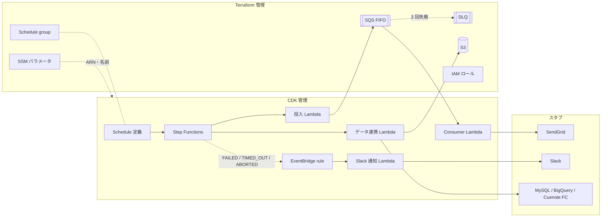

# アーキテクチャ仕様書

システム構成・技術スタック・インフラ・セットアップ手順を定義する。再現対象の構成は [元資料](references/aws-batch-architecture.md)、目的とスコープは [01 要求仕様書](01-business-requirements.md) を参照。

## 目次

- [技術スタック](#技術スタック)
- [構成方針](#構成方針)
- [システム構成図](#システム構成図)
- [環境変数](#環境変数)
- [ローカル開発セットアップ](#ローカル開発セットアップ)
- [デプロイ](#デプロイ)
- [将来構成](#将来構成)

## 技術スタック

| レイヤー | 技術 |
|----------|------|
| Lambda | TypeScript / Node.js 22.x ランタイム / AWS SDK for JavaScript v3 |
| ビルド | esbuild（CDK の `NodejsFunction` 経由） |
| テスト | Vitest |
| IaC（土台） | Terraform 1.14 系 / AWS Provider |
| IaC（アプリ） | AWS CDK v2（TypeScript） |
| Terraform → CDK の受け渡し | SSM Parameter Store |
| ローカル実行 | LocalStack（Docker）+ `tflocal` / `cdklocal` |
| 実 AWS | 個人の検証用アカウント（ステージ名 `dev`） |
| CI | GitHub Actions（markdownlint / shellcheck / 秘匿ファイル検出 / 型検査・テスト） |
| パッケージ管理 | npm（リポジトリ直下に 1 つ） |

## 構成方針

### ディレクトリ構成

```text
.
├── functions/            # Lambda 本体（handler とスタブ）
│   ├── src/
│   │   ├── handlers/     # enqueue / consumer / data-sync / notify-slack
│   │   └── stubs/        # 外部サービスのスタブ
│   └── test/
├── infra/
│   ├── terraform/        # 土台（IAM・SQS・S3・Schedule group・SSM 出力）
│   │   └── envs/         # local.tfvars / dev.tfvars（秘匿値は置かない）
│   └── cdk/              # アプリ（Lambda・Step Functions・Schedule・EventBridge rule）
└── scripts/              # 検査・デプロイ補助スクリプト
```

元資料では Terraform と CDK が別リポジトリだが、デモでは 1 リポジトリ内の 2 ディレクトリで代替する。「変更が 2 か所にまたがる」構造はそのまま残る。

### IaC の責務分担

| リソース | 管理 | 備考 |
|---|---|---|
| IAM ロール（Lambda 4 種・Step Functions・Scheduler） | Terraform | CDK からは `mutable: false` で参照し、ポリシーを足させない |
| SQS FIFO + DLQ | Terraform | `maxReceiveCount: 3`。可視性タイムアウトは Consumer のタイムアウトの 6 倍 |
| S3 バケット（データ連携の出力先） | Terraform | 元資料の表に無いが、状態を持つ土台として Terraform に置く |
| Schedule group | Terraform | |
| SSM パラメータ | Terraform | 上記の ARN・名前・URL を `/serverless-practice-app/<stage>/...` に書き出す |
| Lambda 4 種 | CDK | |
| Step Functions | CDK | |
| Schedule 定義 | CDK | Terraform の Schedule group を名前で参照 |
| EventBridge rule（失敗通知） | CDK | 通知先 Lambda と同じスタックに置く |

**名前の先決め**: IAM ポリシーは Terraform が先に作るため、CDK が後から作るリソースの ARN を知らない。関数名・ステートマシン名を `serverless-practice-app-<stage>-<name>` の命名規約で固定し、Terraform 側はこの接頭辞のワイルドカードで権限を付ける。

**連動するパラメータ**: SQS の可視性タイムアウト（Terraform）と Consumer Lambda のタイムアウト（CDK）は連動する。片方を変えるときはもう片方も確認する。

### 外部サービスのスタブ

外部への接続は `functions/src/stubs/` のスタブに置き換える。実在の宛先へは何も送らない。

| 接続先 | スタブの振る舞い |
|---|---|
| SendGrid | 送信内容を構造化ログに出す |
| Slack | 通知内容を構造化ログに出す |
| MySQL | 固定の配信対象データを返す |
| BigQuery / Cuenote FC | 書き込み内容を構造化ログに出す |
| S3 | スタブにせず、Terraform が作ったバケットへ実際に書く |

handler はスタブを直接 import せず、インターフェース経由で受け取る。失敗の流れ（① 失敗通知・DLQ 行き）を試せるよう、Step Functions の実行入力で失敗を注入できるようにする（例: `{"failAt": "dataSync"}`）。

### Step Functions の流れ

`Enqueue（投入）→ DataSync（データ連携）` を順に実行する。Lambda タスクには一時的なエラー（`Lambda.ServiceException` 等）のみ `Retry` を付ける。Consumer は SQS イベントソースで起動し、Step Functions の外で動く（元資料の「コレオグラフィ」部分）。

## システム構成図



## 環境変数

秘匿値は扱わない（外部サービスはすべてスタブのため）。Lambda の環境変数は CDK が SSM の値から設定する。

| 変数 | 用途 | 参照箇所 |
|------|------|----------|
| `STAGE` | ステージ名（`local` / `dev`） | 全 Lambda |
| `QUEUE_URL` | メール送信キューの URL | 投入 Lambda |
| `BUCKET_NAME` | データ連携の出力先バケット | データ連携 Lambda |

LocalStack 上の Lambda から AWS API を呼ぶときのエンドポイントは、LocalStack が注入する設定に任せる。コード側でエンドポイントを分岐しない。

## ローカル開発セットアップ

### 前提ツール

| ツール | 用途 | 導入 |
|---|---|---|
| Docker | LocalStack の実行 | 導入済み前提 |
| Node.js 22 以上 | Lambda のビルド・CDK | 導入済み前提 |
| Terraform 1.14 系 | 土台の構築 | 導入済み前提 |
| AWS CLI v2 | 実行の起動・確認 | `brew install awscli` |
| `tflocal` | Terraform を LocalStack へ向ける | `pipx install terraform-local` |
| `cdklocal` / `cdk` | CDK を LocalStack へ向ける | npm の devDependencies で導入 |

### 手順（ステージ `local`）

1. LocalStack を起動する（`docker compose up -d`）
2. 依存を入れる（`npm ci`）
3. 土台を作る（`infra/terraform` で `tflocal init` → `tflocal apply -var-file=envs/local.tfvars`）
4. アプリを作る（`cdklocal bootstrap` → `cdklocal deploy -c stage=local`）
5. Step Functions の実行を手動で起動し、各 Lambda のログを確認する

コマンドの正本は実装時に `scripts/` と README に置く。

## デプロイ

### 順序

Terraform → CDK の順にデプロイし、削除はその逆（CDK → Terraform）で行う。逆にすると、CDK のスタックが参照中のロールやキューが先に消える。

### ステージ

| ステージ | デプロイ先 | 方法 |
|---|---|---|
| `local` | LocalStack | 手元から `tflocal` / `cdklocal` |
| `dev` | 実 AWS（検証用アカウント） | 手元から `terraform` / `cdk`（AWS プロファイルで認証） |

CI からのデプロイは行わない（デモのため手動で十分）。Terraform の state はローカルに置き、ステージごとに workspace を分ける。

### 費用

常時課金のリソースは作らない。

- **VPC・NAT Gateway は作らない**: 外部接続はすべてスタブなので、Lambda から外部へ出る経路が要らない。NAT Gateway は時間課金のため、置くとデモを止めている間も費用がかかる
- 残りは従量課金（Lambda・SQS・Step Functions・S3・SSM）で、デモの実行量なら無料枠に収まる見込み
- 試し終えたら CDK → Terraform の順に削除する

### LocalStack で要検証の点

次の 2 点は、LocalStack で本物と同じように動くかを実装時に確認する。動かない場合は、手動起動や直接呼び出しで代替し、本物どおりの確認は `dev` ステージで行う。

- EventBridge Scheduler がターゲットを定時に起動するか
- Step Functions の状態変化イベントが EventBridge rule に届くか

## 将来構成

元資料の構成のうち、デモでは省いたもの。必要になったら追加する。

- VPC / Security Group / NAT Gateway（実在の外部 SaaS へ接続する場合に必要）
- 元資料「改善提案の候補」: DLQ アラーム、決定的な `MessageDeduplicationId`、Consumer の冪等化、`waitForTaskToken`
- Terraform の state のリモート管理（S3 バックエンド）
