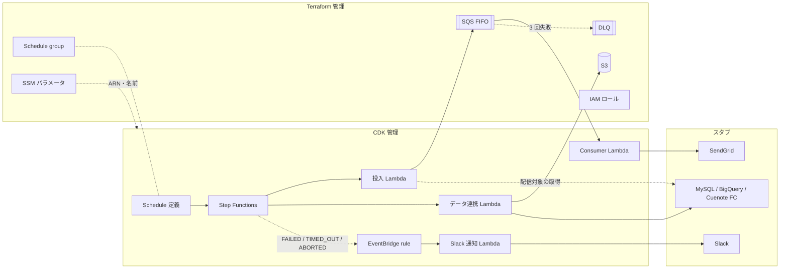

# アーキテクチャ仕様書

システム構成・技術スタック・インフラ・セットアップ手順を定義する。再現対象の構成は [元資料](references/aws-batch-architecture.md)、目的とスコープは [01 要求仕様書](01-business-requirements.md) を参照。

## 目次

- [技術スタック](#技術スタック)
- [構成方針](#構成方針)
- [システム構成図](#システム構成図)
- [環境変数](#環境変数)
- [ローカル開発セットアップ](#ローカル開発セットアップ)
- [デプロイ](#デプロイ)
- [将来構成](#将来構成)

## 技術スタック

| レイヤー | 技術 |
|----------|------|
| Lambda | TypeScript / Node.js 22.x ランタイム / AWS SDK for JavaScript v3 |
| ビルド | esbuild（CDK の `NodejsFunction` 経由） |
| テスト | Vitest |
| IaC（土台） | Terraform 1.14 系 / AWS Provider |
| IaC（アプリ） | AWS CDK v2（TypeScript）。アプリは `tsx` で実行し、ステージは `-c stage=<ステージ名>`（`local` または `dev`）で渡す。機能フラグは推奨値を `cdk.json` に記録 |
| Terraform → CDK の受け渡し | SSM Parameter Store |
| ローカル実行 | LocalStack（Docker）+ `tflocal` / `cdklocal` |
| 実 AWS | 個人の検証用アカウント（ステージ名 `dev`） |
| CI | GitHub Actions（markdownlint / shellcheck / 秘匿ファイル検出 / 型検査・テスト / Terraform の整形・構文 / LocalStack での IT） |
| パッケージ管理 | npm（リポジトリ直下に 1 つ） |

## 構成方針

### ディレクトリ構成

```text
.
├── functions/            # Lambda 本体（handler とスタブ）
│   ├── src/
│   │   ├── handlers/     # enqueue / consumer / data-sync / notify-slack
│   │   ├── stubs/        # 外部サービスのスタブ
│   │   ├── schemas/      # 入力の Zod スキーマ（型は z.infer で導出）
│   │   ├── errors/       # エラークラス（name が Step Functions との契約）
│   │   ├── types/        # 複数ファイルで使う型と、スタブが実装する口（interface）
│   │   └── lib/          # 入力検証・構造化ロガーなどの共通処理
│   └── test/
├── infra/
│   ├── terraform/        # 土台（IAM・SQS・S3・Schedule group・SSM 出力）
│   │   └── envs/         # <stage>.tfvars（変数）/ <stage>.s3.tfbackend（state のキー）。秘匿値は置かない
│   └── cdk/              # アプリ（Lambda・Step Functions・Schedule・EventBridge rule）。bin/（入口）・lib/（スタック）・test/
├── scripts/              # 検査・デプロイ補助スクリプト
└── test/                 # リポジトリ全体に対するテスト（Lint 設定の回帰テスト等）と IT（test/it/）
```

元資料では Terraform と CDK が別リポジトリだが、デモでは 1 リポジトリ内の 2 ディレクトリで代替する。「変更が 2 か所にまたがる」構造はそのまま残る。

### IaC の責務分担

| リソース | 管理 | 備考 |
|---|---|---|
| IAM ロール（Lambda 4 種・Step Functions・Scheduler） | Terraform | CDK からは `mutable: false` で参照し、ポリシーを足させない |
| SQS FIFO + DLQ | Terraform | `maxReceiveCount: 3`。可視性タイムアウトは Consumer のタイムアウトの 6 倍 |
| S3 バケット（データ連携の出力先） | Terraform | 元資料の表に無いが、状態を持つ土台として Terraform に置く |
| Schedule group | Terraform | |
| SSM パラメータ | Terraform | 上記の ARN・名前・URL を `/serverless-practice-app/<stage>/...` に書き出す |
| Lambda 4 種 | CDK | |
| Step Functions | CDK | |
| Schedule 定義 | CDK | Terraform の Schedule group を名前で参照 |
| EventBridge rule（失敗通知） | CDK | 通知先 Lambda と同じスタックに置く |

**名前の先決め**: IAM ポリシーは Terraform が先に作るため、CDK が後から作るリソースの ARN を知らない。関数名・ステートマシン名を `serverless-practice-app-<stage>-<name>` の命名規約で固定し、Terraform 側はこの接頭辞のワイルドカードで権限を付ける。

**連動するパラメータ**: SQS の可視性タイムアウト（Terraform）と Consumer Lambda のタイムアウト（CDK）は連動する。Consumer のタイムアウトの正本は Terraform に置き、SSM 経由で CDK に渡す（04「連動するパラメータ」）。

### 外部サービスのスタブ

外部への接続は `functions/src/stubs/` のスタブに置き換える。実在の宛先へは何も送らない。

| 接続先 | スタブの振る舞い |
|---|---|
| SendGrid | 送信内容を構造化ログに出す |
| Slack | 通知内容を構造化ログに出す |
| MySQL | 固定の配信対象データを返す |
| BigQuery / Cuenote FC | 書き込み内容を構造化ログに出す |
| S3 | スタブにせず、Terraform が作ったバケットへ実際に書く |

handler はスタブを直接 import せず、インターフェース経由で受け取る。

| インターフェース（`functions/src/types/`） | 役割 | 実装するスタブ |
|---|---|---|
| `RecipientRepository` | 配信対象を取得する | `MySqlStub` |
| `MailSender` | メールを 1 通送る | `SendGridStub` |
| `FailureNotifier` | 実行の失敗を知らせる | `SlackStub` |
| `ExportWriter` | 配信対象の全件を書き出す | `BigQueryStub` / `CuenoteFcStub` |

BigQuery と Cuenote FC は、データ連携 Lambda から見た振る舞い（全件を書く）が同じため、1 つのインターフェースにまとめる。失敗の流れ（① 失敗通知・DLQ 行き）を試せるよう、Step Functions の実行入力で失敗を注入できるようにする（例: `{"failAt": "dataSync"}`）。

### Step Functions の流れ

`Enqueue（投入）→ DataSync（データ連携）` を順に実行する。Lambda タスクには一時的なエラー（`Lambda.ServiceException` 等）のみ `Retry` を付ける。Consumer は SQS イベントソースで起動し、Step Functions の外で動く（元資料の「コレオグラフィ」部分）。

## システム構成図



## 環境変数

Lambda の環境変数に秘匿値は無い（外部サービスはすべてスタブのため）。Lambda の環境変数は CDK が SSM の値から設定する。

| 変数 | 用途 | 参照箇所 |
|------|------|----------|
| `STAGE` | ステージ名（`local` / `dev`） | 全 Lambda |
| `QUEUE_URL` | メール送信キューの URL | 投入 Lambda |
| `BUCKET_NAME` | データ連携の出力先バケット | データ連携 Lambda |

LocalStack 上の Lambda から AWS API を呼ぶときのエンドポイントは、LocalStack が注入する設定に任せる。コード側でエンドポイントを分岐しない。

手元（開発機）で使う環境変数は次のとおりで、`.env`（Git 管理外）に置く。雛形は `.env.example`。

| 変数 | 用途 | 参照箇所 |
|------|------|----------|
| `LOCALSTACK_AUTH_TOKEN` | LocalStack の起動に要る認証トークン（下記「LocalStack の認証」）。CI ではリポジトリのシークレットから渡す | `docker-compose.yml` |
| `LAMBDA_IGNORE_ARCHITECTURE` | 任意。`1` なら Lambda の `ARM_64` 指定を無視してホストのアーキテクチャで動かす。x86 のホスト（CI のランナー・Intel の Mac）用で、既定は `0`。Lambda は JS だけでネイティブモジュールを含まないため、動作は変わらない | `docker-compose.yml` |

## ローカル開発セットアップ

### 前提ツール

| ツール | 用途 | 導入 |
|---|---|---|
| Docker | LocalStack の実行 | 導入済み前提 |
| LocalStack アカウント | 認証トークンの取得 | 無料の Hobby プランを作成（下記「LocalStack の認証」） |
| Python 3 | 起動スクリプトのヘルスチェック判定 | macOS 標準 |
| Node.js 22 以上 | Lambda のビルド・CDK | 導入済み前提 |
| Terraform 1.14 系 | 土台の構築 | 導入済み前提 |
| AWS CLI v2 | 実行の起動・確認 | `brew install awscli` |
| `tflocal` | Terraform を LocalStack へ向ける | `brew install pipx` → `PIPX_HOME=~/.local/pipx pipx install terraform-local`（`PIPX_HOME` を付けないと、macOS では空白を含むパスに入り起動できない） |
| `cdklocal` / `cdk` | CDK を LocalStack へ向ける | npm の devDependencies で導入 |

### 手順（ステージ `local`）

1. `.env.example` を `.env` にコピーし、`LOCALSTACK_AUTH_TOKEN` を入れる
2. LocalStack を起動する（`./scripts/localstack.sh up`。使うサービスがすべて使える状態になるまで待つ）
3. 依存を入れる（`npm ci`）
4. 土台とアプリを作る（`./scripts/stack.sh local up`。Terraform → CDK の順に作る）
5. 実行を起動して結果を見る（`./scripts/batch.sh local run [failAt]` → 表示された実行名で `./scripts/batch.sh local logs <実行名>`）。受け入れ条件をまとめて確かめるなら `npm run test:it`
6. 消す（`./scripts/stack.sh local down`。CDK → Terraform の順に消す）

コマンドの正本は `scripts/` に置き、README からはスクリプトを呼ぶだけにする。Terraform・CDK を個別に操作するときは `scripts/terraform.sh` / `scripts/cdk.sh` を使う。

### LocalStack の認証

2026-03-23 以降の LocalStack は、起動に LocalStack アカウントの認証トークンが要る（コミュニティ版のイメージは廃止された）。本デモは無料の **Hobby プラン**（非商用）を使う。使う 9 サービス（Lambda / SQS / S3 / Step Functions / EventBridge / EventBridge Scheduler / SSM / IAM / CloudWatch Logs）はすべて含まれる。

- トークンの要らない最後の版（`4.14.0`、2026-02 で更新停止）に固定する案もあったが、保守されない版では本物の AWS との挙動のずれが広がるため採らなかった
- トークンは秘匿値として扱う（06「データ保護」）
- イメージのタグは `docker-compose.yml` を正本とする

## デプロイ

### 順序

Terraform → CDK の順にデプロイし、削除はその逆（CDK → Terraform）で行う。逆にすると、CDK のスタックが参照中のロールやキューが先に消える。

### ステージ

| ステージ | デプロイ先 | 方法 |
|---|---|---|
| `local` | LocalStack | 手元から `tflocal` / `cdklocal` |
| `dev` | 実 AWS（検証用アカウント） | 手元から `terraform` / `cdk`（AWS プロファイルで認証） |

CI からのデプロイは行わない（デモのため手動で十分）。

### Terraform の state

backend は `s3` の 1 種類に統一し、置き場所をステージで分ける。運用ルールの正本は [`.claude/rules/iac.md`](../.claude/rules/iac.md)。

| ステージ | state の置き場所 | 理由 |
|---|---|---|
| `dev` | 実 AWS の共有バケット `kojikawazu-tfstate`、キー `serverless-practice-app/dev/terraform.tfstate` | 手元の state を失うと実 AWS のリソースを見失うため |
| `local` | LocalStack 内の S3（`tflocal` が backend の向き先を LocalStack へ差し替える） | LocalStack の再起動でリソースごと消えるため、state も同じ寿命の使い捨てでよい |

- state バケットは Terraform で管理しない（自分の state を置くバケットを自分で作れないため）。冪等なスクリプトで作成し、バージョニング有効・公開アクセス禁止にする。スクリプトは実装時に `scripts/` へ置く
- ロックは S3 のネイティブロック（`use_lockfile = true`）を使い、DynamoDB テーブルは作らない
- `envs/*.tfvars` は秘匿値を置かない前提でコミットする。秘匿値が必要になったら `*.secret.tfvars`（Git 管理外）に分ける
- backend の共通部分（バケット・リージョン・`use_lockfile`）は `infra/terraform/versions.tf`、ステージで変わる `key` は `envs/<stage>.s3.tfbackend` に置き、`init` で渡す（`scripts/terraform.sh`）
- `tflocal` は backend の接続先を LocalStack に差し替え、state のバケットを LocalStack 内に自動で作る（2026-10-08 に確認。`serverless-practice-app/local/terraform.tfstate` に保存された）。差し替えのために作業ディレクトリへ書き出す `localstack_providers_override.tf` は Git 管理外にしている

### 費用

常時課金のリソースは作らない。

- **VPC・NAT Gateway は作らない**: 外部接続はすべてスタブなので、Lambda から外部へ出る経路が要らない。NAT Gateway は時間課金のため、置くとデモを止めている間も費用がかかる
- 残りは従量課金（Lambda・SQS・Step Functions・S3・SSM）で、デモの実行量なら無料枠に収まる見込み
- 試し終えたら CDK → Terraform の順に削除する

### LocalStack での検証結果

本物と同じように動くかが分からなかった 2 点を、LocalStack 2026.09.1 で確かめた（2026-10-11。#22）。**LocalStack で動いたことは本物で動くことの証明にはならない**ため、どちらも最後に `dev` で確認する（02「受け入れ条件」）。

| 点 | 結果 | `local` での扱い |
|---|---|---|
| EventBridge Scheduler がターゲットを定時に起動するか | **起動しない。** `at()` / `rate()` / `cron()`（タイムゾーン指定あり）の Schedule を、デプロイ済みと同じターゲット・ロールで作り 3 分以上待ったが、実行は 0 件で、LocalStack のログにも起動を試みた形跡が無かった。公式ドキュメントにも「モックのみで、スケジュールの実行・ターゲットの起動は再現しない」とある。作成・取得などの API は動くため、デプロイは通る | 実行は `scripts/batch.sh local run` で手動で起動する（Scheduler と同じ `StartExecution` を、入力 `{}` で呼ぶ）。定時の起動は `dev` で確かめる |
| Step Functions の状態変化イベントが EventBridge rule に届くか | **届く。** `FAILED` と `ABORTED` は rule を経て Slack 通知 Lambda まで届き、`SUCCEEDED` は rule の条件で除外される（いずれも IT で確認。08 #21・#22・#25〜#27）。`TIMED_OUT` は発生させるのに 5 分かかるため未確認（rule の条件は同じ。出力の形は UT #16 で確認） | IT で確かめる。イベントの日時の項目が本物と違う形（文字列）で届くため、通知 Lambda は日時の項目を検証しない（07「状態変化イベント」・#30） |

## 将来構成

元資料の構成のうち、デモでは省いたもの。必要になったら追加する。

- VPC / Security Group / NAT Gateway（実在の外部 SaaS へ接続する場合に必要）
- 元資料「改善提案の候補」: DLQ アラーム、決定的な `MessageDeduplicationId`、Consumer の冪等化、`waitForTaskToken`
