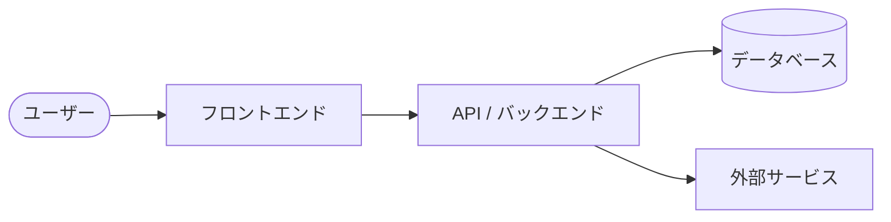

# アーキテクチャ仕様書

システム構成・技術スタック・インフラ・セットアップ手順を定義する。

## 目次

- [技術スタック](#技術スタック)
- [構成方針](#構成方針)
- [システム構成図](#システム構成図)
- [環境変数](#環境変数)
- [ローカル開発セットアップ](#ローカル開発セットアップ)
- [デプロイ](#デプロイ)
- [将来構成](#将来構成)

## 技術スタック

<!-- 記入: レイヤーごとの採用技術（フレームワーク / 認証 / DB / CI / デプロイ など） -->

| レイヤー | 技術 |
|----------|------|
|  |  |

## 構成方針

<!-- 記入: ディレクトリ構成・データの持ち方・モジュール分割の方針 -->

## システム構成図

<!-- 記入: 主要コンポーネントと依存関係を Mermaid の flowchart で記述する。
     レイヤーや外部サービスは subgraph でグルーピングすると見やすい -->

## 環境変数

<!-- 記入: アプリが参照する環境変数と用途。秘匿情報はクライアントへ露出しない方針を明記 -->

| 変数 | 用途 | 参照箇所 |
|------|------|----------|
|  |  |  |

## ローカル開発セットアップ

<!-- 記入: 新規参画者が手元で動かすまでの一本道（前提ツール → env → 依存 → 起動 → テスト） -->

## デプロイ

<!-- 記入: デプロイ先・トリガー（ブランチ）・ビルド手順。CI/CD のフローは図にしても良い -->

## 将来構成

<!-- 記入: 将来の構成変更・移行計画があれば -->
