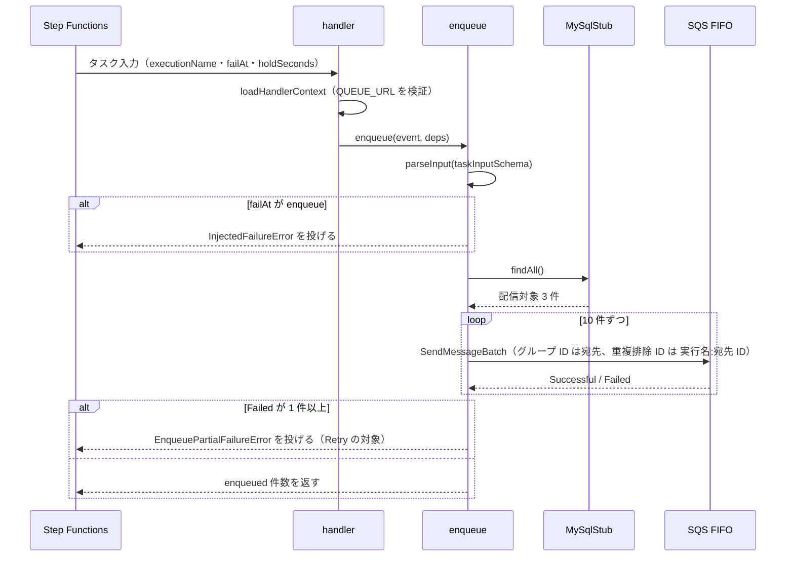
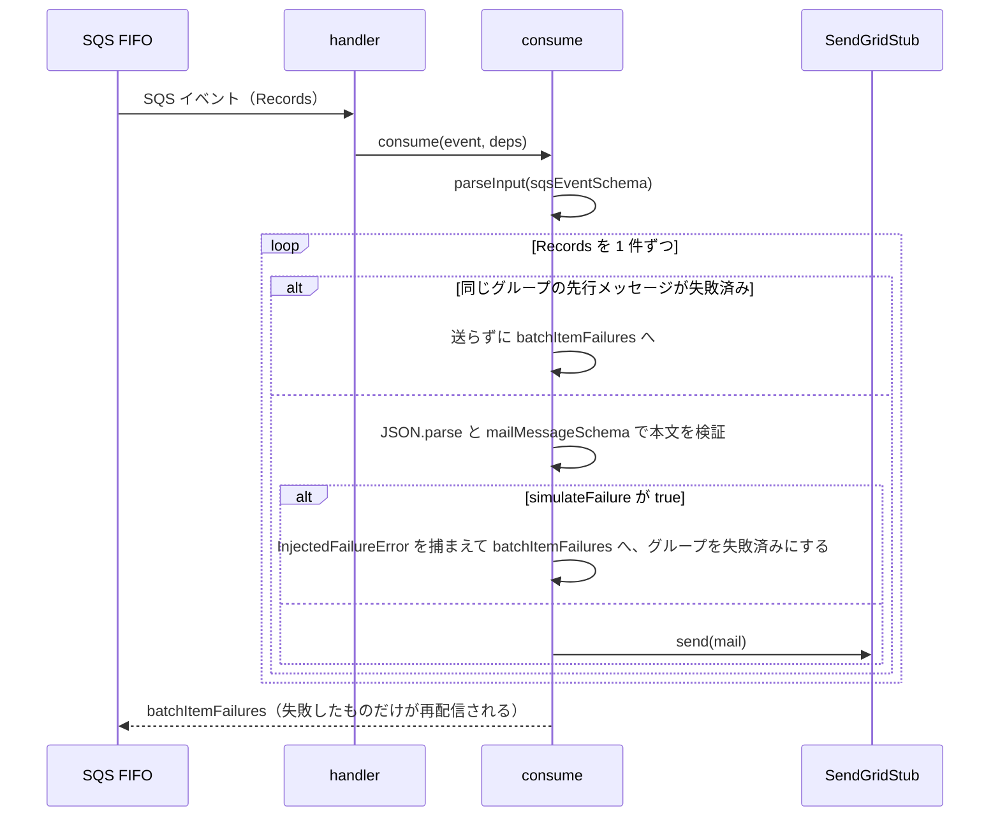
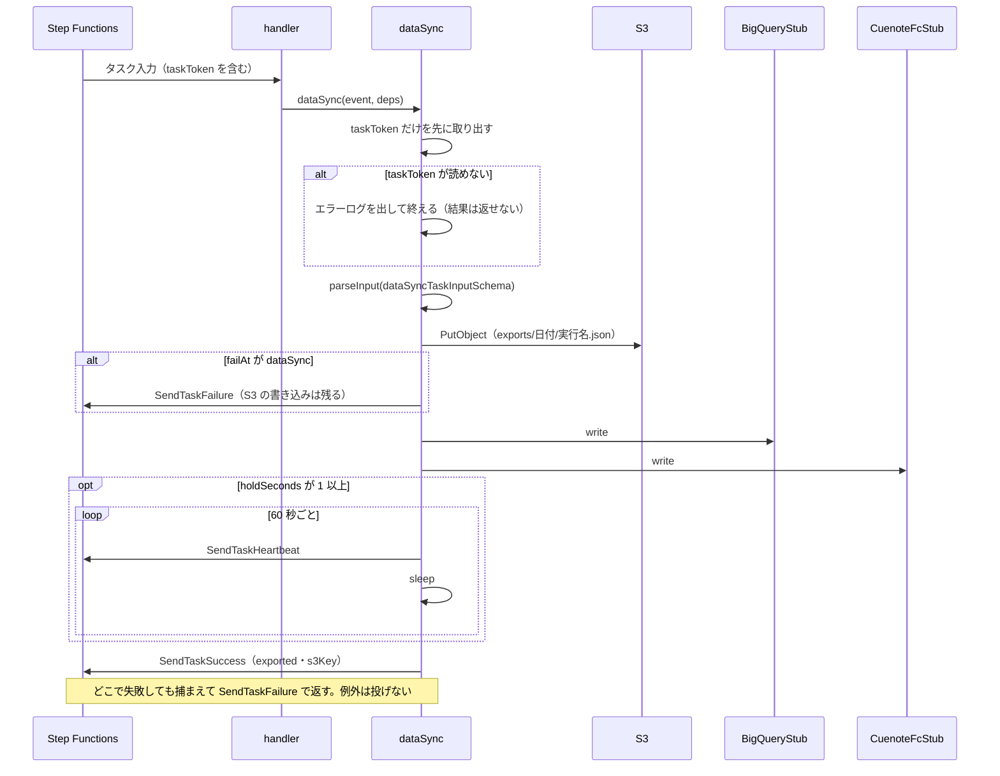
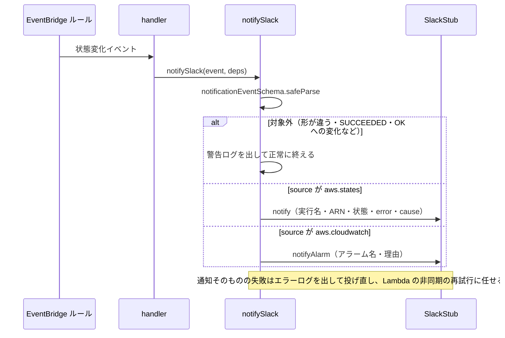

# 処理フロー

4 つの Lambda について、処理の流れと呼び出し連鎖を示す。**失敗の返し方が Lambda ごとに違う**のが読みどころで、どれも呼ばれ方（同期・非同期・SQS）に合わせている。

| Lambda | 失敗の返し方 |
|---|---|
| 投入 | 例外を投げる。Step Functions の `Retry` がエラー名で判定する |
| Consumer | 失敗したメッセージだけを部分バッチ応答で返す。投げるのはイベント全体の形が不正なときだけ |
| データ連携 | **投げない。** `SendTaskFailure` で返す |
| Slack 通知 | 対象外のイベントは正常に終える。通知そのものの失敗だけを投げ直す |

## 投入（enqueue）

Step Functions から同期で呼ばれ、配信対象ごとのメールメッセージを SQS FIFO へ積む。

### ステップ詳細

1. `functions/src/handlers/enqueue.ts:155` — 環境変数（`STAGE`・`QUEUE_URL`）を検証し、ロガーを作る。不正なら `ValidationError` を投げる
2. `functions/src/handlers/enqueue.ts:76` — タスク入力を `taskInputSchema`（未知のキーを拒否）で検証する。検証に通ったら、以降のログに `executionName` を付ける（`:77`）
3. `functions/src/handlers/enqueue.ts:101` — `failAt` が `enqueue` なら、キューへ何も積まずに失敗する
4. `functions/src/handlers/enqueue.ts:106` — 配信対象ごとにメッセージを作る。`failAt` が `consumer` なら `simulateFailure: true` を本文に入れ、Consumer 側で失敗させる
5. `functions/src/handlers/enqueue.ts:125` — 10 件（`SendMessageBatch` の上限）ずつ送る。**一部が失敗しても残りのバッチは送り切り**、最後にまとめて `EnqueuePartialFailureError` を投げる（`:134`）
6. `functions/src/handlers/enqueue.ts:79` — どこで失敗しても、エラーログを 1 行出してから投げ直す

重複排除 ID が `<実行名>:<配信対象 ID>` で決まっているため、`Retry` で同じ実行が再投入されても、5 分以内なら FIFO が重複を除く（03「[投入 Lambda](../../03-functional-specification.md#投入-lambdaenqueue)」）。

## Consumer（consume）

SQS のイベントソースマッピングから、メッセージのバッチを受け取る。

### ステップ詳細

1. `functions/src/handlers/consumer.ts:69` — イベント全体を検証する。ここで失敗したときだけ例外を投げ、バッチ全体が再配信される
2. `functions/src/handlers/consumer.ts:74` — レコードのメッセージグループ ID が、既に失敗したグループなら送らずに失敗として返す。送ると、再配信された前のメッセージが後から届き、グループ内の順序が逆転するため
3. `functions/src/handlers/consumer.ts:37` — 本文を `JSON.parse` してから `mailMessageSchema` で検証する。JSON として読めない（`SyntaxError`）・形が違う（`ValidationError`）・注入された失敗（`InjectedFailureError`）は、どれも `:86` で捕まえて、そのメッセージだけを失敗にする
4. `functions/src/handlers/consumer.ts:45` — 送信内容（`OutgoingMail`）に詰め替えて SendGrid スタブへ渡す。`simulateFailure` などキュー側の項目は渡さない

失敗したメッセージは受信 3 回で DLQ へ移り、Step Functions の実行の成否には影響しない（[SQS FIFO 解説](../../guides/sqs-fifo.md#consumer-の失敗は実行の成否に乗らない)）。

## データ連携（dataSync）

Step Functions から `.waitForTaskToken` で**非同期に**呼ばれる。戻り値も例外も Step Functions には届かないため、結果は必ずタスクトークンで返す。

### ステップ詳細

1. `functions/src/handlers/data-sync.ts:105` — `taskTokenHolderSchema`（`taskToken` だけを見るスキーマ）で、まず結果の返し先を取り出す。ほかの項目が不正でも、その失敗を返せるようにするため
2. `functions/src/handlers/data-sync.ts:110` — トークン自体が読めなければ結果を返せない。エラーログを出して正常に終え、ステートマシン側のハートビートのタイムアウトに任せる
3. `functions/src/handlers/data-sync.ts:151` — S3 のキーは `exports/<UTC の日付>/<実行名>.json`。同じ実行を再実行すると同じキーに上書きされる
4. `functions/src/handlers/data-sync.ts:162` — `failAt` が `dataSync` なら、**S3 へ書いた後・BigQuery へ書く前**に失敗する。前段の書き込みは残る（元資料のリスク 4。補償処理は持たない）
5. `functions/src/handlers/data-sync.ts:186` — `holdSeconds` の間、60 秒ごとにハートビートを送ってから待つ。LMI で 15 分を超える実行を再現するための注入（09「[15 分を超える実行の再現](../../09-architecture-specification.md#15-分を超える実行の再現)」）
6. `functions/src/handlers/data-sync.ts:126` — どこで失敗しても捕まえ、`reportFailure`（`:215`）で `SendTaskFailure` を送る。エラー名は Lambda が投げたときと同じ `error.name` にし、`Retry` の判定がそろうようにしている。`SendTaskFailure` 自体に失敗したら、ログを出すだけにする

**例外を投げない理由**: 非同期の呼び出しで投げた例外を受け取るのは Lambda の非同期の再試行だけで、同じタスクトークンで処理が二重に走る。そのため非同期の再試行は 0 にし、やり直しは Step Functions の `Retry` に任せている（[Lambda 解説](../../guides/lambda.md#失敗したときに誰がやり直すか)）。例外が出うるのは、`handler` が環境変数の検証に失敗したとき（`:258`）だけ。

## Slack 通知（notifySlack）

EventBridge のルールから非同期で呼ばれる。届くイベントは 2 種類で、`source` で見分ける。

### ステップ詳細

1. `functions/src/handlers/notify-slack.ts:38` — `parseInput` ではなく `safeParse` を直接使う。対象外のイベントを `ValidationError` にせず、警告ログで済ませるため。投げても同じイベントを再試行で受け直すだけで、結果は変わらない
2. `functions/src/handlers/notify-slack.ts:46` — `source` で分ける。判別 union（`notificationEventSchema`）を通った後なので、分岐の中では型が絞り込まれている
3. `functions/src/handlers/notify-slack.ts:73` — `error` / `cause` は、項目が無い場合も `null` にそろえる。`TIMED_OUT` / `ABORTED` では値が無いことがある（07「[状態変化イベント](../../07-api-specification.md#状態変化イベントeventbridge--slack-通知-lambda)」）
4. `functions/src/handlers/notify-slack.ts:76` / `:101` — 通知の失敗はエラーログを出してから投げ直す
