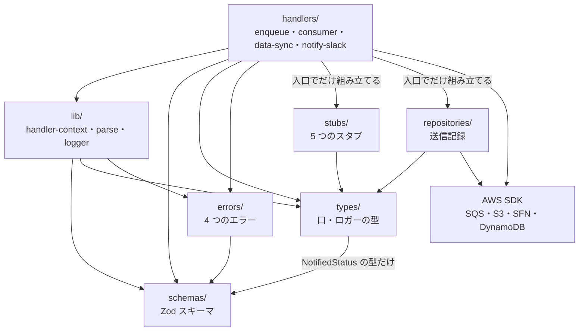

# 主要モジュール・責務

## モジュール一覧

| モジュール / ディレクトリ | 場所 | 責務 |
|---|---|---|
| handlers | `functions/src/handlers/` | Lambda の入口（`handler`）と処理の本体。1 ファイル = 1 Lambda |
| lib | `functions/src/lib/` | 全 handler が使う道具。入力の検証（`parse`）・ロガー（`logger`）・入口の初期化（`handler-context`）・メールのキー（`message-key`） |
| schemas | `functions/src/schemas/` | Zod スキーマ。外部から来る値（環境変数・タスク入力・SQS イベント・メッセージ本文・状態変化イベント）の形を定め、型を導出する |
| types | `functions/src/types/` | 検証を伴わない型。外部サービスの「口」（インターフェース）とロガーの型 |
| repositories | `functions/src/repositories/` | スタブではない実物の AWS サービスを読み書きする口の実装。いまは送信記録（DynamoDB）だけ（#136） |
| errors | `functions/src/errors/` | 意図して投げるエラーのクラス。エラー名は Step Functions との契約 |
| stubs | `functions/src/stubs/` | 外部サービスの代わり。`types/` の口を実装し、構造化ログに出すだけ |

`schemas/` と `types/` の分け方は `typescript.md` の「スキーマの配置」「型定義の配置」に従っている。実行時に `parse` するものだけが `schemas/` にあり、そこから導出した型は `types/` に書き直さない。

## 主要なクラス / 関数

### handlers

| 名前 | 場所 | 役割 |
|---|---|---|
| `enqueue` | `functions/src/handlers/enqueue.ts:87` | 投入の本体。検証 → `sendMessages`（`:112`）で 10 件ずつ送る |
| `consume` | `functions/src/handlers/consumer.ts:121` | Consumer の本体。1 件ずつ `processRecord`（`:45`）を呼び、失敗をグループ単位で伝える。`processRecord` が送信記録で送り直しを防ぐ |
| `dataSync` | `functions/src/handlers/data-sync.ts:97` | データ連携の本体。`exportRecipients`（`:141`）→ `hold`（`:186`）→ `SendTaskSuccess`。失敗は `reportFailure`（`:215`） |
| `notifySlack` | `functions/src/handlers/notify-slack.ts:34` | Slack 通知の本体。`notifyExecutionFailure`（`:61`）と `notifyAlarm`（`:90`）に分ける |
| `EnqueueDeps` などの `*Deps` | 各 handler の先頭 | 本体が受け取る依存の型。テストはこの形で偽物・本物を渡す |

### lib

| 名前 | 場所 | 役割 |
|---|---|---|
| `loadHandlerContext` | `functions/src/lib/handler-context.ts:32` | 環境変数をスキーマで検証し、`function` / `stage` を共通項目に持つロガーを作る。全 handler の入口で最初に呼ぶ 1 か所 |
| `parseInput` | `functions/src/lib/parse.ts:14` | `safeParse` の失敗を `ValidationError` に変える。メッセージの先頭に入力の名前（`タスク入力` など）を付ける |
| `messageKeyOf` | `functions/src/lib/message-key.ts:10` | メールのキー `<実行名>:<配信対象 ID>` を作る。投入の重複排除 ID と Consumer の送信記録のキーが、この 1 か所から同じ値になる |
| `createLogger` | `functions/src/lib/logger.ts:59` | 1 行 1 JSON のロガー。`child` で共通項目を足したロガーを作る。出力先（`LogSink`）は差し替えられ、テストは配列に溜める |

### schemas（主なもの）

| 名前 | 場所 | 役割 |
|---|---|---|
| `baseEnvSchema` / `enqueueEnvSchema` / `consumerEnvSchema` / `dataSyncEnvSchema` | `functions/src/schemas/env.ts:6` / `:17` / `:29` / `:40` | 環境変数。`QUEUE_URL` はスキームを http / https に限る。`SEND_RECORDS_TABLE` は DynamoDB のテーブル名の規則に限る |
| `taskInputSchema` / `dataSyncTaskInputSchema` | `functions/src/schemas/execution.ts:48` / `:70` | Step Functions から渡るタスク入力。未知のキーを拒否する（`strictObject`） |
| `mailMessageSchema` | `functions/src/schemas/mail-message.ts:28` | SQS に積むメールメッセージの本文。宛先は `@example.com` に限る。`simulateFailure` は `simulateFailureSchema`（`:12`）の 3 値 |
| `sqsEventSchema` | `functions/src/schemas/sqs-event.ts:8` | Consumer が受け取る SQS イベントのうち、使う項目だけ |
| `notificationEventSchema` | `functions/src/schemas/notification-event.ts:9` | `source` で見分ける判別 union。`executionStatusEventSchema`（`execution-status-event.ts:26`）と `alarmStateChangeEventSchema`（`alarm-state-change-event.ts:13`） |

### types・errors・stubs

| 名前 | 場所 | 役割 |
|---|---|---|
| `RecipientRepository` | `functions/src/types/recipient.ts:16` | 配信対象を取得する口。`MySqlStub`（`stubs/mysql-stub.ts:15`）が固定の 3 件を返す |
| `MailSender` | `functions/src/types/mail.ts:17` | メールを送る口。`SendGridStub`（`stubs/sendgrid-stub.ts:7`） |
| `ExportWriter` | `functions/src/types/export.ts:7` | データ連携の書き出し先の口。`BigQueryStub`・`CuenoteFcStub` の 2 つが実装する |
| `FailureNotifier` | `functions/src/types/notification.ts:35` | 失敗を知らせる口（`notify` と `notifyAlarm`）。`SlackStub`（`stubs/slack-stub.ts:11`） |
| `SendRecordStore` | `functions/src/types/send-record.ts:16` | 送信記録の口（`begin`・`markSent`・`release`）。結果は `BeginSendResult`（`:4`）の 3 値。スタブではなく実物の `DynamoDbSendRecordStore`（`repositories/send-record-repository.ts:39`）が実装する |
| `ValidationError` | `functions/src/errors/validation-error.ts:7` | 入力がスキーマに合わない。`Retry` の対象にしない |
| `InjectedFailureError` | `functions/src/errors/injected-failure-error.ts:7` | `failAt` で注入した失敗。`Retry` の対象にしない |
| `EnqueuePartialFailureError` | `functions/src/errors/enqueue-partial-failure-error.ts:6` | `SendMessageBatch` の一部が失敗した。`Retry` の対象にする |
| `SendStateUnknownError` | `functions/src/errors/send-state-unknown-error.ts:6` | Consumer が、送信中の記録が残っていて送ったかどうか判定できない。送らずにメッセージを失敗にする（Step Functions には届かない） |

## 依存関係

- **依存は上から下への一方向で、循環は無い。** `stubs/` は `types/` の口にだけ依存し、handler の本体はスタブのクラスを知らない（入口の `handler` だけが `new` する）
- **`types/` から `schemas/` への依存が 1 本ある。** `types/notification.ts` が、通知する実行状態の型（`NotifiedStatus`）をスキーマから導出したものを使う。状態の候補をスキーマ 1 か所に保つため
- **`errors/` も `schemas/` に依存する。** `InjectedFailureError` が `FailAt` の型を使う（`ValidationError` が使うのは `schemas/` ではなく Zod 本体の型）
- **AWS SDK に触るのは handlers と repositories だけ。** SQS・S3・Step Functions・DynamoDB のクライアントは handler のモジュールに 1 つずつ置き（`enqueue.ts:163`・`data-sync.ts:240`・`:246`・`consumer.ts:174`）、ウォームスタートのときに使い回す。DynamoDB のクライアントは、入口で `DynamoDbSendRecordStore` に渡す。テストは `aws-sdk-client-mock` でこのクライアントを差し替える。Consumer の本体のテストは、送信記録の口をメモリ上の偽物で差し替える
