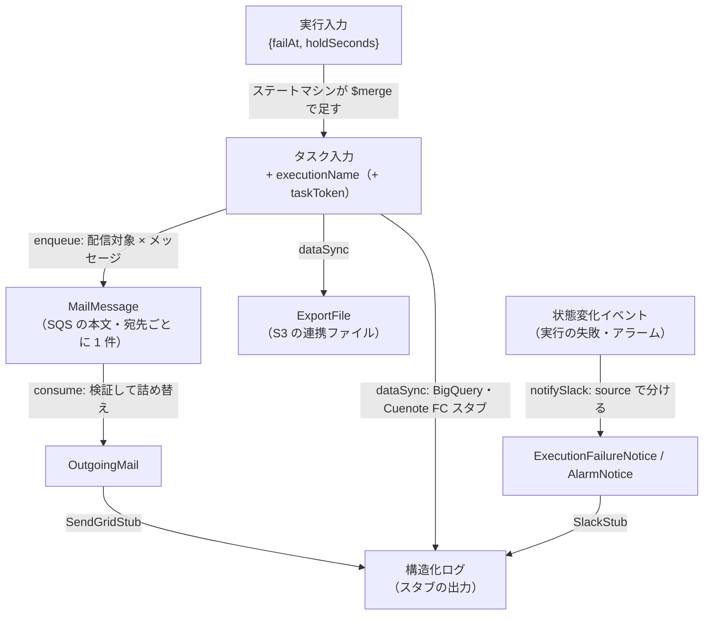

# データフロー・型・注意点

## 主要な型 / データ構造

型はスキーマから `z.infer` で導出しているものが多い。値の意味・制約の正本は 05「[データ仕様書](../../05-data-specification.md)」と 07「[API 仕様書](../../07-api-specification.md)」。

| 型 / 構造 | 場所 | 説明 |
|---|---|---|
| `TaskInput` | `functions/src/schemas/execution.ts:53` | 投入・データ連携が受け取るタスク入力。`executionName`（必須。英数字・`-`・`_` の 1〜80 文字）・`failAt`・`holdSeconds`（0〜1,200 の整数） |
| `DataSyncTaskInput` | `functions/src/schemas/execution.ts:71` | `TaskInput` に `taskToken`（1〜2,048 文字）を足したもの |
| `MailMessage` | `functions/src/schemas/mail-message.ts:29` | SQS に積むメッセージの本文。`executionName`・`recipientId`（`r-001` 形式）・`email`（`@example.com` のみ）・`subject`・`simulateFailure` |
| `OutgoingMail` | `functions/src/types/mail.ts:5` | メール送信の口へ渡す内容。`MailMessage` から送信に要る項目だけを取り出し、`email` を `to` に名前を変える |
| `Recipient` | `functions/src/types/recipient.ts:4` | 配信対象。`recipientId`・`email`・`name` |
| `ExportFile`（非公開） | `functions/src/handlers/data-sync.ts:71` | S3 に書く連携ファイル。`executionName`・`exportedAt`（ISO 8601、UTC）・`recipients` |
| `EnqueueResult` / `DataSyncResult` | `enqueue.ts:35` / `data-sync.ts:61` | Step Functions へ返す出力。`{ enqueued }` / `{ exported, s3Key }` |
| `ExecutionStatusEvent` / `AlarmStateChangeEvent` | `execution-status-event.ts:42` / `alarm-state-change-event.ts:27` | Slack 通知が受け取るイベントのうち、通知に使う項目だけ。未知のキーは拒否せず取り除く |
| `ExecutionFailureNotice` / `AlarmNotice` | `functions/src/types/notification.ts:6` / `:20` | 通知の口へ渡す内容。`error` / `cause` は `string \| null` にそろえてある |

### スキーマの厳しさの使い分け

同じ Zod でも、入力の出どころによって未知のキーの扱いを変えている。

| 扱い | 使っているスキーマ | 理由 |
|---|---|---|
| 未知のキーを**拒否**（`z.strictObject`） | `taskInputSchema`・`mailMessageSchema` | 自分たちが作る値。`failat` のような綴り違いを「省略」として通すと、失敗を注入したつもりで正常に動いてしまう |
| 未知のキーを**取り除く**（`z.object`） | `sqsEventSchema`・`executionStatusEventSchema`・`alarmStateChangeEventSchema` | AWS が作る値。エンベロープに多くの項目があり、使わない項目まで検証すると、形の違いだけで処理を捨てる（#30。LocalStack と実 AWS で日時の形が違った） |

## データフロー

- **`failAt` は値の形を変えながら下流へ運ばれる。** 実行入力の `failAt` は、ステートマシンがタスク入力へそのまま入れる。`consumer` のときは、投入がメッセージ本文の `simulateFailure: true` に変えて Consumer へ渡す（`enqueue.ts:112`）。Consumer は実行入力を見ないため、この形でしか伝わらない
- **実行名（`executionName`）がすべてをつなぐ。** タスク入力 → メッセージ本文 → 送信内容 → スタブのログ、タスク入力 → S3 のキーと連携ファイル、のどこにも入る。`scripts/batch.sh local logs <実行名>` は、この項目で 4 つの Lambda のログから 1 つの実行の行を集める
- **外部への書き込みは 3 種類だけ。** SQS（`SendMessageBatch`）・S3（`PutObject`）・Step Functions（`SendTask*`）。ほかの外部サービスへの「書き込み」は、すべてスタブのログ 1 行になる

## 読解上の注意点

- **入口（`handler`）の環境変数の検証だけは、本体の外で投げる。** ロガーを作る前なので、本体の `try` の外になる。データ連携ではこのとき結果を返せず、ステートマシンのハートビートのタイムアウトで失敗になる（`data-sync.ts:250` のコメント）
- **データ連携は「成功を返すのに失敗した」ときも `SendTaskFailure` を送りに行く。** `SendTaskSuccess`（`data-sync.ts:123`）が投げると、同じ `catch` で `reportFailure` に入る。処理は成功していても、結果の返却に失敗すれば失敗として返る
- **Consumer のグループの判定は、FIFO の `MessageGroupId` が無いレコードを素通りさせる。** `sqsEventSchema` で `MessageGroupId` は任意で、無ければ失敗を後続へ伝えない（`consumer.ts:75`）。この挙動は UT で固定している（`functions/test/handlers/consumer.test.ts:200`）。メール送信キューは FIFO なので常に付く前提だが、実物のイベントで付かないことがあるかは確かめていない（要確認）
- **`MySqlStub` は呼ぶたびに写しを返す。** 呼び出し側が配列や要素を書き換えても、固定データは変わらない（`stubs/mysql-stub.ts:22`）
- **エラー名は文字列リテラルで固定している。** Step Functions の `Retry` は `errorType`（= `name`）で判定する。esbuild の minify でクラス名が変わっても契約が崩れないよう、`constructor.name` を使わない（`errors/validation-error.ts:10`）
- **ログの `level` / `message` は呼び出し側の項目で上書きできない。** `formatLine`（`lib/logger.ts:22`）が先に取り除く。直列化できない値（循環参照・BigInt）が混ざったら、項目を捨てて `logError` を出す
- **SDK のクライアントをモジュールに置いているため、LMI で 1 つの実行環境が並行に呼ばれても共有される。** 状態を持たないクライアントなので問題ない、という判断がコメントにある（`data-sync.ts:243`）

## 技術的負債・改善余地

読解の時点（2026-11-08）で見つけたもの（本番のコードから使われていない実行入力のスキーマ・実装より古いコメント）は、[#151](https://github.com/kojikawazu/serverless-practice-app/issues/151) で直した。いま残っているものは無い。新しく見つけたら、この節に足し、解消したら消す。
